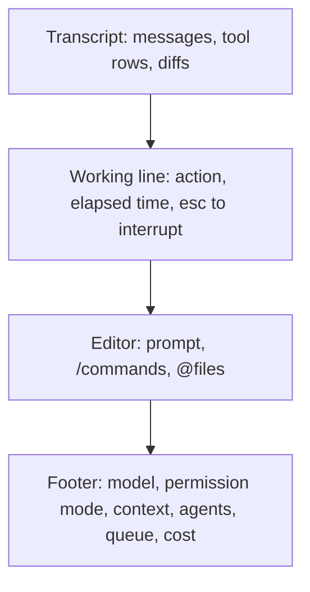

# Terminal UI

`octocode` opens the terminal UI. Keys: [keybindings](keybindings.md). Commands: [commands](commands.md). Colours: [themes](themes.md). Inside tmux also read [tmux](tmux.md).

## Layout modes

| Mode                   | What it does                                                                | Choose it                                            |
| ---------------------- | --------------------------------------------------------------------------- | ---------------------------------------------------- |
| `fullscreen` (default) | Own screen. The transcript scrolls inside Octocode and the mouse works.     | `--tui-mode fullscreen` or `"tuiMode": "fullscreen"` |
| `regular`              | Writes into your terminal's normal scrollback; the terminal owns the mouse. | `--tui-mode regular` or `"tuiMode": "regular"`       |

Fullscreen-only settings (see [settings](settings.md)):

| Setting                      | Values                      | Default      | Effect                                    |
| ---------------------------- | --------------------------- | ------------ | ----------------------------------------- |
| `fullscreenExitOutput`       | `transcript`, `resume-hint` | `transcript` | What stays in the terminal after you exit |
| `fullscreenScrollbar`        | `auto`, `always`, `hidden`  | `auto`       | Scrollbar visibility                      |
| `fullscreenCopyOnSelect`     | boolean                     | `true`       | Selecting text copies it                  |
| `fullscreenWheelScrollLines` | `auto`, or 1 to 100         | `auto`       | Lines per wheel event                     |

Scroll, jump between prompts and search the transcript with the [fullscreen keys](keybindings.md#fullscreen).

## Screen parts

| Part         | Shows                                                                                                                                                        |
| ------------ | ------------------------------------------------------------------------------------------------------------------------------------------------------------ |
| Working line | `⠙ Running Bash (12s · esc to interrupt)`: the action and the run's elapsed time. On a narrow terminal the interrupt hint goes first, then the action.       |
| Tool row     | The tool title, a `↳` line saying why the call was made, and the result. `Ctrl+O` expands or collapses tool output; `Ctrl+T` hides or shows thinking blocks. |
| Run summary  | One dim line after a run, such as `✻ Worked 52s · 7 tools · 3 agents · ≈$4.12 · cache 61%`.                                                                  |
| Footer       | State that lasts: model and thinking level, permission mode, context use, running agents and jobs, queued messages, cost, and `/web · backlogs & activity`.  |
| Messages     | One-off lines such as `Tool output: expanded`. Not saved in the session, not sent to the model; back-to-back info lines share one row.                       |

`/help` opens a searchable command picker (it inserts the command; it does not run it). `/effort` sets reasoning effort; `/context size` sets the session context budget. More on status lines: [native features](native-features.md#live-status).

## Links, images, notifications

| Feature       | Behaviour                                                                                                                      | Control                                                                                                                      |
| ------------- | ------------------------------------------------------------------------------------------------------------------------------ | ---------------------------------------------------------------------------------------------------------------------------- |
| Hyperlinks    | Links are clickable in terminals with OSC 8. In fullscreen a backlog id such as `B90` is a link; a click runs `/web item B90`. | `terminal.hyperlinks` (`true`, `false`, `auto`), `OCTOCODE_HYPERLINKS=1\|0\|auto`                                            |
| Images        | Inline when the terminal supports them.                                                                                        | `terminal.showImages`, `terminal.images`, `OCTOCODE_IMAGE_PROTOCOL`; see [terminal images](configuration.md#terminal-images) |
| Notifications | Desktop notice when an answer is ready, a run fails or Octocode asks you something.                                            | `OCTOCODE_NOTIFY=off\|unfocused\|always`, `OCTOCODE_NOTIFY_METHOD`; see [tmux](tmux.md#notifications)                        |
| Motion        | Spinners and shimmer freeze; elapsed times keep ticking.                                                                       | `terminal.reduceMotion`, `OCTOCODE_REDUCE_MOTION=1`                                                                          |
| Mermaid       | Mermaid blocks in replies draw as Unicode diagrams.                                                                            | `markdown.mermaid` (`off`, `final`, `streaming`)                                                                             |

All variables: [environment variables](environment-variables.md).

## When the screen misbehaves

| Symptom                                                         | Try                                                                                                                   |
| --------------------------------------------------------------- | --------------------------------------------------------------------------------------------------------------------- |
| Alt keys read as Escape, or long pastes arrive split (slow SSH) | Raise `OCTOCODE_TUI_ESC_TIMEOUT` or `OCTOCODE_TUI_PASTE_TIMEOUT` (milliseconds)                                       |
| Leftover rows after content shrinks                             | `terminal.clearOnShrink: true`                                                                                        |
| A component fails to draw                                       | The chat shows `Display failed: <Component> could not render: <error>` once per failure; the rest keeps working       |
| You need the raw terminal output                                | `OCTOCODE_TUI_WRITE_LOG` copies everything written; `OCTOCODE_TUI_DEBUG=1`, `OCTOCODE_TUI_DEBUG_REDRAW=1` log renders |

Other front ends: [web workspace](web-workspace.md), [remote](remote.md), [RPC](rpc.md), [ACP](acp.md), [local session API](session-api.md).
