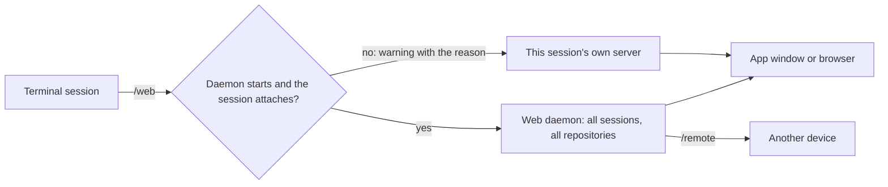

# Web workspace

`/web` opens a browser page for the running session: follow the agent, send messages, answer approvals and questions, and manage the backlog board. One user-level web daemon serves the page for every session; it runs on your machine only (loopback; `/web` opens it with a one-time code). `/backlog` (and `/backlog web`) opens the same page as `/web backlogs`.

| Command         | Opens                                            |
| --------------- | ------------------------------------------------ |
| `/web`          | Activity: live agent output, composer, approvals |
| `/web backlogs` | The task board                                   |
| `/web item B90` | The sheet of one backlog item                    |



## Where the page opens

| Setting      | Values                    | Default  | Effect                                                                                                                                                                                                                                                                   |
| ------------ | ------------------------- | -------- | ------------------------------------------------------------------------------------------------------------------------------------------------------------------------------------------------------------------------------------------------------------------------ |
| `web.window` | `app`, `browser`          | `app`    | `app`: a Chrome, Edge, Chromium or Brave app window with a fresh temporary profile (no extensions or sync, removed when the window closes, not incognito). `browser`: your default browser. Without a Chromium browser `app` falls back to `browser` and `/web` says so. |
| `web.theme`  | `system`, `light`, `dark` | `system` | Page colours; the theme control in the page changes it.                                                                                                                                                                                                                  |
| `web.sound`  | boolean                   | `false`  | A chime with each notification; the **Sound** toggle in the page changes it.                                                                                                                                                                                             |

Run `/web` again to reopen a disconnected workspace. Over SSH, or on Linux with no display, `/web item` prints the address instead of opening a browser; VS Code and Cursor terminals turn it into a link their port forwarding resolves. In fullscreen mode, backlog ids in tool results are links (see [terminal UI](tui.md#links-images-notifications)); a click runs `/web item <id>` and opens a fresh one-time address, so no credential sits in your scrollback.

## Web daemon

`/web` starts one detached, user-level daemon, or reuses the one running, and opens its page on the current session. Every top-level session accepts the daemon when it starts (an owner-only local endpoint), so the page lists them all; subagents are never listed. The daemon keeps running after the session that started it closes and exits after ten idle minutes with no tab and no session (`OCTOCODE_WEB_DAEMON_IDLE_MINUTES`).

If the daemon cannot start or this session cannot reach it, `/web` warns with the reason and opens the session's own server instead. That fallback page closes with its session.

| Web daemon (default)                                                                            | Session's own server (fallback)                |
| ----------------------------------------------------------------------------------------------- | ---------------------------------------------- |
| One daemon for every session; keeps running after the launching session closes                  | One server per session; closes with it         |
| Lists live sessions (blocked ones first), opens the current one, every repository's board and reports | That session and its repository's board        |
| Board edits from the launch page and control links, never view links                            | Board edits from the launch page               |
| Settings on the session's page and a Settings tab for every repository                          | Settings view for this repository              |
| [`/remote`](remote.md) publishes it to another device                                           | Not available                                  |

A board edit on either page is recorded the same way (you, on the web, under the session whose page sent it) and repaints the backlog counts in that session's footer; an edit on the daemon page repaints every attached session of that repository.

### Settings page

A session's page has a Settings view for that session and its repository, on the daemon and on the fallback server alike. The daemon's own Settings tab (no session) lists every repository. Choose a workspace at the bottom to see its trust and its own settings. Writes work from the page `/web` opened, not from a [published link](remote.md).

| Panel                | Shows                                                                                  | Change it here                                     |
| -------------------- | -------------------------------------------------------------------------------------- | -------------------------------------------------- |
| Provider sources     | Octocode and Pi, on or off                                                             | Pi on or off ([providers](providers.md))           |
| Provider credentials | Where each provider's key comes from, never its value                                  | Set or clear a key, sign in, turn a provider off   |
| Settings             | Default provider and model, with the file that sets them                               | Global or workspace value                          |
| Harness              | The `/harness` switches: harnesses, MCP servers, skills, hooks, plugins and extensions | Turn each on or off, globally or for the workspace |
| Tools                | How much of each native and MCP tool a session sends to the model, and what decided it | Pin a tool, globally or for the workspace          |

The Harness panel writes the same settings and MCP files as `/configuration enable|disable` and never changes Claude Code, Codex or Cursor files. Filter by name or path; a row that is always on has no switch. A running session applies a switch on `/reload` (MCP servers in the next session); the panel shows what each switch did. Only the page opened from the terminal sees the panel: a published link cannot read or change it, because its rows name your files.

The Tools panel has one table for the native tools and one per enabled MCP server. Each row shows the tool's state, what decided it, and its pin ([what the states mean](configuration.md#tool-exposure)).

- **State.** On a session's page the state is what that running session declared, and core native tools are listed as always direct; the daemon asks the session for it. On the daemon's own Settings tab no session answers: native tools show what a new session would declare, and a server lists only its pinned tools. A session from an older Octocode cannot answer either, so its page shows the same.
- **Pin.** Choose `Direct`, `Deferred` or, for an MCP tool, `Hidden`; `No pin` removes it. An MCP pin is saved as that tool's `toolExposure` entry in `mcp.json`, a native pin under `nativeToolExposure` in `settings.json`, in the global files or the trusted workspace's. Another tool's file (Claude Code, Codex, Cursor) is never changed: the pin is saved as an override in Octocode's own file.
- **When it applies.** A pin applies from the next session. A running session keeps what it declared, because the declared tools are part of its cached prompt; the row then shows both, for example `Direct` with `Deferred from the next session`.

Like the Harness panel, only the page opened from the terminal reads or changes the Tools panel.

## Activity

- The composer names the terminal session that receives your message. Start a task, guide current work or queue a follow-up; replies stream into the page and the terminal.
- Receipts tell received, queued and handled apart from the agent's answer. The last three sent messages stay in memory so a failed send can be restored without overwriting a newer draft. While disconnected you can keep drafting; sending and stopping wait for reconnection.
- **Approvals and questions:** the page and the terminal race for the first answer, and the page says why an answer was not taken (for example, already answered in the terminal). The permission gate still decides. Every permission prompt shows as an approval; editor and custom dialogs stay terminal-only. A background subagent's approval relayed to the session also shows as needing you.
- Requests time out after 15 seconds. A timeout does not prove a write failed: check the item or activity before retrying. Retries keep their request id, so an accepted request is not repeated.

Other views: **Profiler** (its Agents panel holds the same structured reports as the terminal, a bounded recent feed; the transcript keeps full output), **Settings** ([below](#settings-page)) and **Audit** ([below](#audit-and-comments)). The header holds the repository, the tabs, what needs you, connection state, the command palette (`Ctrl+K` or `⌘K`), **New item**, and a **⋯** menu with theme, notifications, terminal and board statistics. The window title names the view and is prefixed by the number of items waiting for you.

## Backlog board

Columns: Backlog, To do, In progress, Done, each with a count. A card shows the title, a priority dot, tag chips, a task tally (`3/5`), dependency warnings and the assignee. Item rules and commands: [commands](commands.md) (`/backlog`) and the [entity model](https://github.com/bgauryy/octocodecode/blob/main/docs/ENTITIES.md).

| To do this              | Do this                                                                                                                                                                      |
| ----------------------- | ---------------------------------------------------------------------------------------------------------------------------------------------------------------------------- |
| Move a card             | Drag it; or focus it, `Space` to lift, `Left`/`Right` to pick a column, `Space` or `Enter` to drop, `Escape` to cancel; or **⋯** → **Move to…**                              |
| Reorder inside a column | Drop between two cards, or `Up`/`Down` while lifted. Columns list hand-ordered cards first by rank, then priority.                                                           |
| Add an item             | **+ Add a card** under Backlog or To do (title only), or **New item**                                                                                                        |
| Close or reopen         | **⋯** → **Close…** (kind, reason, the duplicate's target) or **Reopen…** (needs a note). Closed items sit in a collapsible **Closed** list; closing shows an **Undo** toast. |
| Find work               | Search task fields, comments, notes and completions; filter by priority, type, assignee, tag or readiness; sort by priority or recent updates                                |
| Other views             | **Backlog** (queue rows), **Table**, **Tree** (epic → item → task), **Attention**. Closed items stay hidden until **Show closed** is on.                                     |
| Inspect an item         | Select it for details and history. **Actions** holds Edit, Correct result, Close…, Add task and Add comment. `Escape` returns to the previous view and filters.              |

What a drop does: **In progress** checks the goal and reason and claims the item as you; **Done** opens the completion editor; moving a done or closed card back asks for a reopen note; an epic does not move because its state follows its items. A refused move snaps back with the reason.

Tree view: an epic has **Add item**; an item has an **Epic** select and **Add task**; each task has a state select, **Edit** and move up/down (`Alt+ArrowUp` / `Alt+ArrowDown`). **Session tasks** groups tasks with no item, with **Promote to item** and **Move under item**.

The board updates live over an authenticated local WebSocket and reconnects on its own; it never overwrites an open edit form. Changes from other agent processes show within about half a second, and stale saves are refused so another session's changes survive. A read-only page (a view link, or a daemon page without a write token) offers no drag, **+ Add a card** or write actions.

### Hand work to an agent

| Action                                    | Effect                                                                                                                                                                                                           |
| ----------------------------------------- | ---------------------------------------------------------------------------------------------------------------------------------------------------------------------------------------------------------------- |
| **Implement** (card, row or item details) | Sends `Implement backlog item B12` to the current agent. The host claims the item and attaches its details, comments, history, relationships and earlier completions; an active agent gets it as follow-up work. |
| **Send to agent**                         | Contacts a live agent explicitly.                                                                                                                                                                                |
| **Request new agent**                     | Asks the current agent to delegate through the normal launch and permission flow, with the same item context.                                                                                                    |
| **View activity**                         | Shows progress; acceptance of a request is not completion.                                                                                                                                                       |

Missing goals or reasons, unfinished dependencies, existing claims and unsent comment drafts are explained before Implement starts. If dispatch fails later, the receipt records it and keeps the claim, because work may already have begun: check the item and agent activity before releasing it. Agent permission dialogs stay in the terminal. Switching sessions rejects stale commands; closing the browser leaves running work intact.

### Audit and comments

Every change to an item is recorded with its actor (an agent session or you) and surface (`tool`, `web`, `command`): creation, field edits, state changes, notes, links and dependencies, with before and after values. **Add comment** in item details adds a comment with a stable id. Audit rows are kept in the database for 14 days and in the [history archive](configuration.md#runtime-storage) until 30 days old; the **Audit** tab and the HTML export read both.

### Exports

| Command           | Writes                                                                         |
| ----------------- | ------------------------------------------------------------------------------ |
| `/backlog html`   | Read-only offline snapshot `.octocode/code/backlog.html` (no docs or diagrams) |
| `/backlog export` | Markdown snapshot `.octocode/code/backlog.md`                                  |

Both refuse to write, naming the item and field, when text they would carry looks like a secret. Other backlog commands: `/backlog tui` (terminal board), `/backlog add <title>`, `/backlog <id> <state>`, `/backlog <id> close`, `/backlog do <id>`.

After a database upgrade, older builds can still read the backlog but their writes fail; upgrade every process sharing the database before editing backlogs.

## Notifications and sound

**Enable notifications** in the **⋯** menu asks the browser for permission (the page never asks on load). Once allowed, an OS notification appears once per event while the window is hidden or unfocused:

| Event                        | Notes                                                   |
| ---------------------------- | ------------------------------------------------------- |
| Approval or question waiting | Includes a subagent's question                          |
| Turn finished                | The run ended without an error or abort                 |
| Subagent or task finished    |                                                         |
| Failure                      | A turn that ended in error, or a failed subagent result |

History present when the page connects, reconnects and re-renders raise nothing. A click focuses the window and opens Activity or Agents for that session. If permission is denied or the browser has no notifications, the button says so and stays disabled. The **Sound** toggle plays a chime made in the page; it is stored as `web.sound` in the global settings, because each launch has an empty browser profile.

## Docs tab

The board's **Docs** tab (`#docs`) lists every Markdown file under the workspace's `.octocode/` folder (symbolic links skipped): RFCs, research, plans, reviews, the exported `backlog.md` and, when temporary files are enabled, handoffs under `.octocode/code/temp/`. Each row shows the title (first heading), a kind from its top-level folder (`rfc`, `research`, `brainstorm`, `review`, `audit`, `plan`, `contract`, else `report`), the modified date, and `status` and `question` from flat front matter. Filter by kind, folder, title, path or status; `tmp/` appears only with **Include tmp/**, and `skills/` never. At most 1,000 documents are indexed; files over 512 KiB, dot-folders, `view/` and `node_modules/` are skipped.

In a **trusted project** the tab also lists the workspace's git-tracked `*.md` files under **Repository docs (git-tracked)**. An untracked file, a path outside the repository or a symbolic link is refused. In an untrusted project no repository documents are listed and the tab says why.

Documents render through a safe Markdown renderer. A backlog id such as `B52` links to its board item when it exists (not inside code or links). A ` ```mermaid ` block renders as a diagram with a type label, a source toggle and copy; the renderer loads only when a document with a diagram opens, from the host with no network source, and a diagram that fails to draw keeps its source visible with the first error line.
