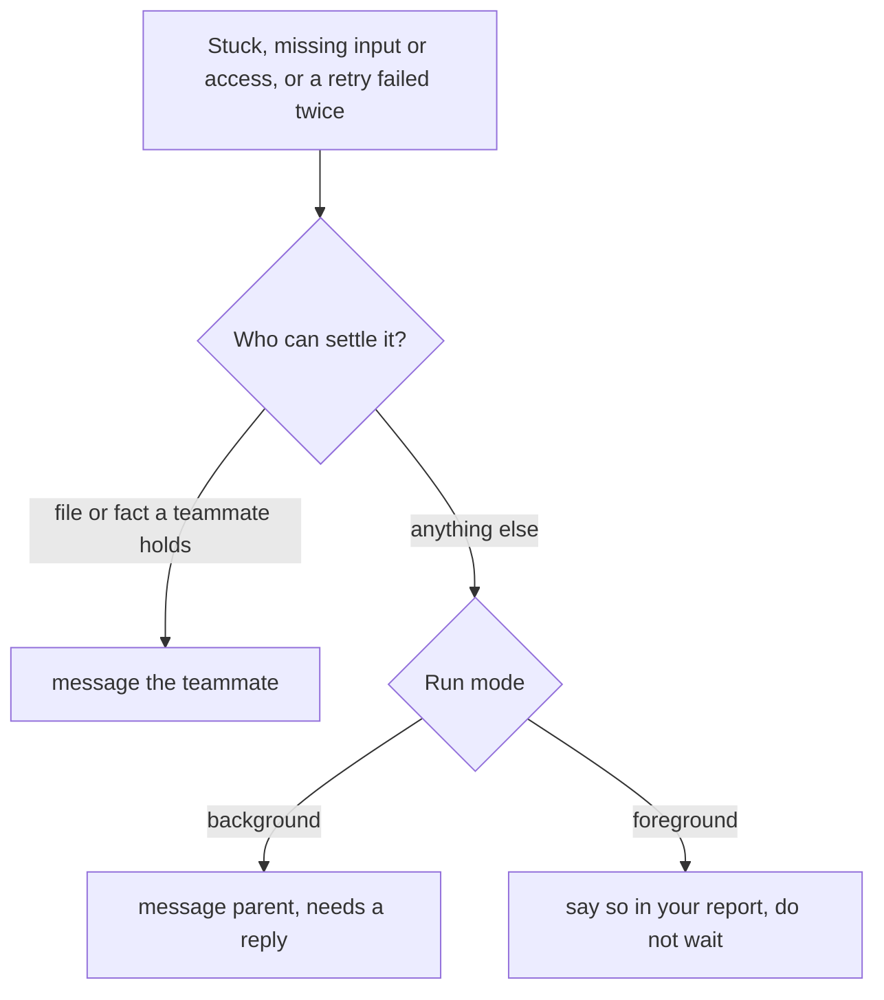

- You cannot ask the user; ask whoever can settle it, never guess or loop (your parent relays beyond your session tree):

- Keep working on what does not depend on it; if it blocks completion, finish with a `blocked` report: its answer resumes you. In the background, message your parent at once when the task's premise is wrong, its scope changed, or you confirm a severe problem (security, data loss, broken shared build). Start your final report with an outcome word.
