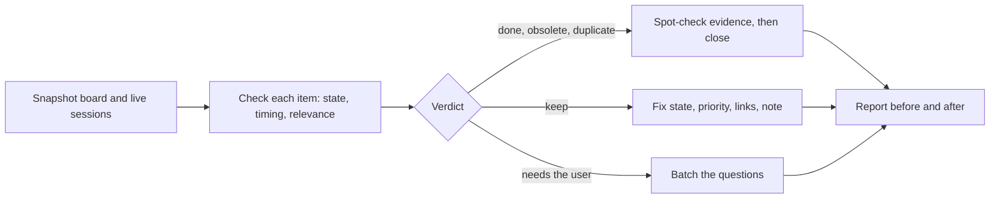

# Octocode Backlog Grooming

Bring every open item on this repository's board up to date with the code, the sessions working on it and the user's decisions. Read and write the board only through the `backlog` and `backlogPlan` tools. Item ids such as `B12` are numbered per repository, and the shared database holds other repositories' items under the same numbers, so never query the database directly.

## 1. Snapshot

1. List the open board: `backlogPlan` `list` with `states` `["backlog","todo","ongoing"]`, `sort` `board` and `limit` 200. Page with `offset` until the list ends, then count items per state, type and priority. These counts are the "before" column of the report.
2. Run `agent` `coordinate` `list` to see live sessions, their claimed items and the paths they hold. An item that a live session or its child holds is theirs: you may only add a `note`, or `message` the holder with a finding.
3. Read items in batches with `backlog` `get` and several ids. Each read shows the goal ("Done when"), where, why, evidence, plan, notes, open steps, prerequisites and the created, updated and claimed ages.
4. For more than about 40 items, split them into batches and delegate the checks; see [delegation](references/delegation.md). You apply every change yourself.

## 2. Check each item

Take the goal literally. An item is done only when every clause of "Done when" holds, including the named test, platform or approval. Read [states](references/states.md) for what each state and mark means and which changes the store allows.

| Check     | How                                                                                                                                                                                                   | Signal                                                                                                                                   |
| --------- | ----------------------------------------------------------------------------------------------------------------------------------------------------------------------------------------------------- | ---------------------------------------------------------------------------------------------------------------------------------------- |
| State     | Its column, the marks (`stale: holder ended`, `blocked by`, `review`, `worked on by`) and its open steps                                                                                              | Wrong column, stale claim, blocked item still in todo, done parent with open children                                                    |
| Timing    | Created, updated and claimed ages from `get`. For changes since then, run `git log --since="<updated ISO>" --oneline -- <paths>`. For one path's last change, run `git log -1 --format=%cr -- <path>` | Code under its paths changed after its last update, so recheck it first. Ongoing with no update for days. Backlog that was never triaged |
| Relevance | Do its paths exist? Does the cited line or symbol still show the problem? Does the failing test still fail? Run focused tests only                                                                    | Problem fixed, file or feature gone, or the goal still unmet                                                                             |
| Overlap   | Search the board for the same paths, goal or origin: `backlogPlan` `list` with `touchingPaths`, `query` or `underEpic`                                                                                | Duplicate, a child folded into its parent, or a follow-up already covered                                                                |
| Research  | Read its saved findings: `.octocode/<topic>/`, links, notes, the completion                                                                                                                           | Question answered, so record the conclusion and mark it done. Decision pending, so ask the user                                          |
| RFC       | Open the linked RFC file and its status, decision and slices                                                                                                                                          | Accepted, so split it into todo slices. Pending, so ask the user. Rejected or superseded, so close it                                    |
| Owner     | Holder alive? Who can do it: you, a child profile, another session, or the user                                                                                                                       | Assign it, or note what is missing                                                                                                       |

Give each item one verdict, with a path:line, command result or report id as evidence. For the verdict and its tool call, see [verdicts](references/verdicts.md).

## 3. Apply

1. Spot-check every verdict other than keep yourself before writing: read the cited code, or rerun the test. A child's verdict is a claim. Keep the item when the evidence is partial; for example, a test passes but does not cover the case the goal names.
2. Write each change through the tools, one item per `backlog` call and priority or state batches through `backlogPlan` `edit`. Every close, done or reopen states its evidence. Never weaken a goal to make an item done; split the remainder into a new item with `from`.
3. For research items, put the conclusion in the completion summary and link the saved findings as `output`. For RFC items, link the RFC file as `evidence` and add its slices as children of an epic.
4. Add a `note` when a check found something but changed no state: what you checked, what holds, and what is left. A note is the comment channel. It is allowed on any item, including items held by others.
5. Batch questions only the user can answer (won't-do, priority conflicts, RFC acceptance, paid runs) into one `askUser` call of at most 4. Leave those items unchanged until the user answers.

## 4. Assign

There is no assignee field: an item is assigned by claiming it.

- **You:** `backlog` `claim` it when you will do it in this session.
- **A child:** `agent` `task` with `item` claims an unheld todo or backlog item for the child (goal and why set). Pick the profile by the work: researcher for research, implementer for a scoped fix, reviewer for a check.
- **Another live session:** `message` it with the item id and the reason; never edit its claimed item.
- **A stale claim**, whose holder ended: `claim` it to take it over, or move it to todo with a note naming the ended holder. The store also returns such claims to todo on its own after a day idle.
- **Nobody yet:** leave it in todo with a note saying what it waits for, such as a decision, a prerequisite (`dependsOn`) or a platform. Use `timer` `until` `item` `ready` to wake when its prerequisites finish.

## 5. Report

Return the sprint report described in [output](output.md): board counts before and after, every change with its evidence, items waiting on the user, blocked and stale items, the next sprint's ready items, and what was not checked.

Done when every open item you could change has a verdict backed by evidence, every non-keep verdict was spot-checked and written through the tools, the after-counts come from a fresh `list`, and the report names items skipped because others hold them.
