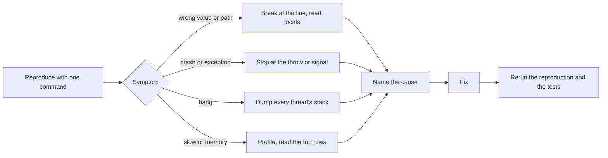

# Octocode Debugging

Run the program, stop it where it goes wrong, and read the real values instead of guessing from source. Every command here runs through `bash` and must finish on its own: debuggers run in batch mode with their commands on the command line and stdin closed, never as an interactive prompt. Reading code and logs comes first; use this skill when they do not explain the behavior.

## Reproduce first

Find the smallest command that shows the failure: one test, one input file, one request. Run it once without a debugger and keep its output; it is the check you rerun after the fix. When the failure is intermittent, loop it (`for i in $(seq 20); do <cmd> || break; done`) before attaching anything.

Build native code with debug information and without optimization (`-g -O0`, `cargo build` without `--release`, `go build -gcflags=all="-N -l"`); optimized builds show wrong lines and missing locals.

## Pick the tool for the language

| Program              | Stop and inspect                                                         | Read                                 |
| -------------------- | ------------------------------------------------------------------------ | ------------------------------------ |
| C, C++, Rust, Swift  | `lldb -b -o "b file.c:12" -o run -o "frame variable" -o bt -- ./prog`    | [native](references/native.md)       |
| Go                   | `dlv` when installed, or stack dumps with `SIGQUIT`                      | [native](references/native.md)       |
| Python               | `python3 -m pdb -c "b file.py:12" -c c -c "p x" -c q prog.py </dev/null` | [python](references/python.md)       |
| Node, TypeScript     | `node scripts/node-break.mjs --break file.ts:12 -- file.ts`              | [node](references/node.md)           |
| Slow or memory-heavy | The language's profiler, then a top-N summary                            | [profiling](references/profiling.md) |

The scripts are in this skill's `scripts/` directory; `<skill>` in the references stands for the skill's directory, which loading the skill reports. Linux has `gdb -batch -ex ...` where macOS has `lldb -b -o ...`.

## Wrong value or wrong path

Break on the line where the value is first wrong, not where it is used. Print the locals and the stack, and when the line runs many times add a condition (`file:line:condition` in node-break, `breakpoint set -f file -l line -c cond` in lldb, `b file:line, cond` in pdb) or cap the pauses. Walk backwards: if the input to that line is already wrong, move the breakpoint to its producer and run again. Each run is cheap; prefer several narrow runs over one run that prints everything.

## Crash or exception

Let the program stop where it fails: lldb stops on the signal and runs the `-k` commands, `pdb` enters post-mortem on an uncaught exception, node-break pauses with `--exceptions all` (the first exception event is usually the one; caught ones also appear). Read the innermost frame from your own code, not the library frame on top, and print the arguments that reached it.

## Hang

Dump every thread's stack while it hangs, twice a few seconds apart: frames that stay the same are where it is stuck. Use `sample <pid> 3` on macOS, `gdb -p <pid> -batch -ex "thread apply all bt"` or `py-spy dump --pid <pid>` on Linux, `faulthandler.dump_traceback_later` in Python, and `--timeout` in node-break. A wait on a lock, a pipe or a socket points at the other side: find what should have released or written it.

## Slow or memory-heavy

Measure before changing code: time the reproduction, profile it, and read only the top rows. Fix the function with the most self time, or the caller that calls it too often, then measure again with the same command. Details per language are in [profiling](references/profiling.md).

## Rules

- Always set a timeout or a cap (node-break `--timeout` and `--max-hits`, `faulthandler`, a bounded loop); a debugger waiting for input stalls the session.
- Run the debugger in the foreground with closed stdin (`</dev/null`); do not leave a debugged process running. Kill what you started.
- Remove temporary `debugger;` statements, `breakpoint()` calls and debug prints before you finish, and check with a search.
- State the cause with the evidence: the line, the value you saw and the value it should have been.
- After the fix, rerun the original reproduction and the affected tests.

## Resources

| When                                      | Read                                       | Why                                                        |
| ----------------------------------------- | ------------------------------------------ | ---------------------------------------------------------- |
| Debugging C, C++, Rust, Swift or Go       | [native](references/native.md)             | lldb and gdb batch commands, crashes, attach, hangs, cores |
| Debugging Python                          | [python](references/python.md)             | pdb batch runs, post-mortem, pytest, hangs                 |
| Debugging Node or TypeScript              | [node](references/node.md)                 | node-break options and output, tests, transformed code     |
| Profiling CPU or memory in any language   | [profiling](references/profiling.md)       | Profiler commands and how to read the result               |
| Breaking inside a Node program            | [node-break.mjs](scripts/node-break.mjs)   | Runs the inspector protocol and prints each pause as JSON  |
| Reading a `.cpuprofile` or `.heapprofile` | [profile-top.mjs](scripts/profile-top.mjs) | Prints the heaviest functions by self or total cost        |

## Related skills

- Use `octocode-research` when the question is what the code does or who calls it, before running anything.
- Use `octocode-chrome-devtools` when the failure is in a web page: console, network and the page's own debugger.
- Use `octocode-eval-benchmark` when a speedup must be proven against a baseline over repeated runs.

## Output

Follow [output.md](output.md).
