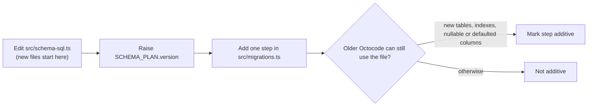

# @octocodeai/octocode-db

Private workspace: SQLite schema, connections, named entity queries, history retention. The coding-agent host bundles it and supplies the database and archive paths. Entities and scoping: [entity ownership](../../docs/ENTITIES.md); files and retention: [runtime storage](../coding-agent/docs/configuration.md#runtime-storage).

- Feature code imports only `src/api.ts`. Each query family (`src/queries/`, one module per table family) takes a handle (`type Db`) and returns a typed result; search `queries/` before adding one.
- Connections: `sharedDatabase` (one per process and file, reopened after closing) or `openDatabase`. Group dependent writes in `AgentDb.transaction`; failures, including the initial event-cursor read, roll back and release the transaction. Use the entity's workspace identity for workspace-scoped data.
- Derived writes that must not wait on the caller's thread (the session mirror) go to `sharedDbWriter`: one worker per database file with its own connection, typed commands (`src/writer/transcript-mirror.ts`), each one transaction, acknowledged in order after commit. Transcript records travel as the JSON text of their file line and are stored as is. A full `save` compares the stored rows first (outside the write lock) and writes only what differs; in the worker a large difference goes in transactions of at most 200 rows or 512 KB with a short pause between them, and until the last one the stored stamp carries a marker so the partial copy never reads as level. A worker waits for another connection's lock in 250 ms attempts (5 s in all), and a process that ends on its own waits at most 1.5 s for unacknowledged commands before stopping its writers; hosts await their own bounded settle before `process.exit`. At most 256 commands wait unacknowledged; past that `submit` rejects (`DbWriterBusyError`). A worker that dies rejects its unacknowledged commands (`DbWriterUnavailableError`, outcome unknown) and restarts up to three times; callers branch on `writerErrorKind(error)` (`queue-full`, `unavailable`, `db-busy`, `failed`), not on the errors' fields; a worker that cannot load, or does not report loading within 10 s, runs commands on the caller's thread. From source it starts `src/writer/worker-entry.ts`; the Node bundle ships that entry built on its own as `db-writer-worker.js` beside the bundle. Never send a `Db` or a callback, and never add a second writer per file.
- `prepare(...)`, `db.exec(...)` and `node:sqlite` imports live only here (`yarn run check:db-boundary`).

## Change the schema

The runner backs the file up with `VACUUM INTO` (other live sessions write this WAL database) and runs each step under `BEGIN IMMEDIATE`, rechecking `user_version` once it holds the lock. A failed step rolls back alone; the file stays at the last completed version. `AgentDbError` reaches the user at startup: the folder trust gate fails closed, so Octocode exits naming the file and the version needed.

## Tests

Tests of the schema, migrations and the writer live in `test/` and run alone: `yarn workspace @octocodeai/octocode-db run test` (`yarn test` includes them). Tests that need the host (its paths, features or session manager) stay in coding-agent.
