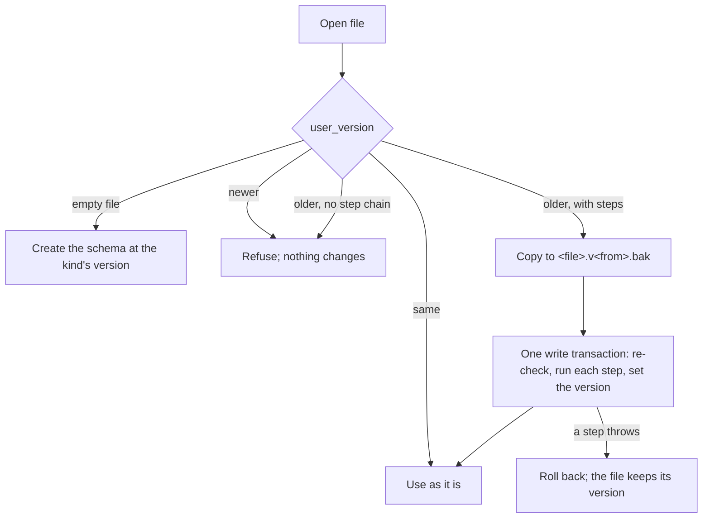

# @octocodeai/octocode-db

Private workspace: SQLite schema, connections, named entity queries, history retention. The coding-agent host bundles it and supplies the database and archive paths. Entities and scoping: [entity ownership](../../docs/ENTITIES.md); files and retention: [runtime storage](../coding-agent/docs/configuration.md#runtime-storage).

- Feature code imports only `src/api.ts`. Each query family (`src/queries/`, one module per table family) takes a handle (`type Db`) and returns a typed result; search `queries/` before adding one.
- Connections: `sharedDatabase` (one per process and file, reopened after closing) or `openDatabase`. Group dependent writes in `AgentDb.transaction`; failures, including the initial event-cursor read, roll back and release the transaction. Use the entity's workspace identity for workspace-scoped data.
- Async startup can await `prepareSharedDatabase(locations, { mirror, signal })` before synchronous consumers. Initialization tries SQLite without a busy wait and yields between lock retries for the existing five-second budget per opened file; successful connections retain the normal synchronous transaction timeout. The mirror stays lazy unless requested. Cancellation, shared cleanup and exhausted lock waits reject; a busy failure is not cached as a permanent refusal. This handles initialization lock waits, not all synchronous database work.
- Two files: the coordination file (`workspaces.db`, `AgentDb.db`) and the transcript mirror beside it (`transcripts.db`, `AgentDb.mirror`, opened at first use, its own schema version: `src/schema-mirror.ts`), which holds `session_transcripts`, `session_entries` and `compaction_summaries` (`queries/transcripts.ts`, `queries/compactions.ts`). Session and workspace ids in the mirror name coordination rows; no foreign key crosses files, so code that touches both (`sessions.erase`, `purge`, `expire.orphans`, `forks.lineage`) takes both connections, and the mirror's lock always comes first: `AgentDb.mirror.transaction` refuses to start inside a coordination transaction, and a coordination transaction may nest inside a mirror one.
- Derived writes that must not wait on the caller's thread go to a writer: one worker per database file with its own connection, typed commands, each one transaction, acknowledged in order after commit. The session mirror uses `sharedMirrorWriter(...).submit` (`src/writer/transcript-mirror.ts`); the bookkeeping the interactive thread does every prompt or turn (a recalled memory's use mark, a session's stats, catalog row, git state, name and end) uses `sharedDbWriter(...).post` (`src/writer/derived.ts`), in one queue, so a session's end never lands before the stats of its last turn. Each writer checkpoints its own file (`src/writer/checkpoint.ts`): PASSIVE every 64 commands while busy, TRUNCATE once its queue is empty, retried with a growing pause (up to 30 s) while a reader is in the way. Transcript records travel as the JSON text of their file line and are stored as is. A full `save` compares the stored rows first (outside the write lock) and writes only what differs; in the worker a large difference goes in transactions of at most 200 rows or 512 KB with a short pause between them, and until the last one the stored stamp carries a marker so the partial copy never reads as level. A worker waits for another connection's lock in 250 ms attempts (5 s in all), and a process that ends on its own waits at most 1.5 s for unacknowledged commands before stopping its writers; hosts await their own bounded settle before `process.exit`. At most 256 commands wait unacknowledged; past that `submit` rejects (`DbWriterBusyError`). A worker that dies rejects its unacknowledged commands (`DbWriterUnavailableError`, outcome unknown) and restarts up to three times; callers branch on `writerErrorKind(error)` (`queue-full`, `unavailable`, `db-busy`, `failed`), not on the errors' fields; a worker that cannot load, or does not report loading within 10 s, runs commands on the caller's thread. From source it starts `src/writer/worker-entry.ts`; the Node bundle ships that entry built on its own as `db-writer-worker.js` beside the bundle. Never send a `Db` or a callback, and never add a second writer per file.
- `prepare(...)`, `db.exec(...)` and `node:sqlite` imports live only here (`yarn run check:db-boundary`).
- Closing an `AgentDb` closes both connections. Its lazy mirror refuses access after closing; only a fresh `openDatabase` or `sharedDatabase` call can reopen it.
- Scheduled history maintenance and interactive archive reads use the coordination writer's bounded queue. Maintenance admits one pass per database; audit reads filter in the worker and return at most 500 rows. Neither operation falls back to compression on the calling thread when its worker is unavailable. The synchronous archive API remains available for explicit callers.
- History archive writes happen before the short database delete transaction. A mutable command receipt is deleted only while its status and message still match the archived snapshot. Concurrent receipt revisions survive as separate archive snapshots with the same receipt id; identical retries deduplicate, so a stale archiver cannot replace a newer result. A month file is a concatenation of gzip members (up to 5000 rows each, headers carrying their length, row count and `at` range), so any gzip reader reads it whole; a write copies members it cannot affect as raw bytes, inflates others one at a time and compresses only new rows, keeping memory at one member. A month an older build wrote (one member) is converted on its next write, and refused above 256 MiB inflated, leaving it and its source rows as they were. No database write lock spans monthly gzip or file-lock work. Closing an active archiver rejects its caller immediately, then lets the current compression unit reach a cancellation check and release its file lock before the worker stops; cancellation is checked again before atomic replacement and source deletion.
- Timer retention removes an active timer only after both its next wake and its last update fall before the retention cutoff. A future wake survives a shorter history window. The all-data purge clears shell command history and optional process samples too; samples belonging to explicitly kept sessions survive.
- An active agent run survives retention while its exact registration remains in `agents`; ended runs and unregistered abandoned runs still expire by age, and a reused agent name cannot keep an older registration's audit alive.

## Change the schema

A file kind lists its upgrade steps (`migrations`, one per from-version; the coordination file's are in `src/schema-migrations.ts`). Steps only go up.

| File at open               | What happens                                                                                                                              |
| -------------------------- | ----------------------------------------------------------------------------------------------------------------------------------------- |
| Empty                      | The schema of `src/schema-sql.ts` (or `src/schema-mirror.ts`) is created at the kind's `version` (`src/schema.ts`)                        |
| Same version               | Used as it is                                                                                                                             |
| Older version, steps exist | Copied beside itself as `<file>.v<from>.bak` (a later upgrade from the same version replaces that copy), then upgraded in one transaction |
| Older version, no step     | Refused with a message; nothing changes: delete the file or point `OCTOCODE_AGENT_DB` at another                                          |
| Newer version              | Refused with a message; nothing changes                                                                                                   |

A workspace file (`WORKSPACE_FILE`, application id "OcWS", its own version and `min_reader`) shares the coordination file's DDL and is stamped with its key (`meta.workspace_key`); a file stamped with another key is refused. `src/schema-split.ts` moves each repository's rows (`WORKSPACE_TABLES`) out of the coordination file into `<workspaceDir>/<db_key>.db` when `DatabaseLocations.workspaceDir` and `split` are given, all inside one coordination write transaction:

1. It refuses while a `sessions` row names another process that `split.running` says still runs (an open connection ignores version stamps).
2. It removes partials a killed split left (`*.<pid>.tmp`), then copies the committed file to `<file>.pre-split.bak` from a second connection, keeping an earlier backup as `.bak.1`.
3. It writes a new `meta.workspace_split_token` and deletes the rows and their backlog number high-water marks (`backlog_seq:<id>`, `backlog_task_seq:<id>`), uncommitted.
4. It copies each group from the committed state into a private partial file stamped with the token, triggers dropped and foreign keys checked, whose counts must equal the rows deleted. The marks go with them.
5. It moves any file already at a target aside as `<key>.db.replaced-<n>` (never trusted, never deleted), renames the partials into place and checks each carries the token.
6. It raises the coordination file to version 13 with `min_reader` 13 and writes `meta.workspace_split = 'done'`.

A failure before the commit leaves the coordination file whole, and the next open copies everything again; only the marker, never `min_reader`, tells a file is split. Version 13 is `COORDINATION_FILE.optionalStep`: new files and migrations stop at 12, so a normal open never raises a file, and an open without `workspaceDir` refuses a version-13 file by name. Builds from before the split refuse it through `min_reader`. The host (`coding-agent/src/storage/workspace-database.ts`) resolves a workspace to its file: `claimDbKey` gives a linked worktree its main checkout's key. `purge` and `expire` take the workspace files beside the coordination file, and `resolveAgent` takes the file holding session rows. The writer thread receives `workspaceDir` but never `split` (`writerLocations`), so it reads a split file and never runs the split.

To change the schema, edit `src/schema-sql.ts` (what a new file gets), raise `COORDINATION_FILE.version`, and add the step from the previous version to `COORDINATION_MIGRATIONS`. While `optionalStep` is set, migrations reach only its `from`, so first decide how the change reaches both unsplit (12) and split (13) files. A step runs inside the upgrade transaction (no `VACUUM`, no transaction of its own) and must leave a file in exactly the shape a new file has.

## Tests

Tests of the schema and the writer live in `test/` and run alone: `yarn workspace @octocodeai/octocode-db run test` (`yarn test` includes them). Tests that need the host (its paths, features or session manager) stay in coding-agent.
