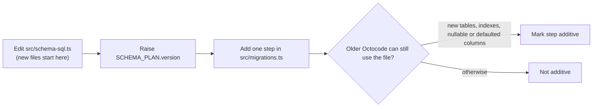

# @octocodeai/octocode-db

Private workspace: SQLite schema, connections, named entity queries, history retention. The coding-agent host bundles it and supplies the database and archive paths. Entities and scoping: [entity ownership](../../docs/ENTITIES.md); files and retention: [runtime storage](../coding-agent/docs/configuration.md#runtime-storage).

- Feature code imports only `src/api.ts`. Each query family (`src/queries/`, one module per table family) takes a handle (`type Db`) and returns a typed result; search `queries/` before adding one.
- Connections: `sharedDatabase` (one per process and file, reopened after closing) or `openDatabase`. Group dependent writes in `AgentDb.transaction`; failures, including the initial event-cursor read, roll back and release the transaction. Use the entity's workspace identity for workspace-scoped data.
- `prepare(...)`, `db.exec(...)` and `node:sqlite` imports live only here (`yarn run check:db-boundary`).

## Change the schema

The runner backs the file up with `VACUUM INTO` (other live sessions write this WAL database) and runs each step under `BEGIN IMMEDIATE`, rechecking `user_version` once it holds the lock. A failed step rolls back alone; the file stays at the last completed version. `AgentDbError` reaches the user at startup: the folder trust gate fails closed, so Octocode exits naming the file and the version needed.
