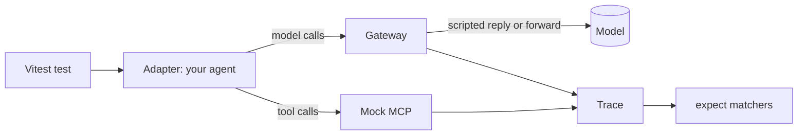

# Developer guide

How to write, run and maintain agent behavior tests with the testkit. The [README](README.md) is the reference (matchers, adapters, options); this page is the workflow.

## How a test works

The agent runs unchanged. The gateway stands in for the model (scripted replies, or forwarded to a real one), the mock MCP server stands in for tools, and both write one trace that the matchers read.

## Run the suites

| Goal                                     | Command (in `packages/octocode-agentic-testkit`)               | Cost                             |
| ---------------------------------------- | -------------------------------------------------------------- | -------------------------------- |
| Every free test                          | `yarn test`                                                    | $0, seconds                      |
| Harness guards (prompt size, cache, MCP) | `yarn test:guards`                                             | $0                               |
| Types                                    | `yarn typecheck`                                               | $0                               |
| Skill triggers on local Ollama           | `yarn test:triggers`                                           | $0, ~30 min                      |
| A paid tier                              | `yarn tier haiku -- ../../node_modules/.bin/vitest run <file>` | paid; set `TESTKIT_TOKEN_BUDGET` |

`yarn tier <name>` reads tier credentials from your `models.json` (read only) into the child process; keys are never printed. Paid tests skip with a reason when no tier is set.

## Write a test

1. Start a gateway with a scripted reply and a mock MCP server.
2. Run your agent through an adapter (or `runInproc` for the reference loop).
3. Assert behavior on the trace.

The [quickstart in the README](README.md#quickstart) is a complete example and runs as `test/quickstart.test.ts`. Rules:

- Assert behavior (tool called with, skill loaded, order, retries), not wording of the model's answer.
- Every new matcher needs a must-fail case in `test/matchers.negative.test.ts`.
- A matcher with no data fails with `cannot observe`: wire the probe instead of loosening the test.

## Pick a tier

| Question                                                                | Tier                                                              |
| ----------------------------------------------------------------------- | ----------------------------------------------------------------- |
| Does the harness send the right tools, prompt, MCP calls, cache prefix? | scripted (free, deterministic)                                    |
| Does a model pick the right skill or tool? First pass                   | `local` (Ollama)                                                  |
| Small model misses: description problem or model limit?                 | `haiku`: only call it a description problem when Haiku misses too |

Model behavior is a rate: use `live()` / `runTrials()`. Throw `NoAnswer` from a trial on timeouts or 429/5xx so errors never count as failures.

## Caching

Two caches, both on by default when a gateway forwards to a real model:

| Cache                             | First run                        | Later runs                    |
| --------------------------------- | -------------------------------- | ----------------------------- |
| Run cache (cassette)              | records each reply               | replays it: no model call, $0 |
| Provider prompt cache (Anthropic) | writes the system + tools prefix | reads it: ~10% of input price |

Workflow:

1. Record once on a paid tier (`TESTKIT_CASSETTE=auto`, the default).
2. Rerun freely: hits replay; the report prints `hits / misses / stale`.
3. Change the agent, prompt or model: requests miss or the fingerprint goes stale, and `auto` re-records only those.
4. CI: `TESTKIT_CASSETTE=replay` fails on any miss instead of spending.
5. Need fresh samples (new statistics)? `TESTKIT_CASSETTE=record` or `off`.

Statistical trials must pass `cassette: { sample: trial }` to the gateway. Without it, every trial through a fresh gateway replays trial 1's reply and the statistics are copies of one answer.

Read `.octocode/tmp/testkit-cache-report.json` after a run: `hits` and `upstreamCallsAvoided` show the run cache; `providerCache.cachedTokens / promptTokens` the provider cache on new calls.

## Add an adapter

Implement `AgentAdapter` (`src/adapter.ts`): `start({gatewayUrl, mcpUrls, workdir, env})` returns `{run(prompt), close()}`. Point the agent's model base URL at `gatewayUrl` and its MCP config at `mcpUrls`, in a temp HOME. Copy `src/adapters/claude-code` as a template. Keep agent-specific code under `src/adapters/<name>/`; `test/decoupling.test.ts` fails if the core names a specific agent. Skip with a reason when the agent's CLI is missing.

## Troubleshooting

| Symptom                         | Cause                                                      | Fix                                                        |
| ------------------------------- | ---------------------------------------------------------- | ---------------------------------------------------------- |
| `cannot observe`                | the probe for that event is not wired                      | connect the mock MCP, or assert on the gateway trace       |
| `cassette stale`                | agent, bundle, tier or model changed                       | rerun with `auto` to re-record                             |
| `cassette miss` in replay       | a new or reordered request                                 | rerun with `auto`, review the diff                         |
| identical results across trials | trials replay one recording                                | pass `cassette: { sample: trial }`                         |
| 0 cached provider tokens        | prefix under the provider minimum, or `promptCache: false` | lengthen the stable prefix, or leave the default           |
| Codex never calls the MCP tool  | approval policy                                            | the adapter sets `default_tools_approval_mode = "approve"` |
