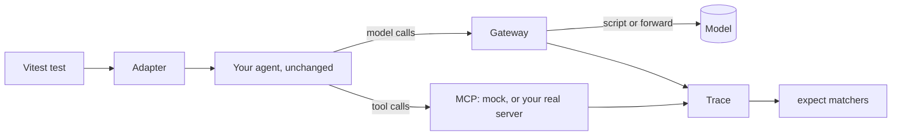

# @octocodeai/octocode-agentic-testkit

Behavior tests for AI agents and agent harnesses, in Vitest. Run your agent unchanged against a scripted model and
mock MCP servers, then check what it did: which tools it called and with what, in what order, whether it recovered
from a failure, how its prompt cache behaved, what its sub-agents did, what it cost and which files it left. The agent
can be a CLI (Claude Code, Codex, Octocode Agent) or an in-process agent (LangChain, the Vercel AI SDK, your own loop),
and the tools any MCP server, real or mocked. Scripted tests are free and deterministic; the same tests run against a
real model when you need a rate.

The kit is general-purpose: it knows no particular agent, model provider, MCP server or skill. It meets an agent only
where every agent already talks to the outside (a model endpoint and MCP servers), and each harness plugs in through
a small adapter.

Status: 0.2.0, ready for npm and not yet published; see the [CHANGELOG](CHANGELOG.md). It runs on Node 24.15+ with
Vitest 5, on macOS and Linux (the OS sandbox is macOS-only), and its types load in TypeScript 5 and 7.

| Read                                | For                                                                                       |
| ----------------------------------- | ----------------------------------------------------------------------------------------- |
| this page                           | setup, what to test, connecting an agent, adding a real model, the imports                |
| [MCP-AND-SKILLS](MCP-AND-SKILLS.md) | testing an MCP server or a skill: surface, results, sizes, routing, efficiency, workflows |
| [GUIDE](GUIDE.md)                   | the workflow, recipes, caching and troubleshooting                                        |
| [REFERENCE](REFERENCE.md)           | every option, result type and matcher                                                     |
| [examples](examples/README.md)      | tested adapters for the AI SDK, LangChain and a hand-written agent loop                   |

## How it works



The kit sits where an agent already talks to the outside. The **gateway** is the agent's model endpoint: it answers
from a script (or forwards to a real model) and records every request. The **MCP servers** are the agent's tools:
mocks that run scripted handlers, or your real server behind `recordMcp`; both record every call. Both write to one **trace**, and `expect(trace)` matchers check it.
An **adapter** is the only code that knows how to start your agent and point it at the two.

A check that needs data nothing recorded throws `cannot observe: <what>`, also under `.not`, so missing data never
passes.

## Set up

Install it with Vitest (and `@types/node` for TypeScript):

```sh
npm install --save-dev @octocodeai/octocode-agentic-testkit vitest @types/node
```

It needs Node 24.15 or later and Vitest 5. `testkitConfig` gives Vitest what the kit needs: the matcher setup, the
run-cache summary, the `forks` pool (agents run as child processes and loopback servers), 60-second timeouts and the
`AgentReporter`. Your own `setupFiles`, `globalSetup` and `reporters` are added after the kit's; any other option you
pass replaces its default.

```ts
// vitest.config.ts
import { defineConfig } from "vitest/config";
import { testkitConfig } from "@octocodeai/octocode-agentic-testkit/config";

export default defineConfig({ test: testkitConfig({ include: ["test/**/*.test.ts"], testTimeout: 120_000 }) });
```

A test file that imports the kit gets the matcher types (`expect(trace).toHaveCalledTool(...)`). For the others, add
the setup module to `tsconfig.json`:

```json
{ "compilerOptions": { "types": ["node", "@octocodeai/octocode-agentic-testkit/setup"] } }
```

## Your first test

```ts
import { expect, it } from "vitest";
import { mockMcp, referenceAdapter, script, startGateway } from "@octocodeai/octocode-agentic-testkit";

it("searches before answering", async () => {
	// The model's replies, in order: a tool call, then an answer.
	const gw = await startGateway({
		responder: script([{ toolCalls: [{ name: "search", args: { query: "cache" } }] }, { text: "done" }]),
	});
	// A mock MCP server with one tool; its calls land on the same trace.
	const docs = mockMcp({
		name: "docs",
		trace: gw.trace,
		tools: [
			{
				name: "search",
				description: "Search the docs",
				inputSchema: { type: "object", properties: { query: { type: "string" } }, required: ["query"] },
			},
		],
	});
	// The agent under test: here the kit's in-process reference loop.
	const session = await referenceAdapter({ trace: gw.trace, mcp: [docs.client()] }).start({ gatewayUrl: gw.url });
	await session.run("find the cache docs");

	expect(gw.trace).toHaveCalledMcp("docs", "search", { args: { query: "cache" }, before: "answer" });

	await session.close();
	await docs.close();
	await gw.close();
});
```

The same code runs as `test/quickstart.test.ts`. For several turns, several fresh agents per test, a pass policy and
a spend cap, wrap it in `agentSuite` ([REFERENCE](REFERENCE.md#suites)), which starts and closes everything for you.

## What to test

Most checks need no model at all: the script decides what the "model" says, and the check is about what your code
does with it. Add a real model only when the question is what a model chooses.

### If you build an agent: prompts, tools, skills, MCP servers

| Question                                                                           | Check                                                                     | Model    |
| ---------------------------------------------------------------------------------- | ------------------------------------------------------------------------- | -------- |
| Does it call the right tool, with the right arguments, before answering?           | `toHaveCalledTool`, `toHaveCalledMcp` with `args` and `before`            | scripted |
| Does it keep a required order, or avoid extra calls?                               | `toFollowTrajectory` (`strict`, `ordered`, `superset`, `subset`)          | scripted |
| Does it recover from a failed tool without resending it?                           | `mock.tool(name).failOnce("error")`, `toReflect`, `toNotRetryIdentically` | scripted |
| Are my tool descriptions present, small, distinct and free of hidden instructions? | `analyzeSurface`, `toPassSurfaceReview`                                   | none     |
| Does a prompt route to the right tool or skill?                                    | `probeRouting`, `toHaveLoadedSkill`                                       | real     |
| Does it never make a dangerous call?                                               | `guards: [never("delete_*")]`, `toHaveBlocked`                            | either   |
| Does it resist hostile tool results, secret lures and hijacked skills?             | `redTeamAttacks`, `runAttack`, `toResist`                                 | either   |
| Is the answer well formed, or good?                                                | `toMatchSchema`; `judge`, `judgePanel`                                    | either   |
| Did it leave the right files, and touch nothing else?                              | `toHaveWorkspace`, `toChangeOnly`, `runVerifier`, `toPassVerifier`        | either   |
| Does it stay within requests, tokens and dollars?                                  | `toStayWithin`, `caps`, `budgetUsd`                                       | either   |
| How often does it get it right? Did my change help?                                | `live`, `agentSuite({ runs, pass })`, `passHatK`, `liveCompare`           | real     |
| Does it reach the goal over several user turns?                                    | `converse` with `scriptedUser` or `modelUser`                             | either   |

### If you build a harness: the loop, context, caching, sub-agents

| Question                                                                                                        | Check                                                                      |
| --------------------------------------------------------------------------------------------------------------- | -------------------------------------------------------------------------- |
| Does each request keep the previous one's prefix, so the provider cache hits?                                   | `toKeepStablePrefix`, `toKeepCacheWarm`, `toHaveCacheReadRatio`            |
| Does the context grow within a budget, without duplicated blocks?                                               | `toGrowAtMost`, `toHaveNoDuplicateBlocks`, `promptShape`                   |
| Are tool results and answers bounded?                                                                           | `toKeepEnvelopesUnder`                                                     |
| Do sub-agents start, report back and never get orphaned?                                                        | `toHaveSpawned`, `toHaveHandedOff`, `toHaveNoOrphanAgents`                 |
| Does compaction happen when it should, and keep the cache after?                                                | `toHaveCompacted`, `toKeepStablePrefix({ allowAfterCompaction })`          |
| Does it survive HTTP 429 and 5xx, malformed tool arguments, cut-off or refused replies and dropped connections? | fault steps in `script` ([REFERENCE](REFERENCE.md#scripted-model-replies)) |
| Does it handle MCP errors, timeouts and schema violations?                                                      | `failOnce("error")`, `failOnce("timeout")`, `tool_error` reasons           |
| Does it read memory before acting?                                                                              | `toHaveRecalledBefore`                                                     |
| Is it contained when a real model drives it?                                                                    | the OS `sandbox`, on by default for forwarded CLI runs                     |

All of these run on real CLIs: the gateway works out which agent sent each request from the conversations, so spawn,
handoff and compaction checks need no cooperation from the harness ([REFERENCE](REFERENCE.md#agents-without-headers)).

A harness check, scripted and free:

```ts
const gw = await startGateway({
	responder: script([
		{ toolCalls: [{ name: "Bash", args: { command: "cat a.txt", description: "read" } }] },
		{ text: "read it" },
	]),
});
const session = await claudeCodeAdapter().start({ gatewayUrl: gw.url, files: { "a.txt": "hello" } });
await session.run("read a.txt");
expect(gw.trace).toKeepEnvelopesUnder({ toolOutputChars: 20_000 });
expect(gw.trace).toKeepStablePrefix(); // the tool round only appended to the cached prefix
await session.close();
await gw.close();
```

The same code runs as `test/readme.test.ts`.

### If you build an MCP server or a skill

Put your real server in front of any agent with `recordMcp`, and install your skill into a harness's isolated home:

```ts
import { recordMcp, startGateway, script } from "@octocodeai/octocode-agentic-testkit";
import { claudeCodeAdapter } from "@octocodeai/octocode-agentic-testkit/adapters/claude-code";

const gw = await startGateway({
	responder: script([{ toolCalls: [{ name: "mcp__docs__search", args: { q: "cache" } }] }, { text: "done" }]),
});
const server = recordMcp({ name: "docs", trace: gw.trace, target: { command: "my-mcp-server", args: ["--stdio"] } });
const session = await claudeCodeAdapter({ skills: { "find-docs": SKILL_MD } }).start({
	gatewayUrl: gw.url,
	mcpUrls: { docs: await server.listen() },
});
await session.run("find the cache docs");
expect(gw.trace).toHaveCalledMcp("docs", "search", { before: "answer" });
expect(server.summary().maxChars).toBeLessThan(20_000); // the largest answer the model had to read
```

| Question                                                                | Check                                                                   |
| ----------------------------------------------------------------------- | ----------------------------------------------------------------------- |
| What does every request pay for my tools, and what does a host cut off? | `analyzeSurface({ servers: [server] }, CLAUDE_CODE_LIMITS)`             |
| Do my tools answer correctly, how large and how fast?                   | `server.client().callTool`, `server.calls()`, `server.summary()`        |
| Does a real harness call them and show the model the answer?            | a CLI adapter with `mcpUrls`, `toHaveCalledMcp`, `toKeepEnvelopesUnder` |
| Does the intended workflow run, and recover from errors?                | `toFollowTrajectory({ mode: "ordered" })`, `toReflect`                  |
| Does a model pick my tool or skill for the right prompts?               | `probeRouting`, `toHaveLoadedSkill` with `live`                         |
| How many calls and tokens does a task take, and did my change help?     | `toStayWithin`, `server.summary()`, `liveCompare`                       |

[MCP-AND-SKILLS](MCP-AND-SKILLS.md) walks through each step against a real server (octocode-mcp, in
`test/example-mcp-server.test.ts`).

## Connect your agent

| Your agent                                                        | Adapter                                                                                                                                                        |
| ----------------------------------------------------------------- | -------------------------------------------------------------------------------------------------------------------------------------------------------------- |
| Claude Code, Codex or Octocode Agent                              | bundled: `claudeCodeAdapter`, `codexAdapter`, `octocodeAgentAdapter` (needs the Octocode Agent CLI bundle: `bundle` option or `TESTKIT_OCTOCODE_AGENT_BUNDLE`) |
| another CLI                                                       | a CLI adapter with `runProcess` ([checklist](REFERENCE.md#plug-in-your-agent))                                                                                 |
| LangChain, the Vercel AI SDK or your own loop in the test process | an in-process adapter ([examples](examples/README.md))                                                                                                         |
| no harness yet, only tools and prompts                            | `referenceAdapter`, the kit's own small tool loop                                                                                                              |

An adapter starts your agent pointed at the gateway and the mock servers, and runs one turn per `run()`:

```ts
import { defineAdapter } from "@octocodeai/octocode-agentic-testkit";

export const myAgent = defineAdapter({
	name: "my-agent",
	async start(ctx) {
		// ctx.gatewayUrl: the model base URL (`${ctx.gatewayUrl}/v1` for OpenAI-style clients)
		// ctx.mcpUrls: mock MCP servers by name, to register as HTTP MCP servers
		const agent = createMyAgent({ baseURL: `${ctx.gatewayUrl}/v1`, apiKey: "testkit", mcp: ctx.mcpUrls });
		return {
			run: async (input) => agent.send(typeof input === "string" ? input : input.prompts.join("\n")),
			close: async () => agent.dispose(),
		};
	},
});
```

`defineAdapter` infers the result type of `run`, so a suite's `turn.result` is typed. The rules that make an adapter
trustworthy (an isolated HOME, a skip with a reason when the agent is missing, a sandbox for real-model runs) are in
the [adapter checklist](REFERENCE.md#plug-in-your-agent).

### In-process frameworks

Any framework whose model client takes a base URL connects the same way. Each example is a tested file in
[examples/adapters](examples/adapters).

**Vercel AI SDK** ([ai-sdk.ts](examples/adapters/ai-sdk.ts)): `createOpenAI({ baseURL }).chat(model)` or
`createAnthropic({ baseURL })`, MCP tools as `dynamicTool`s, `generateText` with `stopWhen: isStepCount(n)`, and the
response messages kept for the next turn.

```ts
import { expect, it } from "vitest";
import { mockMcp, script, startGateway, type ToolDef } from "@octocodeai/octocode-agentic-testkit";
import { aiSdkAdapter } from "./adapters/ai-sdk.ts"; // copied from examples/adapters

const search: ToolDef = {
	name: "search",
	description: "Search the docs",
	inputSchema: { type: "object", properties: { query: { type: "string" } }, required: ["query"] },
};

it("an AI SDK agent searches before answering", async () => {
	const gw = await startGateway({
		responder: script([
			{ toolCalls: [{ name: "mcp__docs__search", args: { query: "parseConfig" } }] },
			{ text: "src/loader.ts" },
		]),
	});
	const docs = mockMcp({ name: "docs", trace: gw.trace, tools: [search] });
	// wire: "openai" (default) or "anthropic"
	const session = await aiSdkAdapter({ wire: "anthropic" }).start({
		gatewayUrl: gw.url,
		mcpUrls: { docs: await docs.listen() },
	});
	expect((await session.run("Where is parseConfig defined?")).answer).toBe("src/loader.ts");
	expect(gw.trace).toHaveCalledMcp("docs", "search", { args: { query: "parseConfig" }, before: "answer" });
	await session.close();
	await docs.close();
	await gw.close();
});
```

**LangChain** ([langchain.ts](examples/adapters/langchain.ts)): `new ChatOpenAI({ apiKey, configuration: { baseURL } })`,
MCP tools as `tool(fn, { name, description, schema })`, `createAgent({ model, tools, systemPrompt })`, and the agent
state's messages kept for the next turn. As an `agentSuite`, each test is the agent's next turn:

```ts
import { agentSuite, script, type ToolDef } from "@octocodeai/octocode-agentic-testkit";
import { langChainAdapter } from "./adapters/langchain.ts"; // copied from examples/adapters

const search: ToolDef = {
	name: "search",
	description: "Search the docs",
	inputSchema: { type: "object", properties: { query: { type: "string" } }, required: ["query"] },
};

agentSuite(
	"a LangChain agent",
	{
		adapter: langChainAdapter({ systemPrompt: "Answer from the docs." }),
		gateway: {
			responder: script([
				{ toolCalls: [{ name: "mcp__docs__search", args: { query: "parseConfig" } }] },
				{ text: "It is in src/loader.ts." },
				{ text: "src/loader.ts, as I said." },
			]),
		},
		mcp: { docs: [search] },
	},
	(t) => {
		t.test("searches, then answers", async ({ run, expect }) => {
			expect((await run("Where is parseConfig defined?")).trace).toHaveCalledMcp("docs", "search", {
				before: "answer",
			});
		});
		t.test("answers the follow-up from the conversation", async ({ run, expect }) => {
			const turn = await run("Which file was it?");
			expect(turn.trace.of("model_tool_call")).toHaveLength(0);
			expect(turn.answer).toBe("src/loader.ts, as I said.");
		});
	},
);
```

**Your own loop** ([agent-loop.ts](examples/adapters/agent-loop.ts)): the pattern for any in-process library with a
pluggable model client, Pi-style agent loops included. Give its client the gateway's base URL; the loop, tools and
history stay yours. Its `delegate` tool shows a sub-agent the gateway recognizes without headers:

```ts
import { expect, it } from "vitest";
import { scripts, startGateway } from "@octocodeai/octocode-agentic-testkit";
import { agentLoopAdapter } from "./adapters/agent-loop.ts"; // copied from examples/adapters

it("hands the search to a researcher", async () => {
	const task = "Find every caller of parseConfig under src/";
	const gw = await startGateway({
		responder: scripts({
			main: [{ toolCalls: [{ name: "delegate", args: { agent: "researcher", task } }] }, { text: "cli.ts calls it." }],
			researcher: [{ text: "cli.ts calls parseConfig" }],
		}),
	});
	const session = await agentLoopAdapter({ subagents: { researcher: "Research, then report in one line." } }).start({
		gatewayUrl: gw.url,
	});
	expect((await session.run("Who calls parseConfig?")).answer).toBe("cli.ts calls it.");
	expect(gw.trace).toHaveSpawned("researcher");
	expect(gw.trace).toHaveHandedOff("main", "researcher");
	await session.close();
	await gw.close();
});
```

The three snippets run as `test/readme.test.ts`. Against a real model, nothing in the adapter changes: start the
gateway with `forward` instead of a script.

### CLI harnesses

A CLI adapter writes the harness's own config into a temp HOME (provider base URL = the gateway, MCP servers = the
mocks), runs the CLI with `runProcess`, and passes `sandbox: await sandboxFor(opts.sandbox, ctx, root)` so that a
real-model run is sandboxed. Start from `src/adapters/codex` (a config file) or `src/adapters/claude-code` (flags and
environment).

## Add a real model

Scripted tests prove your code handles what a model says. A real model tells you what a model will say. Turn one on
in steps:

1. **Pick a tier.** `TESTKIT_TIER=haiku` (or `local` for Ollama, `deepseek`, or any name) with
   `TESTKIT_<NAME>_BASE_URL`, `_MODEL`, `_KEY` and `_API` (`openai`, `anthropic` or `responses`).
   Export them in the environment (never on disk). A missing variable skips with a reason; nothing falls through to a
   paid tier. (`yarn tier` in the source repository fills them from a local `models.json`; see DEVELOPING.md there.)
2. **Forward the gateway.** `startGateway({ forward: forwardOf(tier) })`. The request goes upstream as your agent sent
   it, and the reply comes back as the provider sent it ([what crosses wires](REFERENCE.md#real-model-runs)).
3. **Gate and cap.** Paid tests run only with `TESTKIT_LIVE=1`. Cap them with `caps: { maxRequests, maxUsd, pricing }`
   or a suite's `budgetUsd`.
4. **Record once, replay free.** Forwarded runs record to a cassette and replay its hits. In CI, set
   `TESTKIT_CASSETTE=replay` and a committed `TESTKIT_CASSETTE_DIR` ([caching](GUIDE.md#caching)).
5. **Measure a rate, not a sample.** `live()` runs trials until a Bayesian decision, `agentSuite({ runs: 5, pass: 0.8 })`
   applies a pass policy, and `liveCompare` tells whether a change helped.
6. **Grade wording only when wording is the point:** `judge({ rubric, transcript, model })`, or `judgePanel` with
   several graders.
7. **Simulate the user** for multi-turn goals: `converse(session, modelUser({ model, goal }), { maxTurns })`.

```ts
import { claudeCodeAdapter } from "@octocodeai/octocode-agentic-testkit/adapters/claude-code";
import { live, startGateway } from "@octocodeai/octocode-agentic-testkit";
import { forwardOf, resolveTier } from "@octocodeai/octocode-agentic-testkit/tiers";

const tier = resolveTier();
live("picks search for a docs question", { maxTrials: 20, threshold: 0.8 }, async ({ trial }) => {
	if ("skip" in tier) throw new Error(tier.skip);
	const gw = await startGateway({ forward: forwardOf(tier.tier), cassette: { sample: trial } });
	const session = await claudeCodeAdapter().start({ gatewayUrl: gw.url }); // sandboxed: the gateway forwards
	try {
		await session.run("where are the cache docs?");
		return gw.trace.of("model_tool_call").some((e) => e.name === "mcp__docs__search");
	} finally {
		await session.close();
		await gw.close();
	}
});
```

When the gateway forwards to a real model, a CLI adapter's process runs in an OS sandbox by default: it can write only
inside its run, cannot read credential paths and reaches only loopback ([REFERENCE](REFERENCE.md#sandbox)).

## Imports

| Import                                                           | Gives                                                                                                                                                                                                                                  |
| ---------------------------------------------------------------- | -------------------------------------------------------------------------------------------------------------------------------------------------------------------------------------------------------------------------------------- |
| `@octocodeai/octocode-agentic-testkit`                           | everything for tests and adapters: gateway, scripts, trace, mocks, `recordMcp`, guards, suites, `live`, `judge`, comparisons, simulated users, workspace grading, surface review, `defineAdapter`, `runProcess`, the reference adapter |
| `…/config`                                                       | `testkitConfig`                                                                                                                                                                                                                        |
| `…/setup`                                                        | matcher registration and types                                                                                                                                                                                                         |
| `…/cache-report`                                                 | the run-cache summary (`globalSetup`)                                                                                                                                                                                                  |
| `…/reporter`                                                     | `AgentReporter` (default export): suite pass rates, spend, mock-tool coverage                                                                                                                                                          |
| `…/tiers`                                                        | `resolveTier`, `forwardOf`, `Tier`                                                                                                                                                                                                     |
| `…/adapters/reference`, `claude-code`, `codex`, `octocode-agent` | the bundled adapters and their option types                                                                                                                                                                                            |

The root exports the types you write tests with: `Trace`, `TraceEvent`, `CapturedRequest`, `Step`, `Responder`,
`GatewayOptions`, `ToolDef`, `MockMcp`, `RecordedMcp`, `Guard`, `AgentAdapter`, `AgentSuiteOptions`, `Turn`,
`LiveOptions`, `Judgement`, `SurfaceReport`, `ComparisonSummary`, `VerifierResult` and the rest. The export list is
pinned by the package's own tests; the published tarball is installed into a fresh project and its quickstart run before release.

## Environment variables and output files

Nothing is written outside the directories below, and nothing is written unless a feature that needs it runs.

| Variable               | Effect                                                                                                                                                       |
| ---------------------- | ------------------------------------------------------------------------------------------------------------------------------------------------------------ |
| `TESTKIT_REPORT_DIR`   | where the run-cache report (`testkit-cache-report.json`) and the suite report (`testkit-agent-report.json`) go; default: `testkit/` in the OS temp directory |
| `TESTKIT_CASSETTE_DIR` | where recorded model replies (cassettes) live; point it at a committed directory to replay in CI                                                             |
| `TESTKIT_RESULTS_DIR`  | one JSON per test saved by `saveResult`; nothing is written without it                                                                                       |
| `TESTKIT_TIER`         | the model tier (`local`, `haiku`, `deepseek` or any name) with `TESTKIT_<NAME>_BASE_URL`, `_MODEL`, `_KEY`, `_API`                                           |
| `TESTKIT_LIVE=1`       | allows paid tests; they skip with a reason without it                                                                                                        |
| `TESTKIT_TOKEN_BUDGET` | caps paid spend in tokens                                                                                                                                    |

Tier variables are in [REFERENCE](REFERENCE.md#outputs). Commands to develop the kit itself (running its own
suites, paid tiers, the consumer check) are in `DEVELOPING.md` in the source repository; the npm package leaves them out.

## Rules the kit keeps

- **No data is not a pass.** A check without the data it needs throws `cannot observe`, also under `.not`.
- **Every matcher has a must-fail test**, and a new one must add it.
- **Scripted tests are deterministic and free:** no retries, real timers, identical results run after run.
- **A trial returns a boolean.** `true` passes; `false`, or anything else such as a forgotten `return`, fails.
- **Infrastructure errors are not failures.** A trial that throws `NoAnswer` (timeout, 429, 5xx) is counted apart.

Where the kit stops (what each probe cannot see, how far agent inference goes, the macOS-only sandbox) is in
[Limits](REFERENCE.md#limits).
