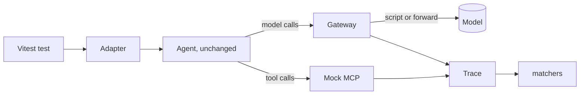

# agentic-testkit reference

Every option, result type and matcher of `@octocodeai/octocode-agentic-testkit`. The [README](README.md) explains what
to test and how to connect an agent; the [developer guide](GUIDE.md) has the workflow and recipes.

| Section                                                                                       | Covers                                                                                                         |
| --------------------------------------------------------------------------------------------- | -------------------------------------------------------------------------------------------------------------- |
| [How it works](#how-it-works)                                                                 | the probes that feed the trace                                                                                 |
| [Suites](#suites)                                                                             | `agentSuite` options, turns and pass policies                                                                  |
| [Plug in your agent](#plug-in-your-agent)                                                     | the adapter contract and checklist, the bundled adapters                                                       |
| [Inputs](#inputs)                                                                             | scripted replies and faults, gateway options, real-model runs, mock MCP, guards, tiers                         |
| [Outputs](#outputs)                                                                           | the trace, agents without headers, result types                                                                |
| [Check catalog](#check-catalog)                                                               | every matcher, surface review, routing, judging, rates, comparisons, simulated users, outcome grading, sandbox |
| [Reliability rules](#reliability-rules), [Tiers and cost](#tiers-and-cost), [Limits](#limits) | what the kit guarantees and where it stops                                                                     |

## How it works



Three probes write to one `Trace`:

| Probe                    | The harness reaches it by                            | It records                                                                                                                                     |
| ------------------------ | ---------------------------------------------------- | ---------------------------------------------------------------------------------------------------------------------------------------------- |
| Gateway (`startGateway`) | setting its model base URL to `gateway.url`          | every request and its usage; `model_tool_call`, `answer` and harness `tool_error` events; the inferred agent of each request (probe `lineage`) |
| Mock MCP (`mockMcp`)     | connecting to the HTTP MCP server at `mock.listen()` | `tool_exec` and `tool_error` events; probe `mcp:<server>`                                                                                      |
| Events (`trace.record`)  | its adapter reporting harness events                 | `skill_load`, `spawn`, `report`, `memory_read`, `memory_write` and `compaction`; probe `events`                                                |

A check that needs data no probe recorded throws `cannot observe: <what>`, also under `.not`, so missing data never
passes. `trace.probes` lists the wired probes, which tells "not wired" apart from "did not happen". For example,
`.not.toHaveSpawned("x")` throws on a trace whose requests all carried identity headers and whose adapter reports no
events, rather than passes.

## Suites

`agentSuite(name, options, (t) => …)` is a `describe` that owns the agents. Each run gets a fresh agent: its own
gateway, trace, mock MCP servers and adapter session. Each `t.test` runs its body once per run, as that agent's next
turn, and passes when the pass policy holds.

```ts
import { agentSuite, never, referenceAdapter, script } from "@octocodeai/octocode-agentic-testkit";

agentSuite(
	"docs search",
	{
		adapter: ({ trace }) => referenceAdapter({ trace, conversation: true }),
		gateway: {
			responder: script([
				{ toolCalls: [{ name: "search", args: { query: "cache" } }] },
				{ text: "The cache docs are in docs/cache.md." },
				{ text: "docs/cache.md" },
			]),
		},
		mcp: { docs: [search] }, // ToolDef[] per server
		guards: [never("delete_*")],
		runs: 3,
	},
	(t) => {
		t.test("turn 1 searches before answering", async ({ run, mcp, expect }) => {
			const turn = await run("find the cache docs");
			expect(turn.trace).toHaveCalledMcp("docs", "search", { args: { query: "cache" }, before: "answer" });
			expect(mcp.docs.tool("search")).toHaveBeenCalledTimes(1);
		});
		t.test("turn 2 answers from the conversation", async ({ run, expect }) => {
			const turn = await run("which file was that?");
			expect(turn.trace.of("model_tool_call")).toHaveLength(0);
			expect(turn.answer).toBe("docs/cache.md");
		});
	},
);
```

The same code runs as `test/quickstart-suite.test.ts` (with `search` defined there).

| Option                 | Does                                                                                                                               |
| ---------------------- | ---------------------------------------------------------------------------------------------------------------------------------- |
| `adapter`              | the harness; a factory gets `{ replica, gateway, trace, mcp }` and is called once per fresh agent                                  |
| `gateway`              | gateway options of each agent (`responder` or `forward`, `caps`, `cassette`); a function gets the run index                        |
| `mcp`                  | mock servers by name; each agent gets its own mocks and spies, passed to the adapter as `mcpUrls`                                  |
| `guards`               | judged at the gateway and at every mock server; see [Guards](#guards)                                                              |
| `budgetUsd`, `pricing` | a hard USD cap for the whole describe, split evenly across runs; `pricing` is USD per million tokens and is required with a budget |
| `runs`                 | fresh agents that each run every test (default 1)                                                                                  |
| `pass`                 | the share of runs that must pass (`0.8`), `"all"` (the default; pass^k) or `"any"` (pass@k)                                        |
| `concurrency`          | runs executed at once (default: all); use 1 for local models                                                                       |
| `isolation`            | `"describe"` (default): the tests are consecutive turns of one agent per run; `"test"`: fresh agents for every test                |
| `start`                | `workdir`, `env` and `files` for `adapter.start`                                                                                   |
| `skip`                 | skip every test with this reason, such as an unresolved tier; the adapter's `unavailable()` is checked too                         |
| `timeoutMs`            | per test                                                                                                                           |

The test context holds `run`, `trace` (every turn of this run), `mcp`, `gateway`, `replica` and `expect`.
`run(input)` returns a `Turn`: the adapter's `result`, the `trace` of this turn alone, its last `answer`, and
`stopped` when a cap or guard stopped it. A test option `{ allowStop, fails, timeoutMs }` adjusts one test.

- With several runs, a failing test reports `k/n runs passed, m needed` and the first line of each failing run's
  error. With one run, it throws the run's own error.
- A turn that a cap or guard stopped fails its run unless the test sets `allowStop`. A run that spent its budget share
  fails its later turns, also when `isolation: "test"` gives each test fresh agents. `fails: true` expects the verdict
  to fail.
- Vitest clears spy history before each test (`clearMocks` is on by default), so a mock's spy counts this turn's calls;
  the context's `trace` keeps every turn.
- A test filtered alone with `-t` starts on a fresh agent without the earlier turns.
- Suite tests never retry, repeat, shuffle or run concurrently, whatever the Vitest config says: a retry would run as
  the agent's next turn. A test that still runs again fails.
- Whether the agent remembers earlier turns is up to the adapter. The reference adapter does with
  `conversation: true`; the CLI adapters start each run fresh.
- Each test stores its pass count, Wilson interval, requests, spend, tools, skills and guard stops on
  `task.meta.agentSuite` and annotates the result with a one-line summary.

To see the totals, add the reporter: `reporters: ["default", new AgentReporter()]` with `AgentReporter` from
`…/reporter`. It prints one line per suite test (passes, 95% interval, requests, spend), the share of advertised mock
tools some test executed and the ones none did, the skills loaded and the guard stops. It writes the same as JSON to
`testkit-agent-report.json` under `TESTKIT_REPORT_DIR`. This package's own config uses it.

## Plug in your agent

An adapter is the only code that knows how a harness is configured:

```ts
interface AgentAdapter<R = unknown> {
	name: string;
	unavailable?(): string | undefined; // why the harness cannot run here; suites skip with it
	start(ctx: AdapterContext): Promise<AgentSession<R>>;
}
interface AdapterContext {
	gatewayUrl: string; // model base URL (`${gatewayUrl}/v1` for OpenAI wires)
	mcpUrls?: Record<string, string>; // HTTP MCP servers to register
	workdir?: string; // else the adapter creates a temp one
	env?: Record<string, string>;
	files?: Record<string, string>; // written into the workspace before the first run
}
interface AgentSession<R> {
	run(input: string | RunInput): Promise<R>; // RunInput: { prompts: string[]; env?; timeoutMs? }
	close(): Promise<void>;
}
```

`defineAdapter({ name, unavailable, start })` returns the adapter unchanged and infers `R` from `run`. `runInput(input)`
turns a `string | RunInput` into `{ prompts }`, and `singlePrompt(name, input)` rejects more than one prompt for a
harness that takes one per process. An in-process adapter (LangChain, the AI SDK, your own loop) needs only steps 2,
3 and 8; the [examples](examples/README.md) are tested starting points.

To write an adapter, follow these steps. Each one names a way to check it.

1. **Isolate.** Create a temporary HOME and workspace, and never read or write the real home. Set `HOME`, plus the
   harness's own config-directory variable, in the child's environment.
2. **Point the model at the gateway.** Write the harness's provider config with base URL `ctx.gatewayUrl`, on the
   wire the harness speaks:
   - OpenAI chat completions: `/v1/chat/completions`
   - Anthropic messages: `/v1/messages`
   - OpenAI Responses: `/v1/responses`
   - Google Gemini: `…/models/<model>:generateContent` or `:streamGenerateContent` (SSE with `?alt=sse`), under any
     prefix such as `/v1beta`

   Check: after one run, `gw.trace.requests.length > 0`.

3. **Register the MCP servers.** Write `ctx.mcpUrls` into the harness's MCP config as HTTP servers. Send no
   identity headers unless the harness can set them per agent: without them, the mock attributes each call to the
   agent whose model asked for it. Check: `toHaveCalledMcp` passes in a scripted run.
4. **Write the files.** Call `writeFiles(workspace, ctx.files ?? {})`.
5. **Run.** Start the harness with `runProcess(command, args, { env, cwd, timeoutMs, home })`. It runs the process in
   its own group, kills the group on timeout and on exit, and parses stdout's JSON lines into `events`. If the harness
   takes only one prompt per process, reject a `RunInput` with more than one prompt.
6. **Report events (optional).** If the harness exposes skill, memory, spawn or compaction events, translate them
   into `trace.record(...)` calls and call `trace.observe("events")`. Spawns, reports and compactions are inferred
   by the gateway anyway (see [Agents without headers](#agents-without-headers)); reported events take precedence.
   Memory events need the adapter.
7. **Sandbox real-model runs.** Pass `sandbox: await sandboxFor(opts.sandbox, ctx, root)` to `runProcess`. It turns
   the OS sandbox on when the gateway forwards to a real model, and an explicit `sandbox: false` opts out. Check: a
   write outside the workspace fails in a forwarded run.
8. **Close.** Remove the temporary root unless `keep` is set.
9. **Skip honestly.** When the CLI or bundle is missing, return the reason from `unavailable()`; `agentSuite` skips
   with it. See `cliMissing` in the claude-code adapter.
10. **Stay out of core.** Harness-specific code lives under `src/adapters/<name>/`. `test/decoupling.test.ts` fails if
    a core file names a harness or imports an adapter.

| Adapter        | How it connects                                                                                                                                                                                                                              | Result         |
| -------------- | -------------------------------------------------------------------------------------------------------------------------------------------------------------------------------------------------------------------------------------------- | -------------- |
| `reference`    | an in-process tool loop that emits every event kind; MCP servers come as `mcp` clients or `mcpUrls`; `conversation: true` keeps the history across runs of one session                                                                       | `InprocResult` |
| `octocodecode` | the built CLI bundle (`bundle` or `TESTKIT_OCTOCODECODE_BUNDLE`) in a temp HOME with `models.json` and `mcp.json`. Options: `api`, `provider`, `skills`, `settings`, `mcp`, `thinking`, `persistSession`, `files`, `args`, `keep`, `sandbox` | `ProcessRun`   |
| `claude-code`  | `claude -p … --output-format stream-json --strict-mcp-config`, with `ANTHROPIC_BASE_URL` set to the gateway and `--permission-mode bypassPermissions`. Options: `command`, `args`, `timeoutMs`, `keep`, `sandbox`                            | `ProcessRun`   |
| `codex`        | `codex exec --json` with a `mock` provider (`wire_api = "responses"`) in a temp `CODEX_HOME`; a dead HTTPS proxy keeps it offline. Sandboxed, Codex's own sandbox is off (macOS refuses nesting) and ours confines it                        | `ProcessRun`   |

Every CLI adapter takes `sandbox: false | SandboxOptions`, and `skills: { name: SKILL.md text }`, written where that
harness reads skills (`<CLAUDE_CONFIG_DIR>/skills`, `<CODEX_HOME>/skills`, the octocodecode agent home). The default sandboxes the process when the gateway forwards
to a real model (`GET <gateway>/testkit` says so); a scripted gateway runs it unsandboxed. See [Sandbox](#sandbox).

## Inputs

### Scripted model replies

`script(steps, { onExhausted })` answers one agent's requests in order. `scripts({ main: [...], researcher: [...] })`
scripts several agents, matched by the `x-testkit-agent` header. A step may also be a function of
`{ request, trace, turn }`, and a custom `responder` may be async.

```ts
type Step =
	| {
			text?: string; // assistant text, alone or alongside tool calls
			toolCalls?: { name: string; args?: unknown; rawArgs?: string }[]; // rawArgs: argument text sent verbatim, malformed JSON included
			usage?: Partial<Usage>; // overrides the simulated usage
			delayMs?: number; // waits before replying
			stop?: "max_tokens" | "refusal"; // ends the reply on a token limit or a refusal, in each wire's stop field
			disconnect?: "before-reply" | "mid-stream"; // drops the connection with no body, or after a partial one
	  }
	| { error: { status: number; message?: string; retryAfterSeconds?: number } }; // an HTTP error in the wire's shape
```

Together these cover the faults a harness must survive: HTTP errors and rate limits, slow replies, malformed tool
arguments, cut-off and refused replies, and dropped connections.

With `onExhausted: "repeat-last"`, the default, the last step repeats. With `"fail"`, the gateway answers 500 and adds
`script exhausted after N steps` to `gw.errors`.

### Gateway options

`startGateway` takes:

| Option             | Does                                                                                                                                                                       |
| ------------------ | -------------------------------------------------------------------------------------------------------------------------------------------------------------------------- |
| `responder`        | answers each request; usually `script(...)` or `scripts(...)`                                                                                                              |
| `forward`          | sends requests to a real upstream: `{ baseUrl, model, api: "openai" \| "anthropic" \| "responses", key, timeoutMs, promptCache }`; see [Real-model runs](#real-model-runs) |
| `agents`           | `infer` (default): requests without `x-testkit-agent` get an agent from the [lineage](#agents-without-headers); `header`: they are all `main`                              |
| `cassette`         | the run cache; see the guide                                                                                                                                               |
| `guards`           | judge each tool call in a reply before the harness sees it; see [Guards](#guards)                                                                                          |
| `caps.maxRequests` | stops answering after this many requests and records a `cut` event                                                                                                         |
| `caps.pricing`     | USD per million tokens (`input`, `output`, `cacheRead`); sets `costUsd` on each answered request                                                                           |
| `caps.maxUsd`      | stops answering once the priced requests reach this many USD and records a `cut` event; needs `caps.pricing`                                                               |
| `token`            | requires this bearer token                                                                                                                                                 |
| `roots`            | paths replaced by `<ws>` in canonical requests                                                                                                                             |
| `simulateCache`    | estimates prompt-cache reads for scripted runs                                                                                                                             |

### Real-model runs

With `forward`, the gateway sends each request to a real upstream and records the provider's own usage.

| Harness wire       | `api: "anthropic"` | `api: "openai"` (chat) | `api: "responses"` |
| ------------------ | ------------------ | ---------------------- | ------------------ |
| Anthropic messages | as sent            | translated             | refused            |
| OpenAI chat        | translated         | as sent                | refused            |
| OpenAI Responses   | translated         | translated             | as sent            |
| Gemini             | translated         | translated             | refused            |

- **As sent:** the body goes upstream unchanged except `model` (when `forward.model` is set) and `stream: false`:
  system blocks, tools, thinking settings, metadata and the harness's own cache markers stay. An Anthropic client's
  `anthropic-version` and `anthropic-beta` headers are forwarded. The reply goes back as the upstream sent it:
  thinking blocks with their signatures, Responses reasoning items with their encrypted content, server-tool
  blocks and the stop reason.
- **Translated:** the request goes through the chat shape, which carries the system prompt, text, tool calls, tool
  results, tool definitions, the tool-choice mode and token limits. Thinking, images and server tools do not cross
  wires.
- `promptCache` (Anthropic, default on) marks the last system block and the last tool, but only on a request that
  carries no cache markers of its own.
- `forward.body` merges fields into every upstream request, for settings the real model requires (a tier's `body`
  arrives here through `forwardOf`). One example is `{ reasoning_effort: "none" }` for an OpenAI model that takes
  function tools on chat completions only without reasoning.
- An OpenAI upstream that rejects `max_tokens` and asks for `max_completion_tokens` gets that request once more with
  the newer parameter, and every later one of that forward with it: the client chose its parameter for the model it
  named, not the one `forward.model` swapped in. Any other rejection fails as before.
- A streaming client still gets SSE; the upstream call itself is not streamed.

### Mock MCP tools

Create a server with `mockMcp({ name, tools, trace, resources, prompts })`. Each `ToolDef` has a `name`, a
`description`, an `inputSchema`, an optional `outputSchema` and an optional `handler`.

- The handler may be sync or async; a rejection behaves like a throw.
- `inputSchema` is a JSON Schema object, checked recursively. Checked keywords: boolean schemas, `type` (a string or
  a list, `integer` and `null` included), `enum`, `const`, `minLength`/`maxLength`, `minimum`/`maximum`,
  `minItems`/`maxItems`, `items`, `required`, `properties` and `additionalProperties`. Other keywords are ignored.
- An invalid call returns a tool error and records `tool_error` with `reason: "invalid-args"`; the message starts
  with the JSON path, such as `$.filters[1].kind`.
- With `outputSchema`, an object result is validated and sent as `structuredContent` beside the text; a mismatch is a
  tool error with `reason: "invalid-output"`.
- `initialize` issues an `Mcp-Session-Id`; an unknown or ended session gets 404, and requests without the header are
  accepted. `mock.sessions()` lists them.
- `resources` and `prompts` answer `resources/list`, `resources/read`, `prompts/list` and `prompts/get`; the
  capabilities are advertised only when configured. `mock.resource(uri)` and `mock.prompt(name)` are spies.
- A JSON-RPC batch gets error -32600 and malformed JSON -32700.
- `mock.tool(name)` is a `vi.fn` spy with `.returns(value)` and `.failOnce("error" | "timeout")`.
- `mock.defs` lists the tools as `tools/list` advertises them. `toolsFromSnapshot(json)` turns a recorded `tools/list`
  into `ToolDef`s, so a mock advertises the production names, descriptions and schemas.
- `connectMcp(server, url)` is a client for any server that answers with JSON bodies, such as a mock's `listen()` URL.

### Real MCP servers

`recordMcp({ name, trace, target, guards, timeoutMs, transformTools })` puts a real server behind a recording HTTP
endpoint; `listen()` gives the URL for `AdapterContext.mcpUrls`. The [MCP and skills guide](MCP-AND-SKILLS.md) shows
it in use.

| Option           | Does                                                                                                                                                                           |
| ---------------- | ------------------------------------------------------------------------------------------------------------------------------------------------------------------------------ |
| `target`         | `{ command, args, env, cwd }` starts a stdio server (newline-delimited JSON-RPC); `{ url, headers }` connects to a Streamable HTTP one (JSON or SSE answers, its session kept) |
| `guards`         | judged before a call reaches the server; a block answers `blocked: <reason>` as an error result                                                                                |
| `timeoutMs`      | per request to the server (default 60000); a timeout is a `tool_error` with `reason: "upstream"`                                                                               |
| `transformTools` | test-only: the tools agents see (a rewritten description for an A/B run); the server still runs each call                                                                      |

- `ready()` starts the server, runs `initialize` and reads `tools/list`; `listen()` and `client()` call it. A server
  that exits fails with its exit code and the tail of its stderr.
- `defs` and `instructions` are the tools and the `initialize` instructions, so `analyzeSurface({ servers: [rec] })`
  reviews the real surface.
- Each call records `tool_exec` (`data: { text, chars, durationMs }`) or `tool_error` (`reason`: `error-result`,
  `rpc-error`, `upstream`) with probe `mcp:<name>`, attributed like the mock's calls.
- `calls()` lists `McpCallRecord`s: `tool`, `args`, `agent`, `isError`, `blocked`, `chars`, `estTokens` (chars / 4),
  `argChars`, `durationMs`, `error`. `summary()` totals them overall and per tool.
- The server's own requests are answered: `ping`, and `roots/list` with the server's working directory; other
  requests get a JSON-RPC error.

### Guards

A guard judges each tool call before it runs and returns a reason to block it. Pass guards to `startGateway`,
`mockMcp` or `agentSuite`.

| Where                            | Sees                                                                                     | A block                                                                                                                                                                                                                                 |
| -------------------------------- | ---------------------------------------------------------------------------------------- | --------------------------------------------------------------------------------------------------------------------------------------------------------------------------------------------------------------------------------------- |
| gateway (`startGateway`)         | every tool call in the model's reply, before the harness receives it, built-in tools too | drops every tool call of that reply and answers with the text `testkit: blocked <tool>: <reason>`, records a `guard` event and sets `trace.cut`. The calls stay on the trace as `model_tool_call` with `data.blocked` or `data.dropped` |
| mock MCP (`mockMcp({ guards })`) | each `tools/call` at the wire                                                            | answers with the MCP error result `blocked: <reason>` without running the tool, and records a `guard` event                                                                                                                             |

- `never(pattern, when?)` blocks the calls a pattern names, or only those whose args satisfy `when`.
- `maxToolCalls(n, { agent })` blocks every call after the `n`th, so a looping agent stops instead of spending.
- `firstCallOnly()` blocks every call; `probeRouting` uses it.
- A pattern is an exact name, a `*` glob or a RegExp. It matches a raw MCP tool name or its `mcp__<server>__<tool>`
  form.
- A custom guard is `(call, seen) => reason | undefined`. `seen` holds the earlier calls, the earlier calls of the same
  reply included.
- `toHaveBlocked(pattern?)` checks that a guard fired. `.not.toHaveCalledTool(pattern)` still fails on a blocked
  attempt, because the model asked for the call.

### Model tiers

`resolveTier()` (from `…/tiers`) picks the tier named by `TESTKIT_TIER=<name>`. It reads:

| Variable                    | Meaning                                                                                            |
| --------------------------- | -------------------------------------------------------------------------------------------------- |
| `TESTKIT_<NAME>_BASE_URL`   | upstream origin                                                                                    |
| `TESTKIT_<NAME>_MODEL`      | model id                                                                                           |
| `TESTKIT_<NAME>_KEY`        | API key; required for any host other than localhost. Set it in the environment only, never on disk |
| `TESTKIT_<NAME>_API`        | `openai` or `anthropic`                                                                            |
| `TESTKIT_<NAME>_TIMEOUT_MS` | per-call timeout                                                                                   |

The presets `local` (Ollama), `haiku` and `deepseek` fill in defaults; any other name works from the variables
alone. If a variable is missing, `resolveTier` returns `{ skip }` with the reason; it never falls through to a paid
tier. To fill these variables for one command from your `models.json` without printing the key, run
`yarn tier <name> -- <command>`.

## Outputs

### The trace

`gw.trace` holds everything the checks read:

| Field                         | Contents                                                                                                                                                                          |
| ----------------------------- | --------------------------------------------------------------------------------------------------------------------------------------------------------------------------------- |
| `requests: CapturedRequest[]` | each model request: `agent`, `span`, `model`, `stream`, `messages`, `tools` (names), the `raw` body, its `canonical` form and `hash`, `bytes`, `usage`, and `costUsd` when priced |
| `events: TraceEvent[]`        | `{ seq, kind, span, agent, name?, args?, data?, server? }`, in arrival order                                                                                                      |
| `probes: Set<string>`         | the wired probes: `events`, `mcp:<server>`, `guards`, `lineage`                                                                                                                   |
| `cut`                         | a cap or a guard stopped part of the run                                                                                                                                          |
| `of(kind, agent?)`            | the events of one kind, optionally for one agent                                                                                                                                  |
| `agent(role)`                 | a view of one agent's requests and events                                                                                                                                         |
| `mark()`, `since(mark)`       | a position, and a view of what was recorded after it (one turn)                                                                                                                   |
| `toJSON()`                    | a serializable copy, for saving or diffing                                                                                                                                        |

| Event kind                    | Recorded by       | Means                                                                                                                                 |
| ----------------------------- | ----------------- | ------------------------------------------------------------------------------------------------------------------------------------- |
| `model_tool_call`             | gateway           | the model asked for a tool (`name`, `args`)                                                                                           |
| `answer`                      | gateway           | the model answered with text and no tool call                                                                                         |
| `tool_exec`, `tool_error`     | mock MCP, gateway | the server ran a tool, or failed it (`data.reason`); the gateway adds built-in tool failures the harness marked (`reason: "harness"`) |
| `skill_load`                  | events            | a skill was loaded                                                                                                                    |
| `memory_read`, `memory_write` | events            | long-term memory was accessed (`name` is the key)                                                                                     |
| `spawn`, `report`             | events, lineage   | a child agent started; a child reported back                                                                                          |
| `compaction`                  | events, lineage   | the history was compacted                                                                                                             |

Events the gateway inferred carry `data.inferred: true` and never wire the `events` probe. When the adapter reports
events of a kind, matchers count those and ignore the inferred ones.

### Agents without headers

Real CLIs send no `x-testkit-agent` header, so the gateway follows each conversation and works out who sent a
request. Each request joins the first match:

| Rule         | The request                                                                                                                           | Becomes                                                                                                                                  |
| ------------ | ------------------------------------------------------------------------------------------------------------------------------------- | ---------------------------------------------------------------------------------------------------------------------------------------- |
| Continuation | starts with a known conversation's last messages                                                                                      | that agent's next turn; a fork when it has tools and answers none of the pending calls                                                   |
| Spawn        | has a first user message holding a string argument (12+ characters) of a tool call no child claimed, answered or not                  | a child; its role is the call's `subagent_type`, `agent_type`, `agent`, `role`, `type`, `profile` or `name` argument, else the tool name |
| Rewrite      | has the same system prompt and tools (dates and ids masked) and keeps the first message, a model or tool message, or a gateway answer | the same agent; a `compaction` when the history shrank                                                                                   |
| Spawn        | has tools and another prompt or tool set while a conversation has a pending call no child claimed                                     | a child of that conversation                                                                                                             |
| Otherwise    | is the first request, a fresh conversation with main's prompt and tools, or anything else                                             | `main`, a new `main` session (`main#2`), or a side call (`<role>:aux`)                                                                   |

- A child reports when, after it answered, its parent's history gains the spawn call's tool result or a message
  holding the child's answer, as background-task notifications do.
- `scripts({ main, researcher })` routes by the inferred role, so a real CLI's children get their own script.
- A side call (a title or a summary) has its own turn counter and never consumes main's script steps.
- The lineage sees only model requests through the gateway. A child whose task shares no 12-character string with
  the spawn call and whose prompt and tools equal its parent's reads as the parent; pass `agents: "header"` to turn
  inference off.
  | `cut` | gateway | `caps.maxRequests` or `caps.maxUsd` stopped the run |
  | `guard` | gateway, mock MCP | a guard blocked a call (`data.reason`, `data.by`) |

### Other results

| Type                              | From                                                 | Fields                                                                                                                                                                                                                               |
| --------------------------------- | ---------------------------------------------------- | ------------------------------------------------------------------------------------------------------------------------------------------------------------------------------------------------------------------------------------ |
| `ProcessRun`                      | `runProcess`, the CLI adapters                       | `exitCode`, `signal`, `timedOut`, `durationMs`, `stdout`, `stderr`, `events` (parsed JSON lines), `home`, `workspace`                                                                                                                |
| `InprocResult`                    | the reference adapter                                | `answer` (null when `maxTurns` ended the loop), `messages`                                                                                                                                                                           |
| `Gateway.errors`                  | the gateway                                          | responder, script or upstream failures that reached the client as a 5xx                                                                                                                                                              |
| `LiveSummary`                     | `runTrials`, `live` (also in the test's `meta.live`) | `decision`, `trials`, `successes`, `failures`, `errors`, `passRate`, `passHatK`, `probability`, `stoppedEarly`                                                                                                                       |
| `VerifierResult`                  | `runVerifier`                                        | `pass`, `exitCode`, `timedOut`, `reward?`, `stdout`, `stderr`                                                                                                                                                                        |
| `WorkspaceDiff`                   | `diffWorkspace(before, after)`                       | `added`, `removed`, `changed` paths                                                                                                                                                                                                  |
| `McpCallRecord`, `McpCallSummary` | `recordMcp`: `calls()`, `summary()`                  | per call `tool`, `args`, `agent`, `isError`, `chars`, `estTokens`, `durationMs`; totals per tool with the largest result and the slowest call                                                                                        |
| `ComparisonSummary`               | `runComparison`, `liveCompare` (`meta.compare`)      | per variant `successes`, `failures`, `errors`; `difference` (treatment − base), its Newcombe `interval` and `verdict`                                                                                                                |
| `Judgement`                       | `judge`                                              | `pass`, `criteria: { id, criterion, pass, reason, score? }[]`, `score?` (the mean, scored mode only), the grader's `usage`                                                                                                           |
| `Panel`                           | `judgePanel`                                         | `pass` (majority; a tie fails), `judgements`, `agreement` (share of judge pairs that agree, per criterion), `perCriterion: { id, passes, of }[]`, summed `usage`                                                                     |
| saved result                      | `saveResult(ctx, { trace, live, judgement, run })`   | one JSON per test under `TESTKIT_RESULTS_DIR` (nothing is written without it); `yarn results [dir] [substring]` lists them, failures first, or prints one as Markdown; `yarn results --html [dir] [out.html]` writes a static report |
| `PromptShape`                     | `promptShape(request)`                               | per system block: bytes, cache TTL and `<tag>` sections; per tool: description and schema bytes; cache markers, reusable prefix bytes and sentences repeated across places                                                           |
| cache report                      | `…/cache-report`                                     | `hits`, `misses`, `stale`, `recorded`, `upstreamCallsAvoided`, `providerCache`, written as JSON under `.octocode/tmp/`                                                                                                               |
| `Turn`                            | a suite's `run(input)`                               | `result` (the adapter's), `trace` (this turn), `answer`, `stopped`                                                                                                                                                                   |
| `SuiteMeta`                       | `agentSuite` (the test's `meta.agentSuite`)          | `runs`, `passes`, `needed`, `interval`, `costUsd`, `requests`, `failures`, `toolsAdvertised`, `toolsExecuted`, `modelTools`, `skills`, `guards`, `trajectories`                                                                      |
| agent report                      | `…/reporter`                                         | `totals: { tests, costUsd, toolCoverage, neverExecuted, skills, guards }` and every suite test's meta                                                                                                                                |
| `SurfaceReport`                   | `analyzeSurface`                                     | `items` (by estimated tokens), `totalChars`, `estTokens`, `issues: { kind, target, detail }[]`                                                                                                                                       |
| `RoutingReport`                   | `probeRouting`                                       | `accuracy`, `results: { prompt, expected, chose, correct }[]`, `confusion` (expected → chosen → count)                                                                                                                               |

## Check catalog

All matchers take a `Trace`. Each has a must-fail case in `test/matchers.negative.test.ts`.

| Matcher                                                                                       | Passes when                                                                                                                                                                                                                                                                                                                                                            | Throws `cannot observe` when                                                      |
| --------------------------------------------------------------------------------------------- | ---------------------------------------------------------------------------------------------------------------------------------------------------------------------------------------------------------------------------------------------------------------------------------------------------------------------------------------------------------------------- | --------------------------------------------------------------------------------- |
| `toHaveCalledTool(name, { args, before, times })`                                             | the model called the tool. `name` and `before` are exact names, `*` globs or RegExps. `args` must be a deep subset, compared unmasked (a different date, id or secret is a different value) with key order ignored; `before` names a tool or `"answer"`, which means an answer by the call's own agent follows it. With `times`, every counted call must meet `before` | the trace is empty; the `before` target is absent                                 |
| `toFollowTrajectory(steps, { mode, args, agent })`                                            | the model's tool calls match `steps` (names or patterns). `mode`: `strict` (same order and count, the default), `ordered` (these steps in this order, extra calls anywhere), `unordered`, `superset` (extra calls allowed) or `subset` (no call outside `steps`). `args`: `subset` (default), `exact` or `ignore`                                                      | there are no tool calls and no requests                                           |
| `toHaveCalledMcp(server, tool, opts)`                                                         | the server executed the tool; same options as `toHaveCalledTool`                                                                                                                                                                                                                                                                                                       | there are no events from that server                                              |
| `toHaveBlocked(pattern?)`                                                                     | a guard blocked a call the pattern names (any call without one)                                                                                                                                                                                                                                                                                                        | no guard is wired and none fired                                                  |
| `toHaveLoadedSkill(name)`                                                                     | a `skill_load` event, a `Skill`-style call naming the skill, or a read of `<name>/SKILL.md` by any tool; an edit, write, move, delete or shell change of the file is no load                                                                                                                                                                                           | there are no events                                                               |
| `toReflect({ after: "error" })`                                                               | after each tool error, the model makes another tool call before answering                                                                                                                                                                                                                                                                                              | there is no tool error, or nothing after it                                       |
| `toNotRetryIdentically(tool)`                                                                 | no call resends the args of a failed call (unmasked: a changed date or id is a different call)                                                                                                                                                                                                                                                                         | the tool never failed, or there are no model calls                                |
| `toHaveSpawned(role, { times })`                                                              | a `spawn` event exists for the role                                                                                                                                                                                                                                                                                                                                    | neither the events probe nor the lineage is wired                                 |
| `toHaveHandedOff(from, to)`                                                                   | `to` was spawned and reported back                                                                                                                                                                                                                                                                                                                                     | there are no spawn events and no lineage                                          |
| `toHaveNoOrphanAgents()`                                                                      | every child span reported                                                                                                                                                                                                                                                                                                                                              | there are no child spans                                                          |
| `toHaveRecalledBefore(key, tool)`                                                             | a `memory_read` of the key precedes the tool call                                                                                                                                                                                                                                                                                                                      | there are no memory events, or the tool was never called                          |
| `toHaveCompacted({ times })`                                                                  | a `compaction` event exists; exactly `times` of them when given                                                                                                                                                                                                                                                                                                        | neither the events probe nor the lineage is wired                                 |
| `toKeepStablePrefix({ allowAfterCompaction, raw })`                                           | each request of an agent extends its previous request byte for byte                                                                                                                                                                                                                                                                                                    | there are fewer than two requests                                                 |
| `toKeepCacheWarm({ minPromptTokens, allowAfterCompaction, agent })`                           | after an agent's first request, no request of at least `minPromptTokens` (default 1024) reads 0 cached tokens; each compaction excuses one cold read of its agent                                                                                                                                                                                                      | there is no usage                                                                 |
| `toHaveNoDuplicateBlocks({ minChars })`                                                       | no large text block repeats within a request                                                                                                                                                                                                                                                                                                                           | there are no requests                                                             |
| `toGrowAtMost(bytes)`                                                                         | no turn adds more than `bytes`                                                                                                                                                                                                                                                                                                                                         | no agent has two requests                                                         |
| `toHaveCacheReadRatio({ min })`                                                               | cached / prompt tokens ≥ `min`                                                                                                                                                                                                                                                                                                                                         | there is no usage                                                                 |
| `toKeepEnvelopesUnder({ toolOutputChars, toolInputChars, answerChars, agent })`               | every tool call's args, every tool result the harness sent back (built-in tools too) and every answer stay under the limits                                                                                                                                                                                                                                            | there are no requests                                                             |
| `toStayWithin({ requests, promptTokens, completionTokens, cachedTokensAtLeast, usd, agent })` | every limit holds; the failure message marks estimated usage                                                                                                                                                                                                                                                                                                           | a token limit is set but there is no usage; `usd` is set but no request is priced |
| `toMatchSchema(schema, { agent })`                                                            | the last answer (or a string) holds JSON that a Standard Schema (Zod, Valibot, ArkType) accepts; the JSON is a fenced block, the whole text or the first `{…}` / `[…]` span                                                                                                                                                                                            | there is no answer                                                                |
| `toPassSurfaceReview({ allow })`                                                              | a `SurfaceReport` has no issue outside `allow`                                                                                                                                                                                                                                                                                                                         | the received value is not a `SurfaceReport`                                       |
| `toHaveWorkspace({ path: text \| RegExp \| null })`                                           | every listed file has that exact text or matches the RegExp; `null` files do not exist. Takes a directory, a `ProcessRun` or a snapshot                                                                                                                                                                                                                                | the workspace directory is missing                                                |
| `toChangeOnly(globs)`                                                                         | every added, removed or changed path of a `WorkspaceDiff` matches a glob                                                                                                                                                                                                                                                                                               | the received value is not a `WorkspaceDiff`                                       |
| `toPassVerifier()`                                                                            | a `VerifierResult` passed: exit code 0, or a reward of at least 1 when a reward file was read                                                                                                                                                                                                                                                                          | the received value is not a `VerifierResult`                                      |

For your own assertions, these functions take a trace or a request: `prefixBreaks`, `cacheBreaks`,
`duplicateBlocks`, `growth`, `cacheReadRatio`, `toolEnvelopes`, `skillLoads`, `spentUsd`, `promptShape`,
`repeatedSentences` and `surfaceOfRequest`; `extractJson` takes text. `yarn measure` records the prompt shape of every
octocodecode agent for free, into `.octocode/tmp/testkit-measure/<TESTKIT_MEASURE_LABEL>/`.

### Static surface review

`analyzeSurface({ servers, tools, instructions, skills }, limits)` reviews what a model reads before it acts, with no
model call and no cost. It reports:

- missing, long or host-truncated descriptions
- oversized or deeply nested schemas
- parameters without a description, and objects without declared keys
- duplicate names, and tools whose descriptions overlap too much to tell apart
- server instructions past the host's cut-off, and skill descriptions over 1,024 characters (the Agent Skills limit)
- a surface over its size budget, and tools that a host in threshold mode would defer behind search (when
  `contextWindowTokens` is set)
- hidden instructions (`suspicious-instruction`), the tool-poisoning shapes: invisible, bidi or tag Unicode; override
  phrases ("ignore previous instructions"); hiding things from the user; mentions of the system prompt;
  `<IMPORTANT>`-style tags and HTML comments; and imperative requests to read credential files or pass secrets into a
  parameter or URL. Each issue names its rule and an excerpt, with hidden characters as code points. To accept one
  rule, pass the others as `suspiciousRules` (from `SUSPICIOUS_RULES`); `findSuspicious(text)` checks any text

Pass mock servers as they are (`servers: [docs]`), or `tools: surfaceOfRequest(gw.trace.requests[0])`, which reads
the tools a harness actually sent on any wire, built-in tools included. `CLAUDE_CODE_LIMITS` (from
`…/adapters/claude-code`) applies Claude Code's documented cut-offs. `expect(report).toPassSurfaceReview({ allow })`
fails with every issue listed.

### Routing probe

`probeRouting(cases, run)` asks each prompt once and records only the model's first choice: a tool name, or
`skill:<name>` for a skill load. `run(prompt, guards)` starts your harness on a gateway with those guards and returns
the gateway's trace. The guards block every call, so nothing executes and a case costs about one model request.
`expect` in a case is a tool name, a pattern, or `null` for an answer without a tool. The report holds the accuracy,
each result and a confusion matrix of expected against chosen. Use it on a model tier to find descriptions that route
to the wrong tool; a single probe is one sample, so repeat it for a rate.

### Judging an answer

`judge({ rubric, transcript, model, instructions })` asks a grader model for a pass/fail verdict and a reason for each
criterion. The grader is a tier or any `{ baseUrl, model, api, key }` endpoint.

- `pass` requires every criterion to pass, and a criterion the grader skips fails.
- A `ChatMessage[]` transcript shows each tool call with its name, id and JSON arguments, and each tool result with
  its call id, unshortened, so a rubric can judge the process ("read the file before claiming").
- A reply that is not the requested JSON throws, so a broken grader never passes. Duplicate criterion ids also throw.
- Print the failures with `explainJudgement(j)`.
- `scored: { threshold }` asks for a 0–1 score per criterion; a criterion passes at `score >= threshold`, and a
  missing or out-of-range score throws. `Judgement.score` is the mean.
- `judgePanel({ ...opts, models: [a, b, c] })` runs one grader per model in parallel and votes by majority; a tie
  fails, and a grader that errors rejects the panel instead of counting as a vote. Low `agreement` means the rubric
  is ambiguous or the graders are noisy.

### Rates

`live(name, { maxTrials, threshold, minTrials, confidence = 0.95, k }, trial)` runs trials until a Beta(1+s, 1+f)
posterior decides. It runs only with `TESTKIT_LIVE=1` or `force: true`.

| Posterior P(rate > threshold) | Decision                                                              |
| ----------------------------- | --------------------------------------------------------------------- |
| ≥ confidence                  | `pass`, stop early                                                    |
| ≤ 1 − confidence              | `fail`, stop early                                                    |
| otherwise                     | keep sampling; `inconclusive` after `maxTrials`, which fails the test |

- A trial must return `true` (pass) or `false` (fail), or throw; any other return, such as a forgotten `return`, is a
  failure. A thrown `NoAnswer` (timeout, 429, 5xx) counts as an error instead,
  neither a pass nor a failure.
- With threshold 0.8 and confidence 0.95, 13 straight passes are enough to pass; 5 are not.
- With `k`, the summary adds pass^k = C(successes, k) / C(trials, k): the chance that k new trials all pass. It drops
  quickly for a flaky agent.
- `runTrials` is the same loop without the Vitest wrapper.

For a fixed number of fresh runs with a pass rule, use `agentSuite` with `runs` and `pass`. Its reports carry the 95%
Wilson interval: 2 of 2 runs passing gives 34–100%, so a green single run proves little. `wilson(successes, trials)`
and `passAtK(trials, successes, k)` (the unbiased pass@k) are exported beside `passHatK`.

### Comparing variants

`liveCompare(name, { variants: { base, treatment }, trials, expect: "better" }, ({ variant, trial }) => boolean)` runs
each variant the same number of times, interleaved, and reports the difference in pass rate (treatment − base) with
its Newcombe score interval and a verdict: `better`, `worse` or `no-difference`. `no-difference` only means the
interval contains 0. It runs with `TESTKIT_LIVE=1` or `force`, like `live`; `runComparison` is the loop and
`compareRates(a, b)` the statistic. For an ablation, make `base` the full surface and `treatment` the surface with one
tool, skill or instruction removed, and expect `no-difference` (nothing needs it) or `worse`.

### Simulated users

`converse(session, user, { maxTurns, firstMessage })` drives a multi-turn run and returns the turns and why it
stopped (`user`, `stop-token` or `max-turns`). `scriptedUser([...])` answers from a list (entries may be functions
of the last answer); `modelUser({ model, goal, persona })` plays the user from a goal with any tier and ends with
`###STOP###`. The adapter must keep context across runs, such as `referenceAdapter({ conversation: true })` or an
octocodecode session with `persistSession`.

### Outcome grading

Grade what the agent produced as well as the path it took:

```ts
const before = snapshotWorkspace(workspace);
const run = await session.run("fix the typo in a.txt");
expect(run).toHaveWorkspace({ "a.txt": "the\n", "notes.md": /fixed/, "tmp.log": null });
expect(diffWorkspace(before, snapshotWorkspace(run.workspace))).toChangeOnly(["a.txt", "notes.md"]);
expect(await runVerifier(run.workspace, "node", ["--test"], { rewardFile: "reward.txt" })).toPassVerifier();
```

`runVerifier` runs a verifier command in the workspace, as Harbor's task tests do: it passes on exit code 0, or on a
reward of at least 1 in `rewardFile`. A reward file the agent planted is deleted before the verifier runs.

### Sandbox

`runProcess(command, args, { sandbox })` runs a process in a macOS Seatbelt sandbox (`@anthropic-ai/sandbox-runtime`):

| Access  | Allowed                                                                                                                         |
| ------- | ------------------------------------------------------------------------------------------------------------------------------- |
| write   | the run's temp root and workspace, or `writable`                                                                                |
| read    | everything except `DEFAULT_DENY_READ` (`~/.ssh`, `~/.aws`, `~/.gnupg`, `~/.netrc`, …) and `denyRead`; `readable` reopens a path |
| network | loopback (the gateway and mock MCP servers) and the hosts in `network.allow`                                                    |

The CLI adapters sandbox their process by default when the gateway forwards to a real model. `sandboxAvailable()`
says why it cannot run here (it supports macOS); a sandbox that cannot start fails the run and never falls back to an
unsandboxed one.

## Reliability rules

- **No data is not a pass.** Checks throw `cannot observe` instead of returning false, so `.not` cannot turn missing
  data into a pass.
- **Every matcher has a negative test**, and a new matcher must add one.
- **Scripted tests are deterministic and free.** They use no retries and real timers, and three runs give identical
  results.
- **Stopping early has a price.** `live` checks the posterior after every trial and stops as soon as it decides. That
  keeps runs cheap, but it means the 0.95 is not a frequentist error rate. Set `minTrials`, and report `passHatK` when
  consistency matters.
- **Scripted usage is estimated.** Scripted token counts are chars / 4 and marked `estimated`. Only forwarded runs
  report real provider usage and cache reads.
- **Trials need fresh samples.** With a run cache, pass `cassette: { sample: trial }`; otherwise every trial replays
  the first.

## Tiers and cost

| Tier     | Model                       | Cost                | Turn on with                               | Use for                                          |
| -------- | --------------------------- | ------------------- | ------------------------------------------ | ------------------------------------------------ |
| scripted | `script` / `scripts`        | free, deterministic | the default                                | wiring, tools, MCP, flows, cache layout, budgets |
| local    | Ollama via `forward`        | free, slow          | `TESTKIT_TIER=local` or `TESTKIT_OLLAMA=1` | trigger rates on small models                    |
| hosted   | any tier from `resolveTier` | paid                | `TESTKIT_TIER=<name>` and `TESTKIT_LIVE=1` | rates where small models confound; grading       |

- Default to scripted. Add a model only for questions a script cannot answer, such as whether the model picks the
  right tool.
- Paid tests skip with a reason unless `TESTKIT_LIVE=1` is set, and forwarded runs replay from the run cache by
  default. A forwarded run sandboxes the CLI adapters' processes by default.
- Cap spend with `caps.maxRequests`, `caps.maxUsd` (with `caps.pricing`) or a suite's `budgetUsd`, and check it with
  `toStayWithin`. The cap is checked before each request, so the spend can overshoot by the last answered request;
  leave headroom. A request the cap stopped reached no model and costs nothing. The trigger suite also reads
  `TESTKIT_TOKEN_BUDGET`.
- Set byte ceilings about 5% above the measured size.

## Limits

- The kit sees only what its probes see. A harness with no MCP or event probe is invisible to the checks that need
  them.
- Guards see the tool calls a model asks for and the calls a mock server receives. A harness action that no model
  tool call drives, such as a startup hook, is outside them; the sandbox still confines it in a sandboxed run.
- Supported wires: OpenAI chat completions, Anthropic messages, OpenAI Responses and Gemini. Responses input maps
  messages, function calls and function outputs; Gemini input maps text, `functionCall` and `functionResponse` parts.
  Other item and part types are not interpreted by the matchers, but a forwarded request on the upstream's own wire
  keeps them. There is no Gemini upstream: a Gemini client is translated to a chat or Anthropic upstream.
- The agent lineage is inference from conversations; see [Agents without headers](#agents-without-headers) for the
  cases it cannot tell apart.
- Built-in tool failures are visible on the Anthropic wire (`is_error`) and Gemini (`response.error`); the chat and
  Responses wires carry no error flag.
- The sandbox runs on macOS only: on Linux the sandbox's network namespace hides the loopback gateway. Linux live runs
  must pass `sandbox: false` explicitly.
- `saveResult` redacts key-shaped strings, but review saved files and HTML reports before sharing them.
- The real-harness adapters need the built harness, loopback sockets and a real clock: no fake timers.
- The Claude Code and Codex adapters skip with a reason when their CLI is missing.
