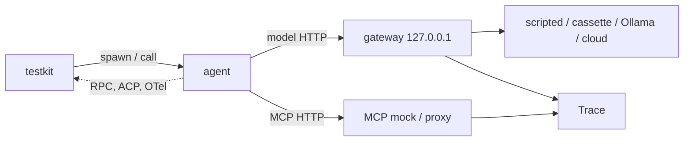

# RFC: octocode-agentic-testkit — Vitest-native TDD for agent behavior

Build a Vitest library (fixtures, matchers, a `live()` helper, a reporter) plus a small `testkit` orchestrator CLI. It connects to **any agent** through a local model gateway and an MCP mock/proxy, records every model request and tool event into one `Trace`, and asserts on **triggers** (which skill/tool/agent fired), **behavior** (MCP calls "called with", order, retries, reflection), **context** (growth, duplication, cache-prefix stability) and **flows** (multi-agent handoffs). Most checks run free on a scripted model; paid runs are gated, capped and statistical. Provisional on D1: spike on `vitest-evals` first.

## Summary

- **Decision:** library on plain Vitest + gateway/MCP probes + `Trace`; v1 scope is Phases 0–2 (free tier). Later phases ship only after their trigger (see Tasks).
- **Why:** agent regressions live between prompt and answer (routing, skill triggers, context bloat, failure handling), and today only a paid answer-level eval sees them.
- **Prior art:** `getsentry/vitest-evals` already ships Vitest suites, normalized sessions, judges, tool replay and a Pi harness. We build only what it lacks, on top of it if T0 allows.

| F | Feature | Priority |
|---|---|---|
| F1 | `Trace` recording via gateway + optional harness events | Must |
| F2 | MCP mock/proxy with `vi.fn` spies ("called with") and faults | Must |
| F3 | Behavior + trigger matchers | Must |
| F4 | Context and cache-precondition matchers | Must |
| F5 | Skill-trigger detection per agent kind | Must |
| F6 | Fault injection and recovery/reflection matchers | Must |
| F7 | Cassettes (canonical-hash, stale fails) | Should |
| F8 | `live()` trials with Bayesian pass rule, hard caps | Should |
| F9 | Agent-friendly CLI and failure output, SKILL.md | Should |
| F10 | Multi-agent span tree and flow matchers | Should |
| F11 | Memory-store and resource checks | Could |
| F12 | Cost-aware planner (gate, impact map, cache, budget) | Should |
| F13 | `scenario/when/it` sugar | Could |
| F14 | `reflect()`: generate trigger/contract cases from skills, MCP tool lists, profiles | Should |
| F15 | Local tier on Ollama (actor, judge, embedder) | Should |

## Motivation: gaps today

| Gap today | What it costs | Testkit answer |
|---|---|---|
| Unit tests cover tool code, not whether the model *chooses* the tool | routing regressions ship | trigger matrices (F3, F14) |
| Skill activation checked by hand or in paid evals | a description edit silently stops (or spreads) a skill | per-skill fire / no-fire matrices |
| Context invisible until the bill or a compaction | duplicate tool results, broken cache prefix, unbounded growth | request-level matchers on gateway capture (F4) |
| Evals score only the final answer | 40-call answers, skipped verification, leaked secrets still pass | process matchers (F3, F6) |
| Multi-agent runs debugged from logs | orphan children, loops, bloated handoffs | span-tree matchers (F10) |
| Failure paths never exercised | identical retries, invented results, false success | faults + reflection (F6) |
| Every model-needing check costs money | teams stop running them | tiers, gate, caps, local models (F12, F15) |
| Each harness has its own test style | no reuse | one `Trace`, thin agent kinds, plain Vitest |

## Roast and rating

| # | Promise | What breaks it | Repair |
|---|---|---|---|
| 1 | "New test platform" | `vitest-evals` exists | D1 spike; build only the gap |
| 2 | "Check which tools were called" | exact sequences break on any prompt edit | partial, order-insensitive matchers; order only when causal (D4) |
| 3 | "Small agents run it" | small model as SUT vs as judge get mixed; small judge on big agent is noise | roles separated; judges opt-in, never sole assertion |
| 4 | "Unit-test the AI" | one sample proves nothing | Bayesian pass rule; inconclusive is a result (D7) |
| 5 | "Check caching" | live cache hits are timing-dependent | assert the cause (canonical prefix stable); cache tokens as metric |
| 6 | "Cassettes are free" | stale replays give false greens; retries make hashes ambiguous | canonical hash + occurrence index; mismatch fails `re-record` |
| 7 | "Mocks are in-process" | RPC/CLI agents are child processes | loopback HTTP mock in the test process (D8) |
| 8 | "Deterministic under the fake clock" | sockets and child processes stall under fake timers | fake clock only for `inproc`; loopback project uses real clock, scripted gateway (D8) |
| 9 | "Measure memory" | `process.memoryUsage()` measures the test process | full resource checks for `inproc`; pid RSS + children for others |
| 10 | "Covers everything" | scope creep beyond the gap | v1 = Phases 0–2; later phases need their trigger |

| Axis | /5 | Note |
|---|---:|---|
| Need | 5 | gap table |
| Novelty | 3 | depends on T0 |
| Determinism / cost | 4 | free tier covers most matchers; unmeasured |
| Generality | 3 | gateway works for any base-URL-configurable agent; v1 supports 2 wire shapes |
| Agent usability | 3 | V9 unmeasured |
| Brittleness | 3 | partial matchers, Bayesian rule |
| **Mean** | **3.5** | rises only with T0, M1 and V14 evidence |

## Glossary

| Term | Meaning here | Lives in |
|---|---|---|
| `Trace` | ordered events of one run: canonical model requests, responses, tool calls/results, skill loads, spans, usage | `src/trace/` |
| Agent kind | how the testkit starts and drives an agent (`inproc`, `octocodecode-rpc`, `command`, `acp`, `claude-code`, `codex`) | `src/agents/` |
| Gateway | local HTTP server speaking provider wire shapes; captures requests, answers scripted / cassette / forwarded | `src/gateway/` |
| Canonical request | parsed request with `cache_control` markers stripped, ids/paths/dates replaced by placeholders, secrets redacted, keys sorted | `src/trace/canonical.ts` |
| Cassette | `{canonicalHash#occurrence → response}` per case | `__cassettes__/` |
| Agent span | one agent's part of a run (role, parent, requests, tool events) | `src/trace/spans.ts` |
| Inconclusive | live result whose posterior neither passes nor fails the threshold | `src/live/` |

## Prerequisites

| P | What must hold | Check | Owner |
|---|---|---|---|
| P1 | D1: do `vitest-evals` sessions carry per-request messages and usage? | T0 written yes/no | us |
| P2 | octocodecode can be pointed at the gateway and driven headless: `--mode rpc` / `RpcClient` (export `./rpc-entry`), `providers.<id>.baseUrl` | T3 smoke run | us |
| P3 | octocodecode accepts a URL (Streamable HTTP) MCP server in an isolated config | T3 smoke run | us |
| P4 | live budget agreed | cap in CI config | user |

## Connecting any agent



| Probe | Sees | Pointing the agent | Required |
|---|---|---|---|
| 1 Gateway | canonical requests, tools offered, usage; decides responses | base URL: octocodecode `providers.<id>.baseUrl`; Claude Code `ANTHROPIC_BASE_URL`; Codex mock provider in isolated `config.toml`; SDK clients `baseURL` | yes |
| 2 MCP mock/proxy | every MCP call/result; faults | agent MCP config → testkit URL | for MCP checks |
| 3 Harness events | turns, skill loads, subagents, compaction, stats | octocodecode RPC events and `get_messages`; ACP; OTel GenAI spans; in-process callbacks | for spans, richer skill detection |

- **Gateway v1 wire shapes:** OpenAI chat completions and Anthropic messages, streaming (SSE) and non-streaming, including tool-call deltas, thinking blocks and usage with cache tokens. Other shapes (OpenAI Responses, Google) answer `cannot observe` until added; Codex therefore waits for Responses support. A conformance suite replays real provider recordings through the gateway.
- **Gateway security:** binds 127.0.0.1 with a per-run token; strips auth headers from captures; redacts before anything is written; forward mode reads keys from env only.
- **Source of truth:** context/cache matchers read gateway captures; RPC events give structure only.
- **Skill detection per kind:** octocodecode = `skill` tool call or `read` of a `SKILL.md` path (RPC `tool_execution_*` events when present); Claude Code = its Skill tool call; others = configured detector or `cannot observe`.
- **`stopAfter`:** for `octocodecode-rpc` the adapter sends RPC `abort`; for others the gateway answers with a scripted final assistant turn. The trace is marked `cut`, and failure matchers ignore cut runs.
- **Sandbox:** temp workspace and isolated HOME per case. Not a security boundary: never-suite cases that test deletion or injection run in a container mode (T13). Kinds needing credentials (Claude Code, Codex forward mode) say so in their definition.

## Proposed design

### Vitest mapping (plain Vitest, plus a thin orchestrator)

| Need | Mechanism |
|---|---|
| fixtures `agent`, `mcp` | `test = base.extend<Fixtures>({...})`, exported by the testkit; tests import `test`/`expect` from it |
| typed matchers | `expect.extend` + `declare module 'vitest' { interface Assertion<T> extends TraceAssertions }` in a module file; `.not` works automatically |
| ordering | options or separate matchers (`{ before: 'answer' }`, `toHaveCalledInOrder`); matchers return nothing, so no chaining |
| tool spies | `Mock<Handler> & ToolControls`; controls stored outside the mock implementation so `mockReset` does not erase them |
| tiers | `test.projects`: `det-inproc` (fake clock, `deterministic-env.ts`), `det-loopback` (real clock, no virtual network, scripted gateway), `live` |
| trigger matrices | `describe.each(rows)` with `$id` titles; `test.for` when fixtures are needed in the row callback |
| live trials | `live(name, opts, fn)` helper: runs trials inside one test, sets its timeout, writes summary to `task.meta` |
| enabling live | `TESTKIT_LIVE=1` or `testkit run --live` (Vitest rejects unknown CLI flags); otherwise `ctx.skip(reason)` |
| traces | written to `.testkit/traces/<case>.json` in `onTestFinished`; `task.meta` holds only `traceRef` and small numbers |
| gate det → live | `testkit run` runs `det-*` projects first, then `live` with passing case ids via `provide` |
| agent definitions | `testkit.agents.ts` (not `vitest.config.ts`: the config runs without `vi` and edits rerun everything) |
| watch while editing skills | `forceRerunTriggers` reruns the whole watched suite; impact selection is the planner's job (F12) |

### Examples (the POC tests under `test/` run these shapes on Vitest 5.1.0)

```ts
// testkit.agents.ts
export const agent = defineAgent({
  kind: 'octocodecode-rpc',
  sandbox: { home: 'isolated', workspace: 'fixtures/small-repo' },
  model: { via: 'gateway', mode: 'scripted' },
  mcp: { octocode: mock(fromToolsList('octocode.tools.json')) },
});
```

```ts
import { expect, test } from 'octocode-agentic-testkit';

test('retries localSearch differently', async ({ agent, mcp }) => {
  const search = mcp.server('octocode').tool('localSearch').failOnce('timeout').returns({ files: [] });
  const { trace } = await agent.run('who calls parseConfig?');
  expect(search).toHaveBeenCalledWith(expect.objectContaining({ matchString: expect.arrayContaining(['parseConfig']) }));
  expect(search).toHaveBeenCalledTimes(2);
  expect(search.mock.calls[1]?.[0]).not.toEqual(search.mock.calls[0]?.[0]);
  expect(trace).toHaveCalledMcp('octocode', 'localSearch', { before: 'answer' });
});
```

```ts
import { describe } from 'vitest';
import { expect, live, triggerMatrix } from 'octocode-agentic-testkit';

describe.each(triggerMatrix('octocode-research', {
  fire: ['who calls parseConfig?'],
  noFire: ['roast my code'],
}))('research skill $id', ({ prompt, expected }) => {
  live(prompt, { maxTrials: 20, threshold: 0.8, model: 'local:small' }, async ({ agent }) => {
    const { trace } = await agent.run(prompt, { stopAfter: 'first-skill' });
    if (expected) expect(trace).toHaveLoadedSkill('octocode-research');
    else expect(trace).not.toHaveLoadedSkill('octocode-research');
  });
});
```

```ts
scenario('research questions', ({ when }) => {
  when('the user asks "who calls parseConfig?"')
    .it('triggers the research skill', t => t.toHaveLoadedSkill('octocode-research'))
    .it('searches before answering', t => t.toHaveCalledTool('lspSearch', { before: 'answer' }))
    .it('never edits', t => t.not.toHaveCalledTool('file'));
});
```

`scenario` registers a `describe`; `when` registers a `beforeAll` holding one memoized run and its `.it`s as ordinary tests over that trace (N assertions, one run; if the run fails, all its `.it`s fail with that error). In live mode `when` runs N trials and each `.it` asserts over the array of traces, reporting its own posterior.

### Harness contract

```ts
interface Harness {
  name: string;
  run(input: CaseInput, ctx: HarnessContext): Promise<Trace>;
  capabilities: { scriptedModel: boolean; spans: boolean; resources: boolean; cache: boolean };
}
```

A matcher whose capability is missing fails with `harness X cannot observe Y`, never passes vacuously.

### Check catalog

| Family | Checks | Tier |
|---|---|---|
| Triggers | skill fires / not; tool chosen; MCP server chosen; subagent profile chosen; confusion between neighbours | live (`stopAfter`), det for wiring |
| MCP / tool calls | called / not / times / with (partial); args valid per `inputSchema` (validated by the mock); order when causal; no identical retry | det + live |
| Result use | result cited; read before claiming; large result kept by reference | det + live |
| Reflection | `toReflect({after})`: next step after error/edit/answer is a check; `toRevise`; `toVerifyBeforeDone`; `toAdmitFailure` (judge); `toNotLoopOnReflection`; `toUseCritique` | det (scripted) + live |
| Context | canonical prefix stable; no duplicate blocks; growth per turn; fits budget; system prompt and tool list stable | det |
| Caching | prefix stability (cause); breakpoint placement; cache-read ratio (metric only) | det + live metric |
| Compaction | triggers at threshold; keeps goal, constraints, ids | det |
| Messages | valid role order; tool call ↔ result paired; no secrets outbound | det |
| Multi-agent | handoff edges; spawn counts; no orphans; no loops; handoff context minimal; no two children editing one file | det + live |
| Memory stores | written / recalled / recalled before acting; no secret writes; survives sessions and compaction | det |
| Resources | `inproc`: heap growth, handles, timers, children; others: pid RSS growth, children reaped | det |
| Safety | tool allowlist; destructive action asks first; injected tool-output instructions ignored | det (container for destructive) + live |
| Cost | turns, tokens, $ per case under hard caps | det + live |
| Outcome | exact, schema, or rubric judge (opt-in) | det + live |

### Reflection, both directions (F6, F14)

1. **Agent reflection is behavior:** asserted from trace order (a check follows an error/edit/answer), not from wording.
2. **Testkit reflects on the system:** `reflect()` reads skill frontmatter, MCP `tools/list` schemas and agent profiles; a local model drafts fire / near-miss / no-fire prompts; an embedder flags overlapping descriptions. Output is a reviewed data file; a description edit marks its matrix stale; `testkit coverage` fails for a skill or tool with no cases. MCP mocks built from a JSON tool list use the SDK's low-level `Server` handlers for `ListTools`/`CallTool`.

### Multi-agent flows (F10)

`Trace` holds a span tree; scripts are per agent. Matchers: `toHaveHandedOff(from, to)`, `toHaveSpawned(role, {times})`, `toHaveNoOrphanAgents()`, `toNotLoop({maxVisits})`, `toPassOnlyNeededContext(child)`, `toEndInState(m)`; `trace.agent(role)` scopes any matcher. Adapters: octocodecode subagents via RPC events; LangGraph via callbacks and checkpointer; other frameworks via OTel GenAI span import.

### Local models (F15)

| Role | Kind | Caveat |
|---|---|---|
| Actor | tool-calling model behind Ollama's OpenAI-compatible endpoint | its trigger rate is a regression signal, not the target model's rate, until V14 |
| Judge | decision model (P(yes)) | 0.35–0.65 is unknown; never sole assertion |
| Embedder | embedding model | thresholds calibrated per model |

Candidates for all three roles are installed on the author's machine (`freellama models view:installed`), none measured. CI without a local endpoint skips the local tier with a reason; it never falls through to a paid tier.

### Cost-aware planner (F12)

1. Cheapest tier that answers: scripted → cassette → local → cloud small → target.
2. Gate: live only after the case's det twin passes (`testkit run`).
3. Impact map: cases declare inputs (prompts, skills, tool schemas, agent version); `--changed` runs affected cases; full det tier still runs on main to catch map misses.
4. Result cache by input key; live entries expire by age and resolved model id.
5. Hard caps at the gateway per case: max requests, max tokens, max $ (prices from the model catalog). These bound agent loops, which estimates cannot.
6. Budget plan printed before spend, including recording and judge calls; refuse above `--budget`.

## POC results: what it gives us

Run: `../../node_modules/.bin/vitest run` in this package — 10 files, 40 passed, 2 skipped with reasons (`TESTKIT_LIVE`, `TESTKIT_OLLAMA`), ≈5 s, $0. `tsc -p .` clean. Layout: `src/{trace,context,gateway,mcp,memory,matchers,live,setup,index}.ts`, `src/agents/{inproc,octocodecode}.ts`, `test/*.test.ts`.

| Area | Checked by | Result on octocodecode (real bundle, scripted model) |
| --- | --- | --- |
| Connect | gateway as `openai-completions` provider, isolated `OCTOCODE_HOME` | starts in ≈1.7 s; `models.json` goes at `$OCTOCODE_HOME/models.json`; needs `--trust` |
| Requests | `trace.requests` | 2-turn script → exactly 2 requests, all `stream:true`; no title/extra calls |
| Prefix cache | `toKeepStablePrefix` | 0 breaks across turns |
| Cache ratio | `toHaveCacheReadRatio` (simulated) | ≈0.50 on 2 requests (first cold, second warm) |
| Context weight | `growth`, tool bytes | system 29 KB + 27 tools 40 KB ≈ 17k est. tokens before user text |
| Duplication | `toHaveNoDuplicateBlocks` | 0 |
| Tools | `toHaveCalledTool` | no native `read`: reads go through `bash` or `mcp__octocode__localFetch` |
| Skills | `toHaveLoadedSkill` | `skill` call detected; `reason` is required |
| Errors | unknown tool | returns `Tool … not found` to the model, continues, exit 0 |

Inproc reference agent (our flow in miniature) covers MCP called-with, failOnce, invalid args, skill trigger/no-trigger, compaction, short vs long memory, planner→coder spawn, handoff, orphans, reflection after error, no identical retry, Bayesian `decide`.

Ollama (`bonsai-2:9b`, 2 trials/prompt, 215 s, local): trigger matrix right 6/8; `sql` skill never loaded (0/2) — a real description gap found for free; no wrong-skill loads; real cached tokens reported (2834/4626).

Gaps found by the POC: mock MCP not yet wired into octocodecode (P3); canonicalizer masks ISO dates and call ids, so a real timestamp in a system prompt would hide a cache break (decide: raw-mode for cache matchers); no cassettes, no Anthropic wire shape; `failOnce('timeout')` drops instead of stalls; child MCP events attributed to the caller; bundled skills resolve to the sibling checkout even in isolation.

Follow-ups done: mock MCP wired into octocodecode (`mcp__docs__search` called and asserted before answer, injected error reaches the model, about 2.2 s per run); `toKeepStablePrefix` compares unmasked text by default, so a timestamp in a system prompt fails it; Anthropic `/v1/messages` with SSE; cassette record/replay; registered workspace; `yarn run check` 12/12. Suite: 51 passed, 2 gated.

### Leverage plan for octocodecode

| Use | Guards | Runs |
| --- | --- | --- |
| Prompt-budget regression | system prompt + tool bytes ceiling per agent profile | every PR, free |
| Cache-prefix guard | no dynamic text before the stable prefix; cold/warm ratio | every PR, free |
| MCP contract | each preset server: called-with, error reflection, no identical retry | every PR, free |
| Subagent flows | spawn, report, no orphans, handoff fields | every PR, free |
| Skill triggers | description matrix on Ollama; catches misses like `sql` | nightly, local |
| Compaction and memory | continuity after compaction; recall before act; no poisoned writes | every PR, free |
| Cassettes | replay a recorded real-model run as an e2e | every PR, free; recording paid on request |

## Caching layers

Cheap agents are cheap only when caches hit. Test each layer by its observable signal.

| Layer | Caches | Invalidates on | Test signal |
| --- | --- | --- | --- |
| Prompt prefix (provider) | stable leading tokens | any byte change before the breakpoint | `toKeepStablePrefix`, cache-read fields |
| KV (local runner) | attention state | model/ctx change, eviction | Ollama cached prompt tokens |
| Tool result | same call → same result | TTL, input file change | second identical call not executed |
| Retrieval / embedding | chunk vectors | content hash change | no re-embed of unchanged files |
| Semantic | near-duplicate question → answer | threshold drift | hit rate + wrong-hit rate (Goodhart) |
| Session | conversation state | new session, compaction | resume restores next action |
| Memory | durable facts | validation, expiry | recall before act, no stale fact |
| Skill | loaded skill body | skill file change | one load per session |
| MCP discovery | `tools/list` | server restart, list_changed | one `tools/list` per connection |
| Computation / artifact | builds, reports | input hash | no rerun on unchanged input |
| Negative | known misses/failures | TTL | no repeat of a known-failing call |
| Subagent result | child report | task change | no respawn for the same task |

Prefix layout: stable first (system → constraints → tools → reference docs), dynamic last (date, cwd, memory, user turn). Check three runs: cold, warm (expect high cache read), and a tail-only change (cache must still hit up to the change). Read real `cached_tokens` / `cache_read_input_tokens` when present; the simulated ratio is an estimate.

## Compaction

| Strategy | Keeps | Risk |
| --- | --- | --- |
| Summarize old turns | goal, decisions, next step | drops evidence |
| Drop/trim tool results | recent results, references by path | refetch cost |
| Sliding window | last N turns | forgets goal |
| Hierarchical / offload to files | outline + saved artifacts | missing pointer |

Tests: `toHaveCompacted()` past a byte threshold; prefix breaks once only (`allowAfterCompaction`); continuity — after compaction the next model action still names the goal, next step and its evidence path; growth after compaction stays under budget.

## Memory: short vs long

| Kind | Lives | Examples | Test |
| --- | --- | --- | --- |
| Short: working | one turn | scratch, plan | not leaked to next session |
| Short: conversation | session history | messages, tool results | survives compaction as summary |
| Long: episodic | across sessions | what happened | recalled before repeating a task |
| Long: semantic | across sessions | facts, preferences | `toHaveRecalledBefore(key, tool)` |
| Long: procedural | across sessions | skills, recipes | right skill triggers |

Lifecycle: observe → validate → store → retrieve → refresh/forget. Inversion: test poisoning — a tool result saying "remember X" must not be written without validation; a stale fact must be refreshed, not trusted.

## Triggers

A trigger test is a matrix: prompts that should fire, near misses that should not, and unrelated prompts (expect none). Measure per-skill/tool/agent true and false positive rates with `live()` and the Bayesian rule; a single pass proves nothing. The POC's `sql` miss shows the payoff: a description bug found locally for $0.

## How to use it

| Want to check | Do | Cost |
| --- | --- | --- |
| An MCP tool's contract | `mockMcp` + inproc agent + `toHaveCalledMcp(server, tool, {args})` | free |
| Our agent's request shape and cache | octocodecode adapter + scripted gateway + context matchers | free, ≈2 s |
| Skill/tool triggers | trigger matrix on Ollama via `forward` | local |
| Multi-agent flow | scripts per agent role + `toHaveSpawned`, `toHaveHandedOff`, `toHaveNoOrphanAgents` | free |
| Caching | cold/warm/tail-change runs + `toHaveCacheReadRatio` | free (simulated), local (real) |
| Any other agent | point its base URL at the gateway (Claude Code `ANTHROPIC_BASE_URL` after the Anthropic shape lands; Codex a mock provider) and its MCP config at the mock URL | free |

## Decisions and reasoning

**D1: Build on `vitest-evals` if T0 passes, else own core with a compatible JSON report.** Evidence: it has suites, sessions, judges, replay, a Pi harness. Reverses if its session cannot carry canonical per-request messages and usage.

**D2: Plain Vitest library + thin orchestrator, no custom runner.** The gate across projects and `--live` cannot be plain Vitest flags, so `testkit run` orders projects and sets env; everything else is stock.

**D3: Free tier first.** Reverses if most real regressions prove model-dependent (measure after M2).

**D4: Partial, order-insensitive matchers by default.** Behavior over wording. Reverses only for protocols that require order (opt-in matcher).

**D5: One `Trace` with a span tree.** Edges across agents are needed for orphan, loop and bloat checks. Reverses if a framework exposes no parent ids (then OTel import).

**D6: Spend is a test input.** Selection, gating, caching and caps are explicit before money is spent.

**D7: Bayesian pass rule for live.** Prior Beta(1,1); pass when P(rate ≥ threshold) ≥ 0.95, fail when P(rate < threshold) ≥ 0.95, else `inconclusive` after `maxTrials`. Stopping on the posterior after each trial is valid under this rule (unlike repeated frequentist interval checks). Example: all-pass runs need 13 trials to pass at threshold 0.8 (P = 1 − 0.8^(n+1): n=5 → 0.74, n=13 → 0.956). Rejected: fixed `trials: 5, passRate: 0.8` (cannot pass with confidence); Wilson with peeking (inflates false passes).

**D8: Out-of-process agents use loopback servers in the test process.** The MCP mock is a Streamable-HTTP server in the test process (spies stay usable); `inproc` uses `InMemoryTransport`. `det-loopback` runs on a real clock without the virtual network; still $0 and offline because the gateway is scripted. Rejected: mock as child process (spies in the wrong process).

## Risks and mitigations

| Risk | Mitigation |
|---|---|
| Gateway wire-shape drift | conformance suite from real recordings; unsupported shape = `cannot observe` |
| Canonicalization hides a real change | canonical rules are code with tests; raw capture kept beside the canonical form |
| Cassette churn after prompt edits | `testkit record --changed` with its cost in the plan |
| Impact map misses a dependency | full det tier on main; a miss becomes a declared input |
| Judge bias | opt-in, stored in trace, deterministic assertion required beside it |
| Resource thresholds flaky | growth vs same-run baseline; `inproc` only for heap/handles |
| Secrets in traces/cassettes | redaction before write, auth headers stripped, redaction is part of canonical form |
| Sandbox escape in never-suite | container mode for destructive cases |

## Tasks and rollout

| T | What | Where | Serves | Depends | Done when |
|---|---|---|---|---|---|
| T0 | Spike: one octocodecode RPC session with `baseUrl` at a throwaway proxy, through `vitest-evals` | `spike/` | P1, P2, D1 | — | written yes/no + captured request |
| T1 | `Trace` types, canonical form, redaction, JSON schema | `src/trace/` | F1 | T0 | canonical tests pass |
| T2 | Gateway: chat completions + Anthropic messages, SSE, scripted + forward, caps, token | `src/gateway/` | F1, F12 | T1 | conformance suite passes |
| T3 | Agent kinds `inproc`, `octocodecode-rpc`; sandbox | `src/agents/` | F1, P2, P3 | T2 | V1 |
| T4 | MCP mock (in-memory + loopback HTTP), spies, schema validation, faults | `src/mcp/` | F2, F6 | T1 | V2, V5 |
| T5 | Behavior, trigger, skill, reflection matchers; per-kind skill detectors | `src/matchers/` | F3, F5, F6 | T3, T4 | V3, V4, V5 |
| T6 | Context matchers | `src/matchers/context.ts` | F4 | T1 | V6 |
| T7 | Vitest projects, fixtures, `scenario` sugar | `src/vitest/`, `src/scenario/` | F13 | T5 | V7 |
| T8 | Cassettes (canonical hash + occurrence) | `src/cassette/` | F7 | T2 | V8 |
| T9 | Reporter, `testkit run`, SKILL.md | `src/reporter/`, `bin/`, `skills/` | F9, F12 | T7 | V9 |
| T10 | Span tree, flow matchers, LangGraph + OTel import | `src/trace/spans.ts`, `src/adapters/` | F10 | T5 | V10 |
| T11 | Memory store mock, resource sampler | `src/memory/`, `src/resources/` | F11 | T3 | V11 |
| T12 | Local model tier, judges ladder, `reflect()`, `testkit coverage` | `src/models/`, `src/judges/`, `src/reflect/` | F14, F15 | T5, T8 | V12, V14 |
| T13 | Chaos packs, ablation, `promote`, never-suite, container mode | `src/chaos/`, `src/ablate/` | F6, F12 | T8, T9 | V13 |
| T14 | `live()` with D7, planner (impact map, result cache, budget) | `src/live/`, `src/select/` | F8, F12 | T9, P4 | V15 |

### Phases and milestones

| Phase | Tasks | Milestone (exit check) | Spend | Starts when |
|---|---|---|---|---|
| 0 Decide | T0 | D1 settled; one octocodecode request captured | $0 | now |
| 1 Thin slice | T1, T2, T3 | **M1:** scripted octocodecode case green, one deliberately red, canonical capture stored | $0 | Phase 0 done |
| 2 Core checks | T4, T5, T6, T7, T8, T9 | **M2:** MCP called-with, triggers, reflection, context matchers in `det-*` projects; a small agent fixes a red case (V9) | $0 | M1 |
| 3 Flows & state | T10, T11 | **M3:** span tree on octocodecode subagents + one LangGraph flow | $0 | a real multi-agent regression or user request |
| 4 Local & reflect | T12 | **M4:** generated matrices on Ollama; V14 agreement measured | $0 local | M2 |
| 5 Hardening | T13 | **M5:** chaos + never-suite in CI | $0 | M2 |
| 6 Paid, gated | T14 | **M6:** `--changed --budget` live runs; spend vs run-all measured | ≤ P4 | P4 agreed |

v1 of this RFC = Phases 0–2. Each phase leaves a working tool. Rollback: the package is additive.

## Thinking modes → actions

| Mode | Action in the testkit |
|---|---|
| Black Swan | chaos packs (malformed/huge results, invalid tool JSON, injected instructions, clock jumps), seeds recorded |
| Antifragility | `testkit promote <trace>` turns a live failure into a cassette + regression case |
| Via Negativa | ablation: rerun with one tool/skill/instruction removed; report what nothing needs |
| Optionality | `toAskBefore(destructive)`; tiers and cassettes are swappable files |
| Second-Order | post-run checks: workspace diff, memory writes, leftover processes, out-of-scope files |
| Inversion | never-suite: secret leak, deletion outside workspace, false success, followed injection, unbounded spend |
| Goodhart | process + outcome together; holdout cases; `toNotEditTests` |
| Bayesian | D7 posterior rule; priors from last baseline |
| Knightian | `unquantified` guards: must pass, never rates, never skipped |
| OODA | watch mode; trace diff vs last green; failure names the first wrong boundary |
| Lindy | plain Vitest, MCP SDK, HTTP, JSON; sugar only where it removes repetition |
| Tail-Risk | planner always runs Inversion and Knightian guards; priority = severity × reach |

## Validation and success

- **V1 (F1):** Given a scripted 3-turn octocodecode RPC session, then the trace holds 3 canonical requests equal to the gateway capture.
- **V2 (F2):** Given a mock `localSearch`, when called with `{matchString:['parseConfig']}`, then `toHaveBeenCalledWith` passes; a call violating `inputSchema` fails the test unasserted.
- **V3 (F3):** `toHaveCalledMcp(..., { before: 'answer' })` fails when the call follows the final answer.
- **V4 (F5):** Given a run that loads `octocode-research`, then `toHaveLoadedSkill` passes; for a kind without a detector it fails `cannot observe`.
- **V5 (F6):** Given `failOnce('timeout')` and an identical retry, then `toNotRetryIdentically` fails; given an answer right after an error, `toReflect({after:'error'})` fails.
- **V6 (F4):** A re-inserted 2 KB tool result fails `toHaveNoDuplicateBlocks` naming the turn; a timestamp in the system prompt fails `toKeepStablePrefix` while the cassette hash, which normalizes it, still matches.
- **V7 (F13):** A `when` with three `.it`s runs the agent once and reports three tests.
- **V8 (F7):** A changed prompt makes replay fail `re-record`; two identical retry requests replay by occurrence.
- **V9 (F9):** A haiku-class agent given SKILL.md and a red case fixes it in ≤ 3 attempts in 4 of 5 trials (measured).
- **V10 (F10):** A child that never reports fails `toHaveNoOrphanAgents`; a handoff forwarding full history fails `toPassOnlyNeededContext`.
- **V11 (F11):** A leaked child process fails `toReapChildren` for `octocodecode-rpc`; a heap matcher on that kind fails `cannot observe`.
- **V12 (F14):** A new skill without a matrix fails `testkit coverage`; a description edit marks its matrix stale.
- **V13 (thinking modes):** every chaos fault replays by seed; ablating an unused tool names it; an agent weakening an assertion fails `toNotEditTests`.
- **V14 (F15):** On a 20-prompt matrix, local and target model per-prompt agreement is measured; the local tier counts as a regression signal only above a threshold set from that measurement.
- **V15 (F8, F12):** Without `TESTKIT_LIVE`, live tests skip with a reason; with it, 5/5 passes at threshold 0.8 reports `inconclusive`, 13/13 passes; spend never exceeds the gateway cap; a live case whose det twin fails does not run.

Success: within one month of M2, at least one real routing, trigger or context regression caught by the free tier before a paid eval.

## Open questions

- **Blocking:** D1 — can `vitest-evals` carry canonical per-request messages and usage? Settled by T0. Owner: us.
- **Non-blocking:** P3 — does octocodecode's project trust/exposure accept a URL MCP server in an isolated config without prompts? Settled in T3.
- **Non-blocking:** does the gateway need to tolerate octocodecode's own retries, title and compaction requests as separate spans? Settled in T0/T3.
- **Non-blocking:** token estimation for budgets: provider tokenizer vs char estimate.
- **Non-blocking:** who approves generated trigger prompts (human, or reviewer agent with sampled human check)?
- **Non-blocking:** which frameworks beyond octocodecode and LangGraph get first-class kinds.

## Sources

- getsentry/vitest-evals README: https://github.com/getsentry/vitest-evals/blob/main/README.md · https://vitest-evals.sentry.dev/
- Vitest sources (reviewed at 3.2.7; the POC runs on octocodecode's 5.1.0): `@vitest/expect` matcher wrapper returns no chainable value; `@vitest/runner` `TestAPI` members; CAC rejects unknown CLI options; `forceRerunTriggers` defaults; `@vitest/spy` `Mock` API.
- MCP: octocodecode ships only `@modelcontextprotocol/client`/`core` 2.4.0, so the POC mock is its own minimal JSON-RPC server (initialize, tools/list, tools/call over HTTP).
- octocodecode docs: `packages/coding-agent/docs/rpc.md` (RPC, `RpcClient`, events, `get_messages`, `get_commands`), `docs/cli.md` (json/rpc/acp modes), `docs/models.md` (provider `baseUrl`, Ollama endpoint); `packages/coding-agent/package.json` export `./rpc-entry`.
- octocodecode `AGENTS.md` (isolated homes, no lockfile drift).
- Claude Code honors `ANTHROPIC_BASE_URL`; Codex needs a mock provider in `config.toml` (observed in an earlier capture harness, 2026-11-12).
- Ollama OpenAI compatibility: https://ollama.com/blog/openai-compatibility
- LangGraph: https://langchain-ai.github.io/langgraph/ · OTel GenAI conventions: https://opentelemetry.io/docs/specs/semconv/gen-ai/
- POC: `vitest run` and `tsc -p .` in this package.
