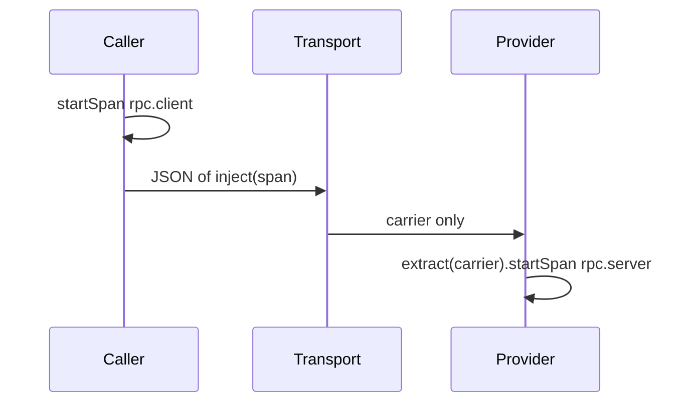

# @octocodeai/octocode-telemetry

Vendor-neutral telemetry contracts and typed schema utilities. The host chooses what to collect and export (see [configuration](../coding-agent/docs/configuration.md) and [environment variables](../coding-agent/docs/environment-variables.md)). The package has no exporter, no global current-span state and no backend dependency; code passes a context explicitly.

| Page                         | Covers                                                                        |
| ---------------------------- | ----------------------------------------------------------------------------- |
| [Adapters](docs/adapters.md) | Adapter contract, no-op and in-memory contexts, stored telemetry, conformance |
| [Schemas](docs/schemas.md)   | Typed spans, start and end attributes, schema metadata, typed metrics         |

```bash
npm install @octocodeai/octocode-telemetry
```

## Concepts

| Concept      | Meaning                                                                 |
| ------------ | ----------------------------------------------------------------------- |
| Span         | Timed record of one operation; ends when the callback settles           |
| Parent/child | Spans started from a span nest into a tree                              |
| Attribute    | Named fact on a span (`provider: "openai"`)                             |
| Event        | Named, durationless occurrence during a span, with optional attributes  |
| Status       | `ok` or `error` (with optional name and message)                        |
| Context      | Handle that says where new work belongs; starting from it makes a child |

Telemetry is diagnostics, not state. An adapter maps these concepts to OpenTelemetry, Sentry, logs or another backend.

## Core API

`TelemetryContext.startSpan(options, callback)` runs the callback inside a span; the callback's `TelemetrySpan` is the explicit parent for child spans. Hosts keep the adapter; invocation contexts and `octocode-ai` request options carry a `TelemetrySpan`, never the adapter. A context may expose `metrics` and `propagation`; children and extracted parents share them. An adapter implementing only `startSpan()` is valid.

```typescript
import { NOOP_TELEMETRY_CONTEXT, type TelemetryContext } from "@octocodeai/octocode-telemetry";

async function loadAccount(id: string, telemetry: TelemetryContext = NOOP_TELEMETRY_CONTEXT) {
	return telemetry.startSpan(
		{ name: "example.account.load", attributes: { "example.account.id": id } },
		async (span) => {
			span.addEvent("example.cache.lookup", { "example.cache.hit": false });
			const account = await readAccount(id);
			span.setAttributes({ "example.account.found": account !== undefined });
			return account;
		},
	);
}
```

There is no `end()`: the span stays open until the callback's value or promise settles. A thrown error or rejection is an `error` status; for an expected failure returned as a value, call `span.setStatus({ status: "error", error: { name, message } })`.

## Propagation and links

An adapter may implement `TelemetryPropagation` (`context.propagation`): `inject(context)` returns a `TelemetryCarrier` (an opaque JSON-safe `Record<string, string>`) or `undefined`; `extract(carrier)` returns a receiver-owned parent context.



```typescript
// caller and provider: InMemoryTelemetryContext instances
await caller.startSpan({ name: "rpc.client" }, async (span) => {
	const wire = JSON.stringify(caller.inject(span));
	await provider.extract(JSON.parse(wire)).startSpan({ name: "rpc.server" }, (s) => handle(s));
});
```

- Send only the carrier, never a context or span. Format is the adapter's (W3C `traceparent` fits). Both methods are synchronous.
- `inject` returns `undefined` for roots, no-op and unsupported contexts. Absent or unknown carriers extract to the adapter's root. Extraction checks only that required keys hold strings. Trace metadata is diagnostics, never authorization; transports own size limits.
- A link relates work without changing its parent: `SpanOptions.links` at creation or `span.addLink({ context, attributes })` later. Targets are any `TelemetryContext` (a span or extracted remote parent). Settled targets stay linkable; a settled source ignores `addLink()`. The typed starter's callback supports `addLink()`; initial links need the low-level `startSpan()`.
- `NOOP_TELEMETRY_PROPAGATION` returns `undefined` on inject and `NOOP_TELEMETRY_CONTEXT` on extract.

## Metrics

An adapter may implement `TelemetryMetrics` (`context.metrics`); applications configure one adapter for all capabilities, and child spans keep it.

```typescript
const metrics = telemetry.metrics; // TelemetryMetrics | undefined (InMemoryTelemetryContext also has the factories directly)
const bytes = metrics.counter("network.bytes", { description: "Encoded bytes", unit: "By" });
bytes.add(size, { direction: "out" });
metrics.upDownCounter("calls.active").add(1);
metrics.histogram("call.duration", { unit: "ms", boundaries: [1, 10, 100, 1000] }).record(ms, { method: "read" }, span);
```

| Instrument      | Method                                 | Notes                                                                                    |
| --------------- | -------------------------------------- | ---------------------------------------------------------------------------------------- |
| `counter`       | `add(value, attributes?)`              | Non-negative increments                                                                  |
| `upDownCounter` | `add(value, attributes?)`              | Signed                                                                                   |
| `histogram`     | `record(value, attributes?, context?)` | Signed; `context` correlates an exemplar; `boundaries` finite, strictly increasing hints |

Factories and recording are synchronous and trust typed inputs (malformed input is unspecified). `NOOP_TELEMETRY_METRICS` discards everything. Use low-cardinality attributes (direction, method), never request or user ids, prompts or paths, and record only values business code already has. Typed metrics: [schemas](docs/schemas.md#typed-metrics).

## Exports

| Group       | Exports                                                                                                                                                                                                                                                                                                |
| ----------- | ------------------------------------------------------------------------------------------------------------------------------------------------------------------------------------------------------------------------------------------------------------------------------------------------------ |
| Core        | `TelemetryContext`, `TelemetrySpan`, `SpanOptions`, `SpanLink`, `SpanAttributes`, `AttributeValue`, `SpanStatus`, `NOOP_TELEMETRY_CONTEXT`                                                                                                                                                             |
| Propagation | `TelemetryCarrier`, `TelemetryPropagation`, `NOOP_TELEMETRY_PROPAGATION`                                                                                                                                                                                                                               |
| Metrics     | `TelemetryMetrics`, `TelemetryCounter`, `TelemetryUpDownCounter`, `TelemetryHistogram`, `InstrumentOptions`, `HistogramOptions`, `NOOP_TELEMETRY_METRICS`                                                                                                                                              |
| Store       | `TelemetryStore`, `StoredSpan`, `StoredTrace`, `TraceQuery`, `MetricQuery`, `StoredMetric`                                                                                                                                                                                                             |
| In-memory   | `InMemoryTelemetryContext`, `RecordedTelemetrySpan`, `RecordedTelemetryEvent`, `RecordedTelemetryLink`, `RecordedTelemetryMeasurement`                                                                                                                                                                 |
| Schemas     | `defineTelemetrySchema`, `createTypedSpanStarter`, `createTypedMetrics`, `TypedSpanStarter`, `TypedTelemetryMetrics`, `SchemaTelemetrySpan`, `SchemaTelemetryCounter`, `SchemaTelemetryHistogram`, `Telemetry*Definition` and `TelemetrySchema*` types, `Infer*Attributes`, `ExactTelemetryAttributes` |
| `/render`   | `renderTrace(spans)`                                                                                                                                                                                                                                                                                   |
| `/testing`  | `createTelemetryAdapterConformance`, `TelemetryAdapterFixture`, `TelemetryAdapterFixtureFactory`, `TelemetryAdapterConformanceCase`                                                                                                                                                                    |

## Package integration

`@octocodeai/octocode-ai` is the only workspace package that uses this one: provider request options take a parent `TelemetrySpan` as `telemetry`, and `AI_TELEMETRY_SCHEMA` is exported from its root and `./models` entry points. Its span names keep the upstream `pi.ai.*` prefix; adapters may translate them without changing the emitted vocabulary.

## Security and portability

- Do not persist a context, span or backend-native trace object in records, messages, snapshots or deferred handles. A carrier may cross a transport or be stored as optional correlation data.
- Attributes are scalars and arrays. Avoid prompts, completions, tool arguments or output, file contents, provider payloads, headers, credentials and free-form errors unless a schema and data policy allow them.
- No `AsyncLocalStorage` or ambient context, so it suits Node.js, Bun, browsers and workers; adapters own their runtime compatibility.

## Development

```bash
yarn test && yarn run build   # packages/telemetry
yarn run check                # repository root
```

MIT licensed.
