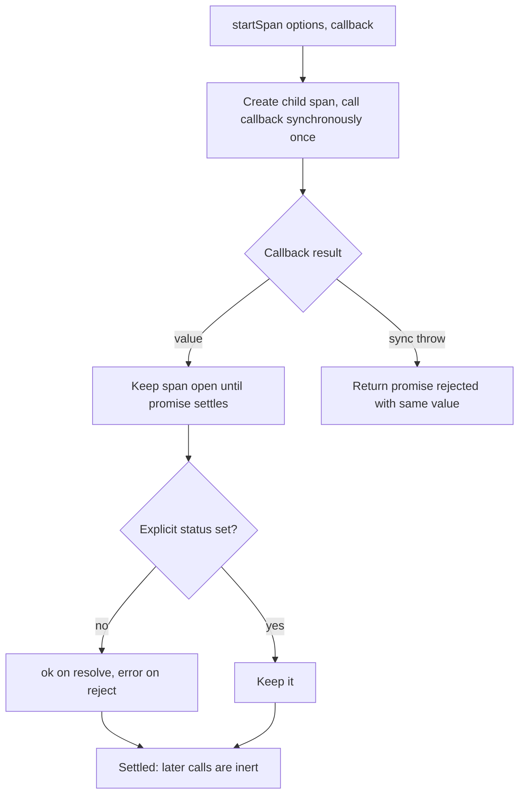

# Adapters

Part of the [`@octocodeai/octocode-telemetry` guide](../README.md). An adapter bridges the [core context API](../README.md#core-api) to a backend.

## Adapter contract

An adapter implements `TelemetryContext`. Typed inputs are trusted; malformed input is unspecified, and adapters need not validate it or suppress backend failures.



- Expose optional `metrics` and `propagation` on contexts, child spans, extracted parents and inert fallback spans.
- Preserve the callback's return value and rejection value.
- `setStatus()` is last-write-wins; `setAttributes()` merges (later defined values win, `undefined` ignored).
- Recording methods are synchronous.
- Adapters may activate backend-native ambient context internally, but Octocode code always passes the parent explicitly. Buffering, flushing, sampling and backend ids belong to the adapter.

Check these semantics with the [conformance suite](#conformance-suite).

## No-op context

`NOOP_TELEMETRY_CONTEXT` is for optional telemetry: it calls callbacks synchronously, preserves values and rejections (a sync throw becomes a rejected promise), uses one shared frozen inert span even for nested spans, exposes `NOOP_TELEMETRY_METRICS` and `NOOP_TELEMETRY_PROPAGATION`, and retains nothing.

## In-memory reference adapter

`InMemoryTelemetryContext` records process-locally, for tests, local diagnostics or capture without an exporter. Storage is unbounded; make a fresh instance per test or scope, and do not record sensitive attributes unless the data policy allows it.

```typescript
const telemetry = new InMemoryTelemetryContext();
await telemetry.startSpan({ name: "example.operation" }, async (span) => span.addEvent("example.started"));
console.log(telemetry.getSpans(), telemetry.getMetrics());
```

| Read           | Returns                                                                                                                                                                                                                                                                                              |
| -------------- | ---------------------------------------------------------------------------------------------------------------------------------------------------------------------------------------------------------------------------------------------------------------------------------------------------- |
| `getSpans()`   | Detached `RecordedTelemetrySpan` snapshots in start order: numeric id, `parentId`, carrier-shaped `context` and `parentContext`, `links`, attributes, events, status, settled state, end sequence. No timestamps. A remote parent has `parentId: null` but a `parentContext`; a root has both `null` |
| `getMetrics()` | Ordered `RecordedTelemetryMeasurement`: `kind`, `name`, optional `description`/`unit`/`boundaries`, `value`, `attributes`, exemplar `context` or `null`. A log, not aggregates                                                                                                                       |

It implements propagation with its own carrier: a recorder scope, a numeric span id and an inherited trace id. It survives JSON round trips across processes; its keys are not a public wire format.

## Stored telemetry

`TelemetryStore` (implemented by `InMemoryTelemetryContext`) separates querying from recording.

| Method                                                     | Behavior                                                                                                                                                                                                                                                              |
| ---------------------------------------------------------- | --------------------------------------------------------------------------------------------------------------------------------------------------------------------------------------------------------------------------------------------------------------------- |
| `findTraces(query?)`                                       | Complete stored traces, newest start first (ties by trace id). Filters: earliest span `name`, inclusive `startMin`/`startMax`, `errors: true`, scalar `attributes` (all must match one span). 20 per page; pass the opaque `cursor` with the same filters to continue |
| `getTrace(traceId)`                                        | A trace or `undefined`                                                                                                                                                                                                                                                |
| `findMetrics({ name, startMin?, startMax?, attributes? })` | Rows with count, sum, min, max over inclusive interval starts. The in-memory adapter maps each measurement to a count-one row in its ten-second interval                                                                                                              |

Only settled spans are returned. A trace id is the root's span id (`<recorder UUID>:<counter>`) and propagates with the parent. Stores return what exists locally: remote or expired parents may be missing and a child can appear before its parent settles. Pages are not snapshots. `StoredSpan` has epoch-ms `startedMs`/`endedMs`, event `timeMs` offsets and links with target `traceId` and `spanId`. Durations use a monotonic clock, so wall clocks across processes can disagree: merge stores by trace id and build the tree from parent links, not timestamps.

`renderTrace(spans)` from `@octocodeai/octocode-telemetry/render` (kept out of the root entry) prints attributes, durations, statuses, event offsets and cross-trace links; it dedupes ids, treats absent parents as roots and never follows links.

```typescript
const page = await telemetry.findTraces({ errors: true, limit: 10 });
for (const trace of page.traces) console.log(renderTrace(trace.spans));
```

## Conformance suite

`@octocodeai/octocode-telemetry/testing` returns runner-independent cases. A fixture supplies a fresh `context` and `getSpans()` that normalizes the backend's finished spans (it may flush an async exporter first); optional `propagation` adds JSON round-trip, multi-hop and root-fallback checks, optional `metrics` with `getMetrics()` adds ordered-measurement, exemplar and input-copy checks.

```typescript
const cases = createTelemetryAdapterConformance(async () => {
	const adapter = createMyAdapter();
	return {
		context: adapter.context,
		getSpans: async () => adapter.normalizedSpans(),
		async [Symbol.asyncDispose]() {
			await adapter.close();
		},
	} satisfies TelemetryAdapterFixture;
});
for (const testCase of cases) it(`${testCase.group}: ${testCase.name}`, () => testCase.run());
```

Cases cover capability identity (roots, children, extracted parents, inert spans), synchronous single admission, result and rejection identity, automatic and explicit status, attribute merging, event order, inert post-settlement calls, nested and concurrent parentage, and links. They do not test malformed input. The subpath uses Node's assertion APIs; the root package stays runtime-neutral.
