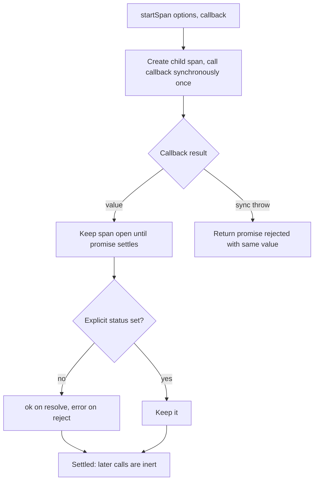

# Adapters

Part of the [`@octocodeai/octocode-telemetry` guide](../README.md). An adapter bridges the [core context API](../README.md#core-api) to a backend.

## Adapter contract

An adapter implements `TelemetryContext`. Typed inputs are trusted; malformed input is unspecified, and adapters need not validate it or suppress backend failures.



- Expose optional `metrics` and `propagation` on contexts, child spans, extracted parents and inert fallback spans.
- Preserve the callback's return value and rejection value.
- `setStatus()` is last-write-wins; `setAttributes()` merges (later defined values win, `undefined` ignored).
- Recording methods are synchronous.
- Adapters may activate backend-native ambient context internally, but Octocode code always passes the parent explicitly. Buffering, flushing, sampling and backend ids belong to the adapter.

## No-op context

`NOOP_TELEMETRY_CONTEXT` is for optional telemetry: it calls callbacks synchronously, preserves values and rejections (a sync throw becomes a rejected promise), uses one shared frozen inert span even for nested spans, exposes `NOOP_TELEMETRY_METRICS` and `NOOP_TELEMETRY_PROPAGATION`, and retains nothing.

## In-memory reference adapter

`InMemoryTelemetryContext` records process-locally, for tests and local diagnostics without an exporter. Storage is unbounded; make a fresh instance per test or scope, and do not record sensitive attributes unless the data policy allows it.

```typescript
const telemetry = new InMemoryTelemetryContext();
await telemetry.startSpan({ name: "example.operation" }, async (span) => span.addEvent("example.started"));
console.log(telemetry.getSpans(), telemetry.getMetrics());
```

| Read           | Returns                                                                                                                                                                                                                                                                                              |
| -------------- | ---------------------------------------------------------------------------------------------------------------------------------------------------------------------------------------------------------------------------------------------------------------------------------------------------- |
| `getSpans()`   | Detached `RecordedTelemetrySpan` snapshots in start order: numeric id, `parentId`, carrier-shaped `context` and `parentContext`, `links`, attributes, events, status, settled state, end sequence. No timestamps. A remote parent has `parentId: null` but a `parentContext`; a root has both `null` |
| `getMetrics()` | Ordered `RecordedTelemetryMeasurement`: `kind`, `name`, optional `description`/`unit`/`boundaries`, `value`, `attributes`, exemplar `context` or `null`. A log, not aggregates                                                                                                                       |

It implements propagation with its own carrier: a recorder scope, a numeric span id and an inherited trace id. It survives JSON round trips across processes; its keys are not a public wire format.
