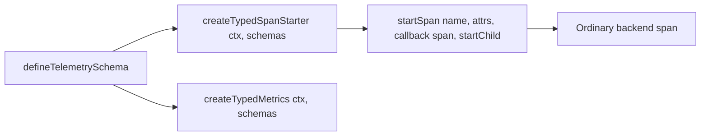

# Schemas

Part of the [`@octocodeai/octocode-telemetry` guide](../README.md). The low-level span API takes open names and attribute bags. Domain packages define closed, serializable schemas and infer exact TypeScript types from them.



```typescript
export const SCHEMA = defineTelemetrySchema({
	version: 1,
	spans: {
		"example.read": {
			description: "Read one resource",
			parents: { kind: "any" },
			startAttributes: {
				"example.resource": {
					type: "string",
					required: true,
					values: ["account", "project"],
					description: "Resource kind",
				},
			},
			endAttributes: { "example.item_count": { type: "number", description: "Items returned" } },
			events: {
				"example.cache": {
					description: "Cache lookup",
					attributes: { "example.cache.hit": { type: "boolean", required: true, description: "Cache hit" } },
				},
			},
			status: { default: "ok", errorWhen: "The read throws or returns an error result" },
		},
	},
} as const);

const startSpan = createTypedSpanStarter(telemetryContext, [SCHEMA]);

await startSpan("example.read", { "example.resource": "account" }, async (span, startChild) => {
	span.addEvent("example.cache", { "example.cache.hit": true });
	const accounts = await readAccounts();
	span.setAttributes({ "example.item_count": accounts.length });
	await startChild("example.read", { "example.resource": "project" }, async (child) => {
		child.setAttributes({ "example.item_count": (await readProjects()).length });
	});
	return accounts;
});
```

The starter has one overload per span and checks names and attributes at compile time. Narrow a union-valued name before calling. `startChild` is bound to the callback span over the same schemas. `defineTelemetrySchema()` is a typed identity function: plain JSON data, no runtime validation or parent-rule enforcement.

## Start and end attributes

| Field             | Recorded                                                           | Requiredness                     |
| ----------------- | ------------------------------------------------------------------ | -------------------------------- |
| `startAttributes` | Passed to the starter when the span is created                     | Each sets `required: true/false` |
| `endAttributes`   | Added through the span's `setAttributes()` while the callback runs | Always optional                  |

Both become ordinary attributes on one backend span; there is no end payload. Calling `setAttributes()` zero times is valid (early failure, cancellation, provider-specific data). Repeated calls merge; `undefined` is ignored; the typed method accepts only that span's declared end attributes. Settlement comes only from the callback returning, resolving, throwing or rejecting; calls after it are inert.

Compose independently versioned schemas with an array: `createTypedSpanStarter(ctx, [A, B])` (inline arrays keep their tuple type; declared arrays need `as const`). Duplicate literal span names are a compile error; schemas are not merged or retained at runtime. Types reject missing required attributes, unknown keys, invalid closed-set values, undeclared events and attributes on empty schemas.

## Metadata

| Field           | Meaning                                                                                                    |
| --------------- | ---------------------------------------------------------------------------------------------------------- |
| `type`          | `string`, `number`, `boolean`, or their arrays                                                             |
| `values`        | Closed set for scalars                                                                                     |
| `elementValues` | Closed set for array elements                                                                              |
| `examples`      | Documentation examples                                                                                     |
| `sensitive`     | Needs special handling                                                                                     |
| `cardinality`   | Expected `low` or `high`                                                                                   |
| `required`      | Start and event attributes only                                                                            |
| `parents`       | `{ kind: "any" }`, `{ kind: "root_or_external" }`, or `{ kind: "spans", spans: [...] }` (descriptive only) |

Adapters need not understand schemas; helpers and tests use them to keep names and attributes consistent.

## Typed metrics

`schema.metrics` declares instruments: `kind` (`counter`, `upDownCounter`, `histogram`; only histograms take `boundaries`), `description`, `unit` and `attributes`. Metric attributes reject `cardinality: "high"`, and omitting it does not waive the low-cardinality rule. `createTypedMetrics(ctx, [schemas])` rejects, at compile time, duplicate names, wrong instrument kinds, unknown attributes and missing required attributes. It reads and keeps metric metadata at runtime but validates no attributes.

```typescript
const schema = defineTelemetrySchema({
	version: 1,
	spans: {},
	metrics: {
		"network.bytes": {
			kind: "counter",
			description: "Encoded bytes",
			unit: "By",
			attributes: {
				direction: {
					type: "string",
					required: true,
					values: ["in", "out"],
					description: "Direction",
					cardinality: "low",
				},
			},
		},
	},
} as const);

createTypedMetrics(telemetry, [schema]).counter("network.bytes").add(size, { direction: "out" });
```
