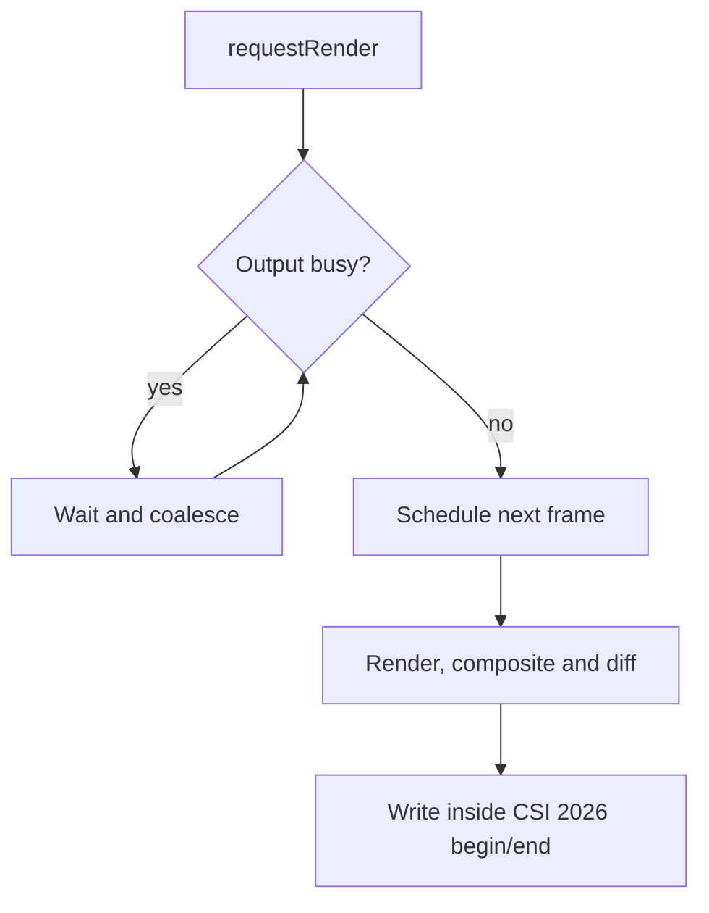

# @octocodeai/octocode-tui

Terminal UI framework: components, input handling and a differential renderer with synchronized output (CSI 2026, no flicker). The coding agent hosts command routing and configuration; see its [terminal UI guide](../coding-agent/docs/tui.md).

| Page                                                         | Covers                                                                             |
| ------------------------------------------------------------ | ---------------------------------------------------------------------------------- |
| [Core API](docs/core-api.md)                                 | `TUI` and renderers, colors, alternate-screen layouts, overlays, mouse, focus, IME |
| [Components](docs/components.md)                             | Built-in components and their key bindings                                         |
| [Input, rendering and terminals](docs/input-and-terminal.md) | Input flow, render loop, pacing, `Terminal`, tmux, utilities                       |

## Quick start

```typescript
import { Editor, matchesKey, ProcessTerminal, Text, TuiMainScreen, type TUI } from "@octocodeai/octocode-tui";

const id = (s: string) => s;
const tui: TUI = new TuiMainScreen(new ProcessTerminal());

tui.addChild(new Text("Welcome to my app!"));
const editor = new Editor(tui, {
	borderColor: id,
	selectList: { selectedText: id, description: id, scrollInfo: id, noMatch: id },
});
editor.onSubmit = (text) => tui.addChild(new Text(`You said: ${text}`));
tui.addChild(editor);
tui.setFocus(editor); // the focused component receives keyboard input

// Raw mode sends Ctrl+C as input, not SIGINT: exit here.
tui.addInputListener((data) => {
	if (matchesKey(data, "ctrl+c")) {
		tui.stop();
		process.exit(0);
	}
	return undefined;
});
tui.start();
```

## Renderers

| Renderer        | Buffer            | Scrolling                                     | Mouse |
| --------------- | ----------------- | --------------------------------------------- | ----- |
| `TuiMainScreen` | Main              | Terminal scrollback                           | No    |
| `TuiAltScreen`  | Alternate (fixed) | Application-owned (`ScrollView`, wheel, keys) | Yes   |

Both implement `TUI`; choose one only where the application is constructed.

## Render loop



Keyboard input gets priority, while both keyboard and ordinary repaints respect output pressure.
POSIX terminal frames use nonblocking output so a slow reader does not stop input, cancellation
or timers. `start()` turns it back on after a child that inherited stdout (an editor) returns the
terminal. Before an explicit exit or suspend, stop rendering and await `drainOutput()` with a
bounded deadline. Forced-exit cleanup writes terminal resets synchronously past any queued
frame, waiting at most one second for a terminal that stopped reading; cleanup hooks remain
registered until normal restore output drains.

Headless consumers can import width helpers and `GLYPH` from `@octocodeai/octocode-tui/text`
without loading terminal components or native clipboard support.

## Writing a component

Implement [`Component`](docs/core-api.md#component-interface).

| Rule                             | How                                                                                       |
| -------------------------------- | ----------------------------------------------------------------------------------------- |
| No line wider than `width`       | `truncateToWidth()`, `wrapTextWithAnsi()`; measure with `visibleWidth()` (all ANSI-aware) |
| Styles do not carry across lines | Reapply per line; the renderer appends an SGR and OSC 8 reset to each line                |
| Cache lines keyed by width       | Drop the cache in `invalidate()`                                                          |
| Keyboard input                   | `handleInput(data)` with `matchesKey(data, Key.up)`                                       |
| Text cursor or IME               | Implement `Focusable` ([IME support](docs/core-api.md#focusable-interface-ime-support))   |

```typescript
import { Key, matchesKey, truncateToWidth, type Component } from "@octocodeai/octocode-tui";

class Menu implements Component {
	private selected = 0;
	private cachedWidth?: number;
	private cachedLines?: string[];
	onSelect?: (index: number) => void;

	constructor(private items: string[]) {}

	handleInput(data: string): void {
		if (matchesKey(data, Key.up)) this.selected = Math.max(0, this.selected - 1);
		else if (matchesKey(data, Key.down)) this.selected = Math.min(this.items.length - 1, this.selected + 1);
		else if (matchesKey(data, Key.enter)) this.onSelect?.(this.selected);
		this.invalidate();
	}

	render(width: number): string[] {
		if (this.cachedLines && this.cachedWidth === width) return this.cachedLines;
		this.cachedWidth = width;
		this.cachedLines = this.items.map((item, i) =>
			truncateToWidth(`${i === this.selected ? "> " : "  "}${item}`, width),
		);
		return this.cachedLines;
	}

	invalidate(): void {
		this.cachedWidth = undefined;
		this.cachedLines = undefined;
	}
}
```

## Development

```bash
yarn install && yarn run check   # repository root
yarn run test                    # packages/tui
yarn run test:tmux               # multiplexer tests only
```

Platform helpers for modifier-key state and clipboard access ship as prebuilds; each page explains how to rebuild it: [macOS](native/darwin/README.md), [Linux](native/linux/README.md), [Windows](native/win32/README.md).

Set `OCTOCODE_TUI_WRITE_LOG` to copy the raw ANSI stream to a file.
