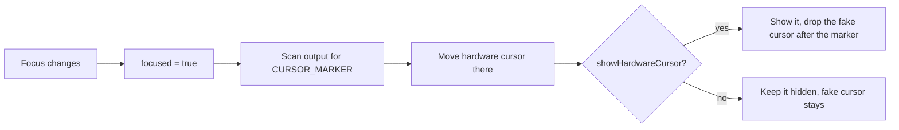

# Core API

Part of the [`@octocodeai/octocode-tui` guide](../README.md).

## TUI interface

`TUI` is shared by `TuiMainScreen` (main buffer, keeps scrollback) and `TuiAltScreen` (fixed-height viewport in the alternate buffer; on stop it restores the main buffer and prints the whole final document).

| Member                                                                        | Purpose                                                                                   |
| ----------------------------------------------------------------------------- | ----------------------------------------------------------------------------------------- |
| `addChild` / `removeChild` / `clear`                                          | Manage root components                                                                    |
| `start()` / `stop({ preserveScreen? })`                                       | Lifecycle; `preserveScreen` leaves output for another TUI taking over the terminal        |
| `requestRender(force?)` / `renderNow(force?)`                                 | Schedule or run a frame; `force` repaints everything                                      |
| `setFocus(component \| null)`                                                 | Choose the keyboard target                                                                |
| `showOverlay` / `hideOverlay` / `hasOverlay`                                  | [Overlays](#overlays)                                                                     |
| `addInputListener(fn)` / `removeInputListener(fn)`                            | See input before the focused component; `fn` returns `{ consume?, data? }` or `undefined` |
| `setShowHardwareCursor` / `setClearOnShrink`                                  | Cursor and shrink behavior (getters exist)                                                |
| `onDebug`                                                                     | Called on Shift+Ctrl+D before input reaches the focused component                         |
| `onRenderError(error, component)`                                             | Called once per distinct render failure                                                   |
| `queryTerminalColors({ timeoutMs, onLateReply? })`                            | Reads foreground, background and ANSI 0-15 colors                                         |
| `onTerminalColorSchemeChange(fn)` / `setTerminalColorSchemeNotifications(on)` | Light/dark scheme reports                                                                 |
| `mode`, `fullRedraws`, `terminal`, `children`                                 | Read-only state                                                                           |

A component that throws in `render` does not stop the frame: it draws as `⚠ <Component> failed to render: <first error line>` until it renders again. Without an `onRenderError` listener the error is appended to `octocode-tui-render-errors.log` in the log directory given to the renderer, else the system temp folder. A direct `render()` call outside a frame still throws.

## Component interface

```typescript
interface Component {
	render(width: number): string[];
	handleInput?(data: string): void;
	handleMouse?(event: TuiMouseEvent): TuiMouseEventResult | undefined;
	invalidate(): void;
}
```

| Method                | Contract                                                                    |
| --------------------- | --------------------------------------------------------------------------- |
| `render(width)`       | One string per line, none wider than `width`                                |
| `handleInput?(data)`  | Focused components get raw input, possibly ANSI escapes                     |
| `handleMouse?(event)` | Alternate-screen pointer input aimed at the component                       |
| `invalidate()`        | Required: clear cached render state (an empty body is fine without a cache) |

The renderer ends every line with an SGR and OSC 8 reset, so styles never span lines.

## Colors

`Color` is an indexed ANSI color (0-15 follow the user's palette, so their sRGB values are approximate), sRGB, OKLCH or OKHSL; all convert to sRGB, so `mixColors()` always works.

- Parse and build: `parseColor("#20242a" | "oklch(70% 0.12 220)" | "okhsl(250 60% 55%)")`, `rgbColor`, `indexedColor`, `oklchColor`, `okhslColor`; mix with `mixColors(a, b, t)`; convert with `colorToRgb`, `colorToHex`, `colorToOklch`, `colorToOkhsl`.
- Emit: `foregroundAnsi`, `backgroundAnsi`, `styleText(text, style, mode)`. `getTerminalColorMode()` is `"truecolor"`, `"256color"` or `"none"` (`NO_COLOR` non-empty or `TERM=dumb`). In `"none"` no color is written and `shimmerText` returns its text; bold, dim, italic, underline and inverse still apply.
- Conversions are not cached and out-of-gamut OKLCH is the costliest: for per-frame colors convert once with `colorToRgb()` and reuse `rgbColor(r, g, b)`.
- `shimmerText(text, { base, peak, mode, now, periodMs = 2000, halfWidth = 5, padding = 10 })` sweeps a light band across a "working" label. `now` defaults to `Date.now()`; the caller redraws on its own timer, so shimmers on one clock move together.

```typescript
const accent = parseColor("oklch(70% 0.12 220)");
const bg = parseColor("#20242a");
const text = styleText("Ready", { fg: mixColors(accent, bg, 0.2), bg, bold: true }, getTerminalColorMode());
```

## Alternate-screen layouts

`VStack`, `HStack` and `ScrollView` only apply under `TuiAltScreen`; check with `isViewportTUI(tui)` and call `setLayoutRoot()`. Without a layout root the renderer scrolls one document.

```typescript
tui.setLayoutRoot(
	new VStack([
		{
			component: new ScrollView(transcript, { follow: "end", primary: true, overscroll: "chain" }),
			basis: 0,
			grow: 1,
			minSize: 1,
		},
		{ component: editorAndFooter, basis: "auto", shrink: 1, minSize: 1 },
	]),
);
```

| Option                                                                       | Where                 | Effect                                                                        |
| ---------------------------------------------------------------------------- | --------------------- | ----------------------------------------------------------------------------- |
| `basis`, `grow`, `shrink`, `minSize`, `maxSize`, `visible`                   | Stack entry           | Size and responsive visibility                                                |
| `follow: "none" \| "end"`                                                    | `ScrollView`          | Follow streaming output while at the bottom                                   |
| `primary`                                                                    | `ScrollView`          | Receives keyboard navigation and wheel over non-scrollable regions            |
| `overscroll: "chain" \| "contain"`                                           | `ScrollView`          | Whether unused wheel delta passes to an outer view                            |
| `scrollbarTrackStyle`, `scrollbarThumbStyle`                                 | `ScrollView`          | Scrollbar colors (defaults: faint track, plain thumb)                         |
| `searchMatchStyle`, `searchCurrentMatchStyle`, `searchNavigationButtonStyle` | `TuiAltScreenOptions` | Search highlighting and arrow buttons                                         |
| `scrollToEndIndicator`                                                       | `TuiAltScreenOptions` | Clickable label on the last row while a `follow: "end"` view is scrolled away |
| `copyOnSelect`                                                               | `TuiAltScreenOptions` | Copy drag selections with OSC 52 (default on)                                 |

The primary view also jumps between OSC 133 prompt markers. `Ctrl+Shift+F` opens or closes its search panel; `Enter`/`Ctrl+G` and `Shift+Enter`/`Ctrl+Shift+G` move between matches, `Escape` closes.

Layout geometry is rebuilt each frame; stateful components and their line caches are kept. Calling `render(width)` on a layout component directly gives an unbounded document, which alt mode uses when it restores the main screen.

## Overlays

Overlays draw over existing content (dialogs, menus).

```typescript
const handle = tui.showOverlay(component, { width: "80%", anchor: "bottom-right", margin: 2, maxHeight: 20 });
handle.setHidden(true);
handle.unfocus({ target: null });
```

| Option                   | Meaning                                                                                                                                  |
| ------------------------ | ---------------------------------------------------------------------------------------------------------------------------------------- |
| `width`, `maxHeight`     | Columns/rows, or a percentage string such as `"50%"`                                                                                     |
| `minWidth`               | Floor applied after the width is computed                                                                                                |
| `anchor`                 | `center` (default), `top-left`, `top-right`, `bottom-left`, `bottom-right`, `top-center`, `bottom-center`, `left-center`, `right-center` |
| `offsetX`, `offsetY`     | Offset from the anchor                                                                                                                   |
| `row`, `col`             | Absolute number or percentage; absolute beats percentage beats `anchor`                                                                  |
| `margin`                 | Number or `{ top, right, bottom, left }`; clamps the final position inside the terminal                                                  |
| `visible(width, height)` | Checked every frame                                                                                                                      |
| `nonCapturing`           | Do not take focus when shown                                                                                                             |

| `OverlayHandle`                | Effect                                                                    |
| ------------------------------ | ------------------------------------------------------------------------- |
| `hide()`                       | Remove permanently                                                        |
| `setHidden(bool)`/`isHidden()` | Hide or show again                                                        |
| `focus()` / `isFocused()`      | Focus and raise to the front                                              |
| `unfocus()`                    | Release focus to another visible capturing overlay or the previous target |
| `unfocus({ target })`          | Release to `target`; `null` leaves focus empty                            |
| `getBounds()`                  | Last rendered terminal-relative bounds                                    |

A focused visible overlay reclaims input after temporary replacement UI releases focus; to keep another component focused while overlays stay visible, call `unfocus({ target: component })`.

## Mouse input

`TuiAltScreen` normalizes SGR mouse input and hit-tests components and overlays. `TuiMainScreen` does not capture the mouse. `TuiMouseEvent` carries component-local `x`/`y`, absolute `screenX`/`screenY`, bounds, button, modifiers, click count and wheel delta. A click is emitted only when press and release complete without a drag.

| Result field | Effect                                                                             |
| ------------ | ---------------------------------------------------------------------------------- |
| `handled`    | Suppress the renderer's default                                                    |
| `capture`    | Route later drag and release events to this component                              |
| `focus`      | Request keyboard focus                                                             |
| `render`     | Repaint; default true for press, click, drag and wheel, false for move and release |

Unhandled gestures keep defaults: wheel scrolls the nearest `ScrollView` and chains leftover delta, primary-button drags select text, OSC 8 links open before parent click handlers, right-click keeps the configured paste behavior.

```typescript
const region = new MouseRegion(content, (event) => {
	if (event.type !== "click" || event.button !== "left") return undefined;
	expanded = !expanded;
	return { handled: true };
});
```

`MouseRegion` adds mouse behavior without changing rendering. `Container` and `Box` route events with geometry recorded by the last frame, so pointer motion does not re-render children.

## Focusable interface (IME support)

A component with a text cursor implements `Focusable` so the hardware cursor, which IME candidate windows follow, lands in the right place.

```typescript
class MyInput implements Component, Focusable {
	focused = false; // set by the TUI
	render(width: number): string[] {
		const marker = this.focused ? CURSOR_MARKER : "";
		return [`> ${before}${marker}${renderFakeCursor(atCursor)}${after}`];
	}
	invalidate(): void {}
}
```



The hardware cursor is hidden by default. Some terminals need it visible for IME positioning: pass `showHardwareCursor` to the renderer constructor or call `setShowHardwareCursor(true)`. `Editor` and `Input` already implement `Focusable`.

A container holding an `Input` or `Editor` must implement `Focusable` and forward `focused` to the child, or IME candidate windows appear in the wrong place:

```typescript
class SearchDialog extends Container implements Focusable {
	private searchInput = new Input();
	private _focused = false;
	get focused() {
		return this._focused;
	}
	set focused(value: boolean) {
		this._focused = value;
		this.searchInput.focused = value;
	}
	constructor() {
		super();
		this.addChild(this.searchInput);
	}
}
```
