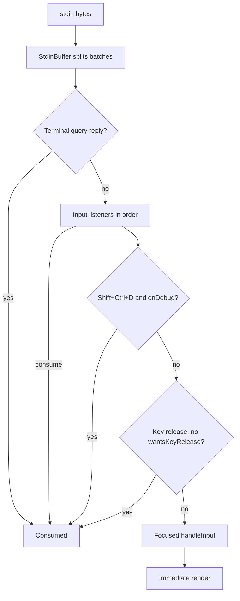

# Input, rendering and terminals

Part of the [`@octocodeai/octocode-tui` guide](../README.md).

## Input flow



A listener returns `{ consume: true }`, `{ data }` to rewrite the input, or `undefined`. A listener or component that throws loses that key, not the session; a throwing listener is dropped. Mouse input in `TuiAltScreen` is separate: [Core API](core-api.md#mouse-input).

## Keys

`matchesKey(data, id)` handles the Kitty keyboard protocol and legacy sequences. Ids are `Key.*` helpers or strings.

| Kind     | Examples                                                                     |
| -------- | ---------------------------------------------------------------------------- |
| Basic    | `Key.enter`, `escape`, `tab`, `space`, `backspace`, `delete`, `home`, `end`  |
| Arrows   | `Key.up`, `down`, `left`, `right`                                            |
| Modified | `Key.ctrl("c")`, `Key.shift("tab")`, `Key.alt("left")`, `Key.ctrlShift("p")` |
| Strings  | `"enter"`, `"ctrl+c"`, `"shift+tab"`, `"ctrl+shift+p"`                       |

Built-in component bindings are configurable: `getKeybindings`, `setKeybindings`, `KeybindingsManager`, `TUI_KEYBINDINGS`.

## Autocomplete

```typescript
editor.setAutocompleteProvider(
	new CombinedAutocompleteProvider([{ name: "help", description: "Show help" }], process.cwd()),
);
```

`/` lists slash commands. `Tab` completes file paths for `~/`, `./`, `../` and `@` prefixes; `@` offers only attachable files. File names containing control characters are never suggested.

## Rendering

- `TuiMainScreen`: the first render writes every line without clearing scrollback. A width change or a change above the viewport clears and redraws everything. Otherwise it moves to the first changed line, clears to the end and writes the changed lines.
- `TuiAltScreen`: owns a terminal-height viewport and updates changed rows in place. It follows streaming output at the bottom, keeps a manual scroll position while content grows, scrolls by wheel or configurable keys without touching scrollback, jumps between OSC 133 prompts, supports scrollbar hover, drag and track clicks, opens OSC 8 links, and selects text by drag (copied with OSC 52 unless `copyOnSelect` is `false`; edge auto-scroll extends the selection).
- Both wrap frames in synchronized output (`ESC[?2026h` ... `ESC[?2026l`). See the [render loop](../README.md#render-loop).

### Experimental render pacing

Requests are coalesced at least 40 ms apart; keyboard input renders immediately. Opt in per renderer:

```typescript
tui.setRenderPacing({ outputGate: true, metrics: true }); // or { adaptiveCadence: true, metrics: true }
const stats = tui.getRenderPacingStats();
```

| Option            | Default | Effect                                                                             |
| ----------------- | ------- | ---------------------------------------------------------------------------------- |
| `outputGate`      | off     | Defer frames while `Terminal.pendingOutputBytes` is above `highWaterBytes`         |
| `adaptiveCadence` | off     | Space frames by the previous frame's cost, up to 200 ms                            |
| `metrics`         | off     | Counters: frames, queued bytes, frame time, timer lateness, input-to-paint latency |
| `highWaterBytes`  | 256 KiB | Gate closes above this                                                             |
| `lowWaterBytes`   | 128 KiB | Gate reopens at or below this                                                      |
| `retryMs`         | 10      | Retry interval while gated                                                         |

The watermarks are unmeasured starting values, not a memory limit. `requestRender(true)`, `renderNow()`, terminal restore and final output bypass the gate; a frame may exceed it. Terminals without `pendingOutputBytes` keep the default schedule. The gate cannot stop a synchronous POSIX TTY write from blocking. `ProcessTerminal.getOutputTelemetry()` reports bytes, write sizes and writes returning `false`; no text is kept. `node scripts/profile-render-backpressure.mjs --trials 3` (repository root) compares four modes with a simulated consumer, not a live PTY.

## Terminal interface

`ProcessTerminal` implements `Terminal` over `process.stdin`/`stdout`. The virtual terminal used in tests is a test helper, not an export.

| Member                                                                                                              | Purpose                                                  |
| ------------------------------------------------------------------------------------------------------------------- | -------------------------------------------------------- |
| `start(onInput, onResize, onCapabilitiesChange?)`, `stop()`                                                         | Lifecycle                                                |
| `drainInput(maxMs?, idleMs?)`                                                                                       | Drain stdin so Kitty key releases do not reach the shell |
| `write(data)`, `columns`, `rows`, `kittyProtocolActive`                                                             | Output and state                                         |
| `moveBy`, `hideCursor`, `showCursor`, `clearLine`, `clearFromCursor`, `clearScreen`                                 | Cursor and clearing                                      |
| `setTitle`, `setProgress` (OSC 9;4), `setProgramStatus` (OSC 7501)                                                  | Title, progress, status                                  |
| `pendingOutputBytes?`, `setDecorativeOutputPressureThreshold?`, `setOutputTelemetryEnabled?`, `getOutputTelemetry?` | Optional pacing support                                  |

## Terminal multiplexers

Helpers take an optional `env`. The tmux queries run `tmux` synchronously with a short timeout, cache per `TMUX` and `TMUX_PANE`, and never throw.

- `detectMultiplexer()`: `"tmux"`, `"screen"`, `"zellij"` or `null`; session markers (`TMUX`, `STY`, `ZELLIJ`) win over the `TERM` prefix. `hasTmuxSession()` needs `TMUX`.
- `paneTarget()`: `TMUX_PANE` or `undefined`.
- `tmuxExec(args, options?)`: async; rejects with `tmux failed: <stderr>` or the abort reason after a 5 s default timeout. `tmuxGlobalOption(name)` returns the option or `undefined`.
- `tmuxClientTerminalNames()`: attached emulators, best first (`kitty(0.35.2)` gives `kitty`); `[]` when unanswered, not cached. `tmuxClientTermFeatures()` must include `hyperlinks` for OSC 8.
- `tmuxPaneAllowsPassthrough()`: `allow-passthrough` is `on` or `all`, or tmux is older than 3.3. `wrapTmuxPassthrough(payload)` doubles every ESC in an `ESC P tmux; ... ESC \` envelope; wrap only when allowed, or tmux drops it.
- `resetMultiplexerCache()` clears caches.

### Images in tmux

Automatic detection enables Kitty images only if the attached client is Kitty or Ghostty (they draw Unicode placeholders; WezTerm and Warp do not), the pane allows passthrough, and 24-bit color reaches the client (`RGB` feature or truecolor `COLORTERM`). Otherwise components render their text fallback; probing is skipped because tmux drops the reply. `OCTOCODE_IMAGE_PROTOCOL=kitty` (or the `terminal.images` setting) forces the mode, `none` disables it. iTerm2 images stay off in tmux.

In this mode `getCapabilities().kittyPlaceholders` is `true`:

- Images are sent with a virtual placement (`a=T,U=1`); `Image` returns text rows of U+10EEEE cells (row and column as combining marks, 24-bit image id as foreground color), so they follow scrolling and pane switches.
- All chunks of one image share one passthrough envelope so another pane's output cannot interleave. Above `TMUX_PASSTHROUGH_LIMIT` (1,000,000 escaped bytes) it splits into several envelopes and can interleave.
- `isImageLine` marks placeholder rows so padding, truncation and overlays skip them. If the first row scrolls out of the viewport the image is not re-sent and may show blank cells.
- With tmux `focus-events on` and focus reports enabled, a focus-in makes the TUI run `tmux list-clients` (non-blocking) and re-send uploads when a client is new or tmux cannot answer. Without focus events a same-size attach stays blank until the next full redraw.

Tests use `test/helpers/fake-tmux.ts` (fake `tmux` first on `PATH`) and `test/helpers/real-tmux.ts` (private server); `yarn run test:tmux` runs them.

### Pastes in tmux

- With extended keys on, tmux may re-encode control bytes as `ESC [ 27 ; 5 ; <cp> ~` or `ESC [ <cp> ; 5 u`. `Editor` and `Input` decode both back inside a bracketed paste (Ctrl+J becomes a newline). In a tmux 3.8 check, bracketed pastes arrived unchanged; only unbracketed input was re-encoded.
- tmux brackets pastes only while the pane's paste mode (DEC 2004) is on. A child on the same tty writing `ESC[?2004l` or a reset turns it off silently, and a multi-line paste arrives as separate lines. With `TMUX` set, `ProcessTerminal` re-sends `ESC[?2004h` on input and resize at most once per second, never inside a paste; the first paste after a reset is still unbracketed.

## Utilities

| Function                                                                            | Behavior                                                          |
| ----------------------------------------------------------------------------------- | ----------------------------------------------------------------- |
| `visibleWidth(s)`                                                                   | Width ignoring ANSI                                               |
| `truncateToWidth(s, width, ellipsis = "…", pad)`                                    | Keeps and closes ANSI codes: `("Hello World", 8)` is `"Hello W…"` |
| `wrapTextWithAnsi(s, width)`                                                        | Wraps, re-applying styles per line                                |
| `sliceByColumn`, `getOsc8LinkAtColumn`, `closeOpenStyles`, `stripTerminalSequences` | Column slice, link lookup, style close, sanitize                  |
| `fuzzyMatch`, `fuzzyFilter`                                                         | Fuzzy matching                                                    |
