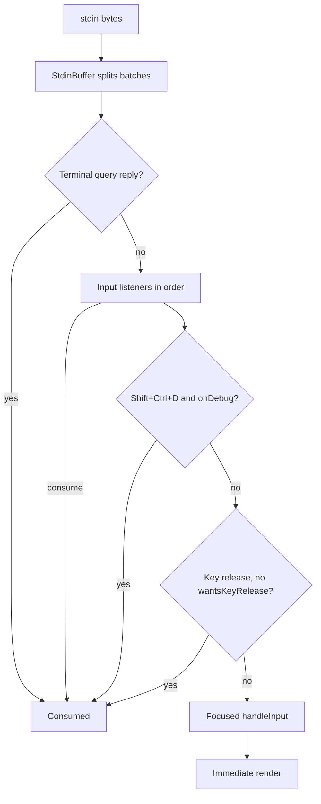
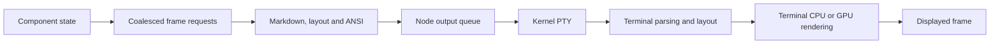

# Input, rendering and terminals

Part of the [`@octocodeai/octocode-tui` guide](../README.md).

## Input flow



A listener returns `{ consume: true }`, `{ data }` to rewrite the input, or `undefined`. A listener or component that throws loses that key, not the session; a throwing listener is dropped. Mouse input in `TuiAltScreen` is separate: [Core API](core-api.md#mouse-input).

## Keys

`matchesKey(data, id)` handles the Kitty keyboard protocol and legacy sequences. Ids are `Key.*` helpers or strings.

| Kind     | Examples                                                                     |
| -------- | ---------------------------------------------------------------------------- |
| Basic    | `Key.enter`, `escape`, `tab`, `space`, `backspace`, `delete`, `home`, `end`  |
| Arrows   | `Key.up`, `down`, `left`, `right`                                            |
| Modified | `Key.ctrl("c")`, `Key.shift("tab")`, `Key.alt("left")`, `Key.ctrlShift("p")` |
| Strings  | `"enter"`, `"ctrl+c"`, `"shift+tab"`, `"ctrl+shift+p"`                       |

Built-in component bindings are configurable: `getKeybindings`, `setKeybindings`, `KeybindingsManager`, `TUI_KEYBINDINGS`.

## Autocomplete

```typescript
editor.setAutocompleteProvider(
	new CombinedAutocompleteProvider([{ name: "help", description: "Show help" }], process.cwd()),
);
```

`/` at the start of the input lists slash commands. A `/` at the start of a later word or line lists only skills (the app marks them): it names a skill to use and never runs a command; a `/` inside a path or URL opens nothing. `@` at the start of any word, not only the first, offers attachable files; a file created after the last index build is found because a query that matches nothing rebuilds the index. `Tab` completes file paths for `~/`, `./`, `../` and `@` prefixes. File names containing control characters are never suggested.

File completion retains the eight most recently used directory indexes; builds already running finish before eviction. Each fd or Git index holds at most 200,000 entries, including directories. Both commands have a five-second deadline: an unavailable or stalled command falls back to the next source, ending with a bounded directory walk. Git output is streamed so a large tree does not need to be buffered before suggestions can be indexed.

Typing or dismissing completion cancels the pending provider request. The next request can proceed even if that provider ignores cancellation; a late result cannot replace the current list or stop its progress indicator.

## Rendering

The editor reuses wrapping for unchanged draft lines across repaints and cursor navigation. Editing a line rewraps that line; resizing or changing paste markers refreshes the wrapping. Fragmented bracketed pastes are assembled once when complete, including when the closing marker spans input chunks.

- `TuiMainScreen`: the first render writes every line without clearing scrollback. A width change or a change above the viewport clears and redraws everything. Otherwise it moves to the first changed line, clears to the end and writes the changed lines.
- `TuiAltScreen`: owns a terminal-height viewport and updates changed rows in place. It follows streaming output at the bottom, keeps a manual scroll position while content grows, scrolls by wheel or configurable keys without touching scrollback, jumps between OSC 133 prompts, supports scrollbar hover, drag and track clicks, opens OSC 8 links, and selects text by drag (copied with OSC 52 unless `copyOnSelect` is `false`; edge auto-scroll extends the selection).
- Both wrap frames in synchronized output (`ESC[?2026h` ... `ESC[?2026l`) when the terminal confirms support.

### Render pacing

Requests are coalesced at least 40 ms apart; keyboard input bypasses this delay when output can drain. Output gating is enabled by default. Enable diagnostic counters or adaptive cadence per renderer:

```typescript
tui.setRenderPacing({ metrics: true }); // or { adaptiveCadence: true, metrics: true }
const stats = tui.getRenderPacingStats();
```

| Option            | Default | Effect                                                                           |
| ----------------- | ------- | -------------------------------------------------------------------------------- |
| `outputGate`      | on      | Defer frames while `Terminal.pendingOutputBytes` is above `highWaterBytes`       |
| `adaptiveCadence` | off     | Space frames by the previous frame's cost, up to 200 ms                          |
| `interactiveFps`  | 60      | Pointer frame target, from 1 to 120; independent of synchronized-output support  |
| `metrics`         | off     | Frame submission, output queue, CPU, heap, RSS, GC and event-loop delay counters |
| `highWaterBytes`  | 256 KiB | Gate closes above this                                                           |
| `lowWaterBytes`   | 128 KiB | Gate reopens at or below this                                                    |
| `retryMs`         | 10      | Retry interval while gated                                                       |

Synchronized output keeps a frame together; it does not report display refresh rate or GPU availability. Set `interactiveFps: 120` only after checking that the target terminal remains responsive during scrolling and streaming.

Frame time covers Octocode's layout, ANSI generation and write submission. `maxInputToPaintMs` retains its API name but ends at submission, not at visible pixels. `runtime` covers the Node process, with CPU expressed as a percentage of one core and event-loop delay sampled every 20 ms. These counters exclude terminal parsing, DOM layout and GPU presentation. A drained Node output queue does not prove the terminal has displayed the frame. Disabling metrics or stopping the renderer releases its GC observer and loop monitor.



CPU, heap and GC counters describe the Node process on the left of the PTY. Terminal rendering uses a separate process and allocation lifetime. Diagnose a slow display at that boundary: cheap frame submission and an empty local queue can coexist with an overloaded terminal renderer.

The watermarks are unmeasured starting values, not a memory limit. `renderNow()`, terminal restore and final output bypass the gate; a frame may exceed it. Terminals without `pendingOutputBytes` keep the default schedule. On POSIX, `ProcessTerminal` switches stdout to nonblocking TTY writes so a paused consumer cannot freeze the event loop, and switches it again on every `start()`: a child given the terminal with inherited stdio (an external editor, a sign-in CLI) leaves the shared descriptor blocking. Ordinary writes share the stdout queue and retain their order. Forced-exit restoration writes synchronously to the terminal descriptor, bypassing that queue; changing the handle mode alone cannot flush JavaScript's queued writes. Those writes retry a full terminal for at most one second in total, then drop the rest so quitting cannot hang; the descriptor is made blocking again for the shell afterwards. Cleanup hooks remain registered until normal restore output drains. Keyboard repaints also wait for the queue and paint the latest state once it drains. `ProcessTerminal.getOutputTelemetry()` reports bytes, write sizes and writes returning `false`; no text is kept.

Stopping or replacing a fullscreen layout cancels its scrollbar timers and releases render callbacks. Restarting attaches them again without removing transcript content.

Clipboard handler failures appear as a transient error and leave input and selection usable. The OSC 52 fallback rejects transfers larger than 100,000 encoded bytes before allocating their base64 payload. An injected clipboard handler can support larger transfers.

## Terminal interface

`ProcessTerminal` implements `Terminal` over `process.stdin`/`stdout`. The virtual terminal used in tests is a test helper, not an export.

| Member                                                                                                              | Purpose                                                                                            |
| ------------------------------------------------------------------------------------------------------------------- | -------------------------------------------------------------------------------------------------- |
| `start(onInput, onResize, onCapabilitiesChange?)`, `stop()`                                                         | Lifecycle                                                                                          |
| `drainInput(maxMs?, idleMs?)`                                                                                       | Drain stdin so Kitty key releases do not reach the shell                                           |
| `drainOutput?(maxMs?)`                                                                                              | Flush queued output before exit or suspend; resolves false on error or deadline (default 1 second) |
| `writeOnExit?(data)`                                                                                                | Synchronous terminal restoration past queued output; used only during forced exit                  |
| `write(data)`, `columns`, `rows`, `kittyProtocolActive`                                                             | Output and state                                                                                   |
| `moveBy`, `hideCursor`, `showCursor`, `clearLine`, `clearFromCursor`, `clearScreen`                                 | Cursor and clearing                                                                                |
| `setTitle`, `setProgress` (OSC 9;4), `setProgramStatus` (OSC 7501)                                                  | Title, progress, status                                                                            |
| `pendingOutputBytes?`, `setDecorativeOutputPressureThreshold?`, `setOutputTelemetryEnabled?`, `getOutputTelemetry?` | Optional pacing support                                                                            |

## Terminal multiplexers

Helpers take an optional `env`. The tmux queries run `tmux` synchronously with a short timeout, cache per `TMUX` and `TMUX_PANE`, and never throw.

- `detectMultiplexer()`: `"tmux"`, `"screen"`, `"zellij"` or `null`; session markers (`TMUX`, `STY`, `ZELLIJ`) win over the `TERM` prefix. `hasTmuxSession()` needs `TMUX`.
- `paneTarget()`: `TMUX_PANE` or `undefined`.
- `tmuxExec(args, options?)`: async; rejects with `tmux failed: <stderr>` or the abort reason after a 5 s default timeout. `tmuxGlobalOption(name)` returns the option or `undefined`.
- `tmuxClientTerminalNames()`: attached emulators, best first (`kitty(0.35.2)` gives `kitty`); `[]` when unanswered, not cached. `tmuxClientTermFeatures()` must include `hyperlinks` for OSC 8.
- `tmuxPaneAllowsPassthrough()`: `allow-passthrough` is `on` or `all`, or tmux is older than 3.3. `wrapTmuxPassthrough(payload)` doubles every ESC in an `ESC P tmux; ... ESC \` envelope; wrap only when allowed, or tmux drops it.
- `resetMultiplexerCache()` clears caches.

### Images in tmux

Automatic detection enables Kitty images only if the attached client is Kitty or Ghostty (they draw Unicode placeholders; WezTerm and Warp do not), the pane allows passthrough, and 24-bit color reaches the client (`RGB` feature or truecolor `COLORTERM`). Otherwise components render their text fallback; probing is skipped because tmux drops the reply. `OCTOCODE_IMAGE_PROTOCOL=kitty` (or the `terminal.images` setting) forces the mode, `none` disables it. iTerm2 images stay off in tmux.

In this mode `getCapabilities().kittyPlaceholders` is `true`:

- Images are sent with a virtual placement (`a=T,U=1`); `Image` returns text rows of U+10EEEE cells (row and column as combining marks, 24-bit image id as foreground color), so they follow scrolling and pane switches.
- All chunks of one image share one passthrough envelope so another pane's output cannot interleave. Above `TMUX_PASSTHROUGH_LIMIT` (1,000,000 escaped bytes) it splits into several envelopes and can interleave.
- `isImageLine` marks placeholder rows so padding, truncation and overlays skip them. If the first row scrolls out of the viewport the image is not re-sent and may show blank cells.
- With tmux `focus-events on` and focus reports enabled, a focus-in makes the TUI run `tmux list-clients` (non-blocking) and re-send uploads when a client is new or tmux cannot answer. Without focus events a same-size attach stays blank until the next full redraw.

Tests use `test/helpers/fake-tmux.ts` (fake `tmux` first on `PATH`) and `test/helpers/real-tmux.ts` (private server); `yarn run test:tmux` runs them.

### Pastes in tmux

- With extended keys on, tmux may re-encode control bytes as `ESC [ 27 ; 5 ; <cp> ~` or `ESC [ <cp> ; 5 u`. `Editor` and `Input` decode both back inside a bracketed paste (Ctrl+J becomes a newline). In a tmux 3.8 check, bracketed pastes arrived unchanged; only unbracketed input was re-encoded.
- tmux brackets pastes only while the pane's paste mode (DEC 2004) is on. A child on the same tty writing `ESC[?2004l` or a reset turns it off silently, and a multi-line paste arrives as separate lines. With `TMUX` set, `ProcessTerminal` re-sends `ESC[?2004h` on input and resize at most once per second, never inside a paste; the first paste after a reset is still unbracketed.

## Utilities

| Function                                                                            | Behavior                                                          |
| ----------------------------------------------------------------------------------- | ----------------------------------------------------------------- |
| `visibleWidth(s)`                                                                   | Width ignoring ANSI                                               |
| `truncateToWidth(s, width, ellipsis = "…", pad)`                                    | Keeps and closes ANSI codes: `("Hello World", 8)` is `"Hello W…"` |
| `wrapTextWithAnsi(s, width)`                                                        | Wraps, re-applying styles per line                                |
| `sliceByColumn`, `getOsc8LinkAtColumn`, `closeOpenStyles`, `stripTerminalSequences` | Column slice, link lookup, style close, sanitize                  |
| `fuzzyMatch`, `fuzzyFilter`                                                         | Fuzzy matching                                                    |
