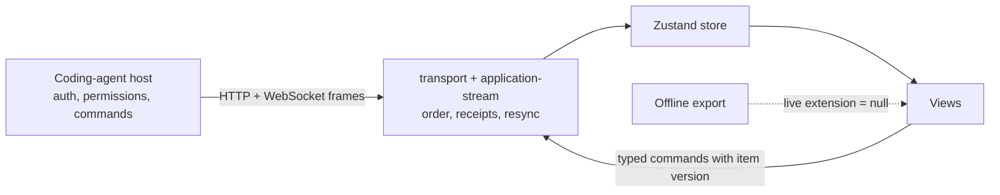
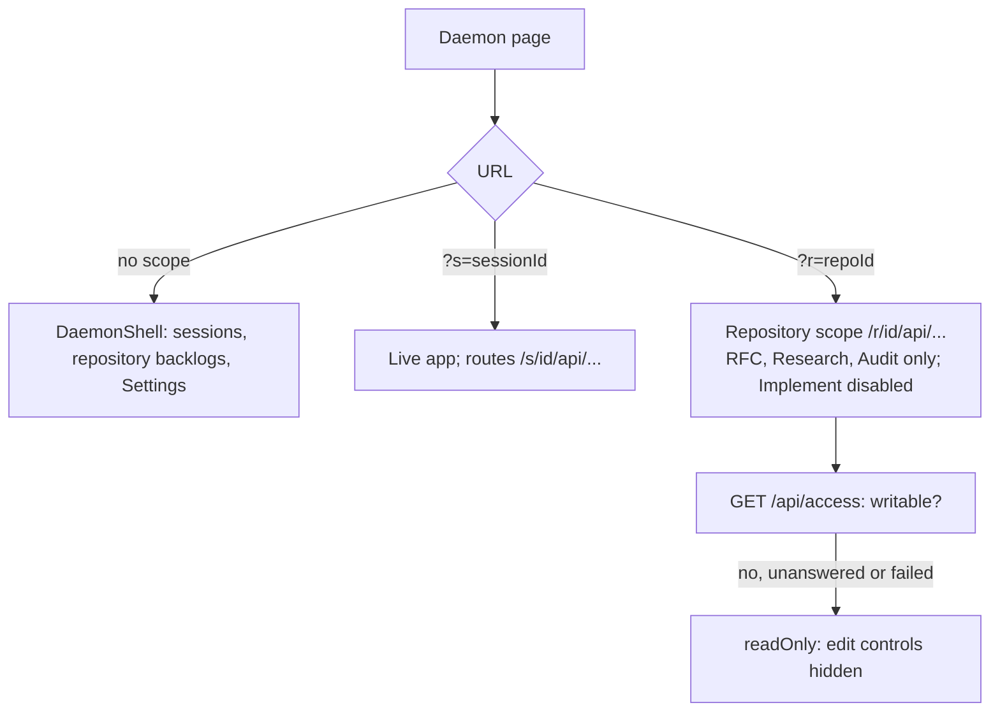

# Octocode webview

Browser presentation for the local Octocode workspace: board, backlog, table, tree, attention views, item sheet, command palette, agent views, activity, audit, RFC and Research report views, Markdown and code rendering, Zustand state. It consumes `@octocodeai/octocode-contracts`; it never touches databases, launches agents or grants permissions. The coding-agent host serves the page through its authenticated local server and owns settings and command authority ([interface architecture](../../docs/INTERFACE_ARCHITECTURE.md)).

## Entry points

| Export                                  | Use                                                          |
| --------------------------------------- | ------------------------------------------------------------ |
| `renderBacklogHtml`, `renderDaemonHtml` | Generate the page (session server, user-level daemon)        |
| `pagePolicy`, `PagePolicyOptions`       | Content-Security-Policy for the meta tag and a server header |
| `MERMAID_SCRIPT_HASH`                   | Hash a header lists so the Mermaid loader may run            |
| `@octocodeai/octocode-webview/state`    | `createWorkspaceStore`, `selectEvents`                       |
| `@octocodeai/octocode-webview/markdown` | `safeMarkdownLink`, `sanitizeMarkdown`                       |

Live pages preview images, audio and video from `blob:` URLs; other attachments download as `application/octet-stream`. The published package ships the compiled page as a string; React is a development dependency.

## Commands

From the repository root:

| Command                                                                                | Does                                                                                                            |
| -------------------------------------------------------------------------------------- | --------------------------------------------------------------------------------------------------------------- |
| `yarn run generate:workspace`                                                          | Rebuilds the checked-in browser bundle (`check:workspace` verifies freshness); run after browser source changes |
| `yarn workspace @octocodeai/octocode-contracts run build`                              | Builds shared declarations first                                                                                |
| `yarn workspace @octocodeai/octocode-webview run build` / `run test` / `run typecheck` | Build, tests (model, component, page flow, security), typecheck                                                 |
| `yarn run check`                                                                       | Also covers lint (React, hooks, accessibility rules), format, browser imports and boundaries                    |

## Structure

| Folder (`src/`)                                     | Holds                                                                                                                                                                                                                                      |
| --------------------------------------------------- | ------------------------------------------------------------------------------------------------------------------------------------------------------------------------------------------------------------------------------------------ |
| `app/model/`                                        | Pure logic: hash routing, filter/sort, derivation tree, attention, editor values to `BacklogMutation`                                                                                                                                      |
| `app/ui/`                                           | Design kit: buttons, badges, state icons, fields, `Sheet` (focus trap and return), `LongText`                                                                                                                                              |
| `app/features/`                                     | Shell (`App.tsx`), tabs, board, table, tree, attention, item detail, ⌘K palette                                                                                                                                                            |
| `app/live/`                                         | Everything needing the authenticated host: session provider, activity, agents, audit, RFC/Research views, comments, editor, Markdown renderer. `App` takes it as `LiveExtension`; the offline build substitutes `live/offline.ts` (`null`) |
| `app/daemon/`                                       | `DaemonShell` (session list, repository backlogs, Settings) and `ScopedApp`                                                                                                                                                                |
| `app/config/`                                       | `ConfigView`, `CredentialEditor`, `SettingEditor`, `SignIn`                                                                                                                                                                                |
| `transport.ts`, `application-stream.ts`, `scope.ts` | Transport lifecycle; frame validation, ordered updates, receipts, resync after gaps; route prefixing                                                                                                                                       |

### Daemon scopes

`readOnly` only hides controls; the daemon authorizes every write.

## Behavior

**Views** follow the URL hash (`#backlog`, `#board?tag=web`, `#table?state=todo`, `#B12`, `#B12/edit`, `#new`), so links, reloads and Back restore filters and open items. Board and Backlog share filters (priority, type, assignee, tag, readiness), search including comments, and priority/recent sorting. Backlog shows To do and Backlog; Board adds In progress and Done.

| Key                   | Action                                  |
| --------------------- | --------------------------------------- |
| ⌘K / Ctrl+K           | Command palette                         |
| `/`                   | Focus the view's search                 |
| `C` / `T`             | Create item / terminal view (live page) |
| Esc                   | Close the topmost sheet or dialog       |
| Alt+↑/↓ in a task row | Reorder tasks (also move buttons)       |

**Implement** (card, backlog row, item sheet) sends the `work` command with the item ID and version; the host resolves details and comments and sends `Implement backlog item B12` to the current agent. An unsent comment must be posted or cleared first. The host owns claims, dependency checks, version conflicts, dedupe and permissions. Offline exports have no implementation controls.

**Editing** is typed `BacklogCommand`s from `@octocodeai/octocode-contracts/protocol`, each naming the version the page read; a refusal shows beside the control (`role="alert"`). The Tree view shows epic → item → task with roll-up counts; items re-parent through the row's Epic select; the board supports native drag and drop (no drag library). Done on a card opens the editor because completion needs a record. Controls come from `LiveExtension.controls`; read-only pages omit them.

### Live feed

| Topic           | Behavior                                                                                                                                                                                                            |
| --------------- | ------------------------------------------------------------------------------------------------------------------------------------------------------------------------------------------------------------------- |
| Content         | Ordered user/assistant blocks, citations, reasoning summaries (expandable; opaque provider continuation data never exposed), images, media fallbacks, tool progress at the call; legacy text-only frames still work |
| Window          | Merged feed of at most 200 events; unchanged events keep identity; deltas coalesce per animation frame. Newest 200 messages and up to 200 tools stay live; older messages load in history pages of 50               |
| Tool groups     | Two or more consecutive calls collapse; a failed call opens the group                                                                                                                                               |
| Run indicator   | Thinking, writing, running tool, compacting, retrying, or "Waiting for you in the terminal" (snapshot `awaiting`); compaction and retry come from snapshot `status`                                                 |
| Disconnected    | Feed, indicator and badge say "cached"/"last known"; commands are not replayed; uncertain sends keep their request ID; session changes drop old agents and late responses                                           |
| Accessibility   | Feed is a silent `role="log"`; a separate status region announces run start and completion                                                                                                                          |
| Loading         | Skeletons until the first snapshot; "Can't reach the session" with reload after a failed first connect; request buttons show a spinner and block repeats                                                            |
| Terminal button | Read-only tool transcript; never runs commands                                                                                                                                                                      |

Offline and live scripts come from one entry; the offline one has no transport, parser or editor. Stream cursors stay in memory; drafts stay in the tab. Blob URLs are revoked on replace or unmount. See the [application boundary](../../docs/INTERFACE_ARCHITECTURE.md#content-assets-and-tool-display) for limits.

## Settings page (`ConfigView`)

Mounted by the daemon shell; loads a `ConfigSnapshot` (`@octocodeai/octocode-contracts/config`) from `GET /api/config`. Only the launch-link capability is writable; a published `/remote` link is read-only and has no key field. It cannot change trust.

| Section              | Behavior                                                                                                                                                                                                                                                                                                                                                                                                                                                                                                                                                                                                                                                            |
| -------------------- | ------------------------------------------------------------------------------------------------------------------------------------------------------------------------------------------------------------------------------------------------------------------------------------------------------------------------------------------------------------------------------------------------------------------------------------------------------------------------------------------------------------------------------------------------------------------------------------------------------------------------------------------------------------------- |
| Provider credentials | Each provider with every source present: OS keychain, plaintext `auth.json`, custom command (never shown), environment variable (name only), signed in (expiry). It does not claim which source a request uses. **Set/Replace key** opens a password field held only in component state; the host writes the keychain first and a reference to `auth.json`, undoing on failure. Without a keychain, **Save** stays off until the user accepts plaintext. OAuth sign-ins must be cleared before setting a key. Each attempt adds one `config_audits` row (never a key)                                                                                               |
| Provider sources     | Octocode (always on) and Pi (on by default; **Turn off** / **Turn on**, the global `providerSources.pi` setting) with their state. Pi off hides Pi's providers and credentials; files are never changed. Each provider also lists where it is configured (Octocode or Pi; `auth.json` or `models.json`, "API key set" for a `models.json` key, never the value) and has **Disable** / **Enable** (the global `disabledProviders` setting: its models are hidden, credentials kept). The page sends `POST /api/admin/config/providers`; the host writes the setting and audits it (`provider.toggle`, `source.toggle`). Running sessions apply a change on `/reload` |
| Sign-in              | Shows what the provider offers (subscription/account sign-in, API key with **Get key** link, Anthropic subscription token). **Sign in with subscription** asks the daemon to run the same login as `/providers`; the page polls status each second, shows relayed links and at most one question, one sign-in per provider, stopped after 10 minutes. Anthropic token: run `claude setup-token` and paste it (starts `sk-ant-oat`)                                                                                                                                                                                                                                  |
| Settings             | Allow-listed `defaultProvider` and `defaultModel` with effective value and source (Global, Workspace, Default); save to Global, or Workspace once trusted. The host enforces allow-list, trust and precedence; running sessions pick changes up with `/reload`                                                                                                                                                                                                                                                                                                                                                                                                      |
| Workspace            | Repository name, trust state, picker. Workspace settings are ignored until the folder is trusted in the terminal                                                                                                                                                                                                                                                                                                                                                                                                                                                                                                                                                    |
| States               | Skeleton, alert with **Try again**, empty state, **Refresh** that keeps the last snapshot                                                                                                                                                                                                                                                                                                                                                                                                                                                                                                                                                                           |

## Design and safety

Tokens live in `src/styles.ts` and share the terminal themes' palette (light and dark). Colour never stands alone: run states use `StateMark` shapes (○ pending, turning arc running, ◇ waiting, ✓ done, ✗ failed, ◼ stopped); `●` means presence only. Contrast (4.5:1 text, 3:1 icons) is computed in a test, and the light tokens `--success`, `--warning`, `--text-3`, `--state-backlog` equal the terminal's `green`, `gold`, `dim`, `faint`: change them together. Reduced motion and forced colors are respected.

Rich text is parsed, sanitized to an allowlist, and rendered through a second allowlist; nothing uses `innerHTML` or `dangerouslySetInnerHTML`, and code blocks cannot run commands. `test/security.test.ts` keeps every HTML sink out of the source and runs the offline export on hostile data with sinks and network APIs trapped. Static exports stay offline and self-contained.
