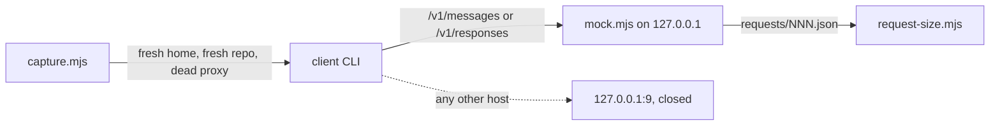

# Agent capture

Records the exact requests a coding agent CLI sends to its model: system prompt, messages, tools and parameters. The CLI talks to a local mock instead of a provider, so no prompt leaves the machine, nothing is billed and no real credential is read. Use it to compare Claude Code, Codex and Octocode request shapes, or to check what an Octocode change does to a real request.



## Run

From the repository root. Each run writes to `.octocode/tmp/agent-capture/<scenario>/` (Git ignores it) unless `--out` names another place; a folder inside the repository that Git tracks is refused, so raw captures stay out of commits.

```sh
K=scripts/agent-capture
node $K/capture.mjs claude-p -- claude -p "say hi"
node $K/capture.mjs --tool claude-tool -- claude -p "list files" --allowedTools Bash
node $K/capture.mjs codex-exec -- codex exec "say hi"
node $K/capture.mjs --tool --pty $K/steps/claude.json claude-tui -- claude
node $K/capture.mjs --tool --pty $K/steps/codex.json codex-tui -- codex
node $K/capture.mjs octocode-p -- octocode -p "say hi" --trust --model anthropic/claude-opus-5-5
```

`--pty` needs `python3`; `extract-prompts.py` and `group-prompts.py` need it too.

| Output | Holds |
| --- | --- |
| `requests/NNN.json` | One request: method, URL, headers (keys and cookies redacted), body |
| `stdout.txt` | The client's output and its exit code |
| `terminal.raw` | With `--pty`: every byte the client wrote to its terminal |
| `home/`, `work/` | The seeded home and the repository the client ran in |

Options:

| Option | Default | Does |
| --- | --- | --- |
| `--out <dir>` | `.octocode/tmp/agent-capture/<scenario>` | Where the run is written; emptied first |
| `--work <dir>` | `<out>/work`, a new repository with one commit | The client's working folder |
| `--tool` | off | The first answer to a request that offers a shell tool is one `ls -la` call, so the second request shows a tool result |
| `--pty <steps.json>` | off | Drives an interactive client in a pseudo-terminal: `[["wait", s], ["send", "text"], ["key", "enter"], ["paste", "text"], ["resize", cols, rows]]` |
| `--dead-proxy-port <n>` | `9` | The proxy every other host is sent to; the run is refused when something listens there |

## How the isolation works

| Client | Pointed at the mock by | Seeded |
| --- | --- | --- |
| Claude Code | `ANTHROPIC_BASE_URL`, dummy `ANTHROPIC_API_KEY` | `.claude.json`: onboarding done, the dummy key approved, the working folder trusted |
| Codex | A `mock` provider in `.codex/config.toml` with `supports_websockets = false`; Codex ignores `OPENAI_BASE_URL` | the working folder trusted |
| Octocode | `.octocode/agent/models.json` moves the built-in `anthropic` provider to the mock and keeps its 1-hour cache tier; dummy `ANTHROPIC_API_KEY`; pass `--model anthropic/<id> --trust` | nothing else: `--trust` trusts the fresh working folder for this run |

The client gets only this shell's `PATH`, terminal and locale variables; every other variable, keys included, is dropped. `HTTPS_PROXY`, `HTTP_PROXY` and `ALL_PROXY` point at the closed port with `NO_PROXY=127.0.0.1,localhost`, and `NODE_USE_ENV_PROXY=1` makes Node's own `fetch` honor them, so a client that tries any other host fails to connect.

## Read the results

```sh
node $K/request-size.mjs --tools .octocode/tmp/agent-capture/claude-p/requests/001.json
node $K/request-size.mjs .octocode/tmp/agent-prompts            # Octocode's rendered first requests, every agent
node $K/esc-report.mjs .octocode/tmp/agent-capture/claude-tui/terminal.raw
```

`request-size.mjs` counts characters the same way for every client: system text (Anthropic `system`, OpenAI `instructions`), message text (a `role: "system"` message and OpenAI developer items count as messages), each tool's description, and its schema as compact JSON (a custom tool's grammar counts as its schema; tools in an OpenAI `additional_tools` item or namespace count as tools). Divide by about 4 for tokens.

Octocode's rendered requests come from `yarn workspace @octocodeai/octocode-agent run generate:prompts`, which captures every agent on a scripted model with default settings. `generate:prompts --exposure direct` captures them with every tool declared in full into `.octocode/tmp/agent-prompts-exposure-direct/`, for comparison.

`extract-prompts.py <src-dir> <out.jsonl> [min-chars]` lists prose string literals of a JavaScript bundle's modules; `group-prompts.py <prompts.jsonl> <out-dir> <label>` sorts them into category files with an index. They are for reading a shipped client's prompt text, not for running it.
