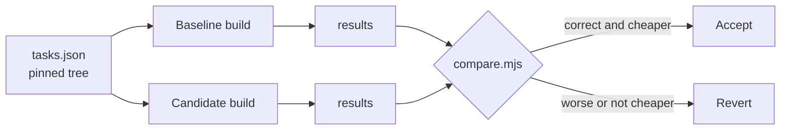

# Agent eval

Decides whether an agent change ships. Both builds answer the same tasks over the same pinned tree, and the gate is **correctness no worse AND cost per task lower**. Octocode share is reported and decides nothing.

Graders have passed every task on both builds so far, so they have not yet been seen to fail a real answer, and repeatability is open (see [What only a live run can prove](#what-only-a-live-run-can-prove)).



## Run it

In the commands below, `REPO` is this checkout's root (`REPO=$(git rev-parse --show-toplevel)`).

A live run spends real money and the runner refuses without `--live --max-usd <n>`. Agree the limit with the user first.

**1. See the plan and cost range. This starts nothing.**

```sh
node scripts/agent-eval/run.mjs --dry-run --model anthropic/claude-opus-5-5 --split all
```

**2. Build the baseline.** The worktree must sit next to this repository, because the `link:` dependencies resolve to `../octocode`. Copy the hydrated catalog so both builds price requests alike.

```sh
git -C "$REPO" worktree add --detach \
  $REPO-eval-baseline refs/octocode/eval-baseline-2026-11-04
cd "$REPO-eval-baseline"
yarn install --immutable
cp -R $REPO/packages/ai/src/providers/data packages/ai/src/providers/data
yarn run build:offline
```

Build the candidate in this repository with `yarn run build:offline`. Run one build at a time.

**3. Run both arms, one after the other, from this repository.** Use the same kit, flags and credentials for both. `--model` takes `provider/id`, because a bare id is ambiguous when several providers list it.

```sh
KIT=$REPO/scripts/agent-eval
OUT=$REPO/.octocode/efficiency/eval-$(date -u +%Y%m%dT%H%M%S)

node $KIT/run.mjs --live --max-usd <n> --split all --runs 1 --model <provider/id> \
  --copy-config $HOME/.octocode/octocodecode/auth.json --copy-config $HOME/.pi/agent/models.json \
  --cli $REPO-eval-baseline/packages/coding-agent/dist/bundle/cli.js \
  --out $OUT/baseline

node $KIT/run.mjs --live --max-usd <n> --split all --runs 1 --model <provider/id> \
  --copy-config $HOME/.octocode/octocodecode/auth.json --copy-config $HOME/.pi/agent/models.json \
  --cli $REPO/packages/coding-agent/dist/bundle/cli.js \
  --out $OUT/candidate

node $KIT/compare.mjs $OUT/baseline $OUT/candidate
```

The limit applies to each run, so two arms can spend twice `<n>`. Credentials reach the agent only by name: `--copy-config <file>` copies a file into the trial's isolated home, removed after the trial, and `--pass-env ANTHROPIC_API_KEY` passes one variable. Copy `auth.json` and `models.json` only where the provider needs them. An explicit home turns off the Pi fallback, so a provider defined in `~/.pi/agent/models.json` must be copied this way.

## The gate

`compare.mjs` exits with its verdict:

| Verdict        | Exit | When                                                                                               |
| -------------- | ---- | -------------------------------------------------------------------------------------------------- |
| `Accept`       | 0    | The gate passes, the 95% interval on the cost change is all saving, and held-out tasks ran         |
| `Revert`       | 1    | Correctness is worse, or cost per task is not lower                                                |
| `Inconclusive` | 2    | The gate passes on means, but the interval includes no saving, or only development tasks ran       |
| `Invalid`      | 3    | Different suite, harness, ref or model; an incomplete run; infrastructure or grader errors; a leak |
| usage error    | 64   | Wrong arguments                                                                                    |

Failed trials stay in the denominator and their cost counts. Cost per task is the mean over tasks of each task's mean cost, including children. The interval is a seeded paired bootstrap over tasks, since repeats of one task are not independent. Numeric thresholds are not set yet: they come from the baseline's repeat runs.

Passing here does not release a change. The release also needs a soak: a few days of the user's own sessions in which the cache hit rate per role and session (`/agents stats`, `get_session_stats`) and the calls wasted on refusals (`archive` with `errors: true`) hold steady. This kit does not measure that, the baseline's repeat runs also set its length, and scripted tests alone do not pass the gate.

## What it costs and why

The dry run prints the current range. As of 2026-11-04, one run of all 12 tasks on Opus 5.5 is estimated at about **$6.70 to $29 per arm, $13 to $58 for a comparison**. With `--runs 3`, which repeatability needs, multiply by three.

- **Prices** come from the hydrated catalog (`packages/ai/src/providers/data/`), including context tiers. 1-hour cache writes cost twice the input rate, per `calculateCost`.
- **Measured** in transcripts of the 7 days to 2026-11-04: a first prompt of about 45k tokens, a mean main prompt of about 163k, about 44 implementer requests per run, and cache hit rates of 98.1% and 97.1%. Those sessions are longer than these tasks, so they set the high end.
- **Assumed** until a live run replaces them: requests per task (5 to 25 for a question, 10 to 40 for an edit, 4 to 15 for a delegating main), the low-end child request counts, and low-end mean prompts of 60k and 40k. Child routes are also assumed: Haiku for the researcher, Sonnet for the implementer and reviewer.

The first request of a session pays to write the whole prompt to the cache: about $0.36 on Opus 5.5, in line with the $0.38 that 1-request sessions cost in those transcripts. That cost is why even a one-line question costs about $0.50.

`--max-usd` is what actually limits spending. The runner reads the transcripts every 5 seconds and kills the agent's process group at the limit, then starts no further trial. Requests already in flight can overshoot it, more so with several children running. A stopped run is `Invalid` for comparison, so set a limit above the high end of the range.

## The tasks

[tasks.json](tasks.json) holds 12 tasks pinned to `refs/octocode/eval-baseline-2026-11-04`, which is a local ref that a fresh clone does not have.

| Kind                                     | Development         | Held out |
| ---------------------------------------- | ------------------- | -------- |
| Code location                            | q-001, q-002, q-003 |          |
| Caller and impact tracing                | q-004               | q-010    |
| Dependency fact from the lockfile        | q-005               |          |
| Small edit with a test                   | q-006               |          |
| Delegated to a researcher                | q-007               | q-011    |
| Delegated to an implementer (seeded bug) | q-008               |          |
| Delegated to a reviewer (seeded bug)     | q-009               | q-012    |

The default is `--split dev`. Tune on those, then use `--split all` once for a decision. Delegating tasks grade the outcome at the main agent's boundary and require a child of the named profile to have run, so children's cost and work count in the result.

Graders are deterministic: regexes on the final answer (`facts`), an exit code from a check that runs after the solver stopped (`command`), the files changed (`changedPaths`) and a child of a role having made a request (`child`). Each answer was checked against the tree: `evidence` entries are re-read from the pinned ref by `test/suite.test.mjs`, `reference.answer` must pass and `reference.wrong` must fail, and each edit check must fail on the untouched tree and pass with its reference patch.

To change a task, change `tasks.json` and rerun both arms: its hash is part of each run, and `compare.mjs` refuses arms with different hashes.

## Isolation

Each trial gets a fresh directory outside the repository, with:

- the pinned tree exported with `git archive` into a new one-commit repository, so it has no history and no link back here;
- a separate home, config, cache and temp, with memory off and an environment built from an allowlist (`buildEnv` in [lib/trial.mjs](lib/trial.mjs)), so an outer agent's identity variables do not leak in;
- `OCTOCODE_OFFLINE=1` and `OCTOCODE_MODELS_DEV=0`, so routing does not depend on a background download. Children route from Octocode's own metadata. The comparison prints each role's models, so check these against the routes you expect;
- no installed dependencies, so the tasks run offline and a solver cannot run vitest. The edit checks run the changed source directly with Node. Language-server answers may also be thinner than in a real checkout, in both arms alike.

The agent is not sandboxed: it runs in `full` permission mode as your user and could read this repository by absolute path. Tool calls that name this kit are flagged and make a comparison `Invalid`, but that catches only the obvious case, and it scans arguments, not results. Treat a run as isolation-limited.

## Results

```text
<out>/run.json                 what ran: hashes, ref, model, CLI, limit, status, spend
<out>/results.jsonl            one row per trial
<out>/trials/<id>/             result.json, prompt.txt, answer.txt, stdout.txt, stderr.txt,
                               status.txt, final.diff, transcripts/main/, transcripts/children/<name>/
```

Each row has the pass or fail with grader evidence, cost, turns (assistant messages that called a tool), requests, tool calls by class (`octocode`, `bashRead`, `bashOther`, `file`, `delegate`, `skill`, `other`), the multi-call turn share, skill loads and the same for each child. Bash code reads use the rule from `.octocode/efficiency/2026-11-04/usage*.py`. Cost includes the side requests a transcript records, such as compaction summaries and cache warming.

## What only a live run can prove

- **Grader tolerance.** The regexes were tested on reference and wrong answers written by hand. A correct answer in an unexpected wording could fail, so read the failures of the first run before trusting a verdict. A grader-only fix needs both arms rerun or regraded.
- **Repeatability.** Whether baseline repeats agree enough to detect a change, and so what `--runs` and numeric thresholds to use.
- **The real flow.** The 2026-11-04 run exercised print mode, foreground delegation and child transcripts with a real model, for the researcher, implementer and reviewer roles. Background children and a refused `paths` start have not run live.
- **Background children.** Print mode returns when the main agent's turn ends, and the runner then kills what is left. The prompts ask the main agent to wait for the report. A main agent that does not wait fails the task.
- **Credentials in an isolated home.** A credential that runs a command (`!security ...`) may behave differently with `HOME` changed.
- **Prompt cache between trials.** The provider's cache outlives a trial, so the first trial of an arm pays for cache writes that later trials read. Arm order, and time between arms, can move cost. Both arms use the same task order; run them back to back, and swap their order on repeats if the difference is small.
- **Dependencies shared by both arms.** Both builds link the sibling `octocode` checkout, so `octocode-mcp` is the same in each arm unless it changes between builds. The kit does not record its version.

## Do agents understand their instructions?

[understand.mjs](understand.mjs) is a separate, cheaper check. It decides no release: a wrong answer points at an instruction to improve. It sends a small model each agent's exact system prompt, tools and first message from `.octocode/tmp/agent-prompts/` (written by every `build:offline`, or by `yarn workspace @octocodeai/octocodecode run generate:prompts`), tools off, with a question about how that agent would work, and grades the answer with the `expect` and `forbid` patterns in [understanding.json](understanding.json). Each agent is also asked what in its instructions is unclear, which is reported and not graded.

Without `--live`, `--max-usd` and `--provider` it prints the number of questions and exits 2, so it spends nothing. Agree a live run with the user first.

```sh
node scripts/agent-eval/understand.mjs --live --max-usd <n> --provider <name>
```

`--provider` names an entry of `--models-file` (default `~/.pi/agent/models.json`) with a `baseUrl` that answers `/v1/messages` in Anthropic's format and an `apiKey`. `--model` is a model of that provider (default `claude-haiku-5-5`), `--agents` a comma-separated subset and `--concurrency` the parallel requests (default 4). It stops starting questions at the limit. The report goes to `--out` (default `.octocode/tmp/prompt-understanding/`) as `report.md` and `results.json`. The exit code does not depend on how many answers were right.

## Develop

```sh
node --test "scripts/agent-eval/test/*.test.mjs"   # also part of yarn run test:scripts; no network, no provider
```

Tests that read the pinned tree skip where the ref is absent. [test/fake-cli.mjs](test/fake-cli.mjs) stands in for the agent and writes transcripts in the real format.
